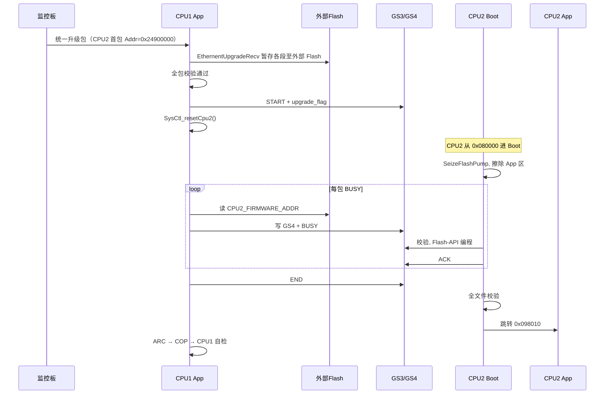

# CPU2 固件在线升级设计规格

**日期**: 2026-06-25  
**状态**: 已评审（用户确认）  
**目标器件**: TMS320F28375D（双核 C28x）  
**相关工程**:
- `Roca3_Pcs_16KHS_App` — CPU1 App
- `Roca3_Pcs_16KHS_Boot` — CPU1 Boot
- `ROCA_3_16KHS_CPU2_APP` — CPU2 App
- `ROCA_3_16KHS_CPU2_Boot` — CPU2 Boot（待新建）

---

## 1. 背景与目标

整机升级由监控板将统一升级包发送至 CPU1。CPU1 将各子固件暂存至外部 SPI Flash，校验通过后依次向下分发：CPU2 → ARC → COP → CPU1 自身。本文档定义 **CPU2 片内 App 在线升级** 的架构与接口，与现有 ARC/COP 向下私有协议对齐。

### 1.1 已确认决策

| 项 | 决策 |
|----|------|
| 上行路径 | 监控 → CPU1 → 外部 Flash |
| CPU2 下行通道 | RAMGS3/GS4 共享 RAM（非 SCI） |
| CPU2 引导方式 | 独立 CPU2 Boot 镜像（方案 A） |
| 片内 Flash 模型 | CPU1/CPU2 **独立 Flash 银行**，逻辑地址镜像（均 Boot `0x080000`、App `0x098010`） |
| CPU2 设备地址 | **`0xF1`** |
| CPU2 外部 Flash 偏移 | **`0x00201000`**（帧区 `0x00200000`） |
| 监控首包地址（UDP） | **`0x24900000`**（`EthernentUpgradeRecv`） |
| 升级顺序 | CPU2 → ARC → COP → CPU1 自检 |
| CPU2 复位方式 | **`SysCtl_resetCpu2()`**（封装 `DevCfgRegs.CPU2RESCTL`） |

---

## 2. 硬件与内存模型

### 2.1 双核独立 Flash 银行（F28375D）

- 每个 CPU 子系统拥有 **256KW（512KB）** 独立 Flash 银行。
- 两核内存映射均从 **`0x080000`** 起，逻辑地址镜像，物理银行独立。
- CPU1 对 `0x098010` 的擦写仅影响 CPU1 银行；CPU2 同理。
- **Flash Pump 互斥**：同一时刻仅一个核能执行片内 Flash 擦写/编程；CPU2 Boot 编程期间 CPU1 不得占用 Pump。

### 2.2 片内 Flash 布局（镜像）

| 区域 | 逻辑地址 | CPU1 银行 | CPU2 银行 |
|------|----------|-----------|-----------|
| Boot 入口 `codestart` | `0x080000` | `Roca3_Pcs_16KHS_Boot` | `ROCA_3_16KHS_CPU2_Boot` |
| App `PROGRAM_SECTOR` | `0x098010`（约 128KB） | `Roca3_Pcs_16KHS_App` | `ROCA_3_16KHS_CPU2_APP` |

CPU2 Boot **不得擦除** Boot 区，仅擦写 App 区 `0x098010` ~ linker 定义的 `PROGRAM_SECTOR` 末尾。

### 2.3 外部 SPI Flash 分区（扩展）

在现有 `firmware_upgrate.h` 基础上增加：

```c
#define CPU2_FIRMWARE_FRAME_ADDR    0x00200000
#define CPU2_FIRMWARE_ADDR          0x00201000
```

| 固件 | 帧地址 | 数据地址 |
|------|--------|----------|
| CPU1 (DSP) | `0x00000000` | `0x00001000` |
| ARC | `0x00080000` | `0x00081000` |
| COP | `0x00100000` | `0x00101000` |
| **CPU2** | **`0x00200000`** | **`0x00201000`** |

### 2.4 监控以太网收包地址（`EthernentUpgradeRecv`）

监控经以太网 UDP 向 CPU1 下发固件，首包为 **256 字节包头**，由 `app/firmware_upgrate.c` 中 `EthernentUpgradeRecv()` 识别 `MonitorUdp_t->Addr` 并路由至对应外部 Flash 区。CPU2 与 DSP/ARC/COP 采用相同机制。

| 目标 | 监控首包 `Addr` | `FirmwareRecvInfo_t` | 外部 Flash 数据区 | 外部 Flash 帧/完成标志区 |
|------|-----------------|----------------------|-------------------|--------------------------|
| CPU1 (DSP) | `0x24600000` | `gstFirmwareInfo.pcs_firmware_info` | `DSP_FIRMWARE_ADDR` (`0x00001000`) | `DSP_FIRMWARE_FRAME_ADDR` (`0x00000000`) |
| ARC | `0x24700000` | `gstFirmwareInfo.arc_firmware_info` | `ARC_FIRMWARE_ADDR` (`0x00081000`) | `ARC_FIRMWARE_FRAME_ADDR` (`0x00080000`) |
| COP | `0x24800000` | `gstFirmwareInfo.copro_firmware_info` | `COPRO_FIRMWARE_ADDR` (`0x00101000`) | `COPRO_FIRMWARE_FRAME_ADDR` (`0x00100000`) |
| **CPU2** | **`0x24900000`** | **`gstFirmwareInfo.cpu2_firmware_info`** | **`CPU2_FIRMWARE_ADDR` (`0x00201000`)** | **`CPU2_FIRMWARE_FRAME_ADDR` (`0x00200000`)** |

**首包判定条件**（与现有三段一致）：

```c
else if ((p_monitor_frame->Length == 256) && (p_monitor_frame->Addr == 0x24900000))
{
    memset((uint16_t *)&gstFirmwareInfo.cpu2_firmware_info, 0x00, sizeof(FirmwareRecvInfo_t));
    p_firmware_info     = &gstFirmwareInfo.cpu2_firmware_info;
    firmware_start_addr = CPU2_FIRMWARE_ADDR;
    firmware_check_addr = CPU2_FIRMWARE_FRAME_ADDR;
    p_firmware_info->upg_state = 1;
    first_pack_flag = 1;
}
```

**收包与落盘流程**（共用函数后半段，无需重复实现）：

1. **写外部 Flash**：`start_address = (p_monitor_frame->Addr & 0x000FFFFF) + firmware_start_addr`，`SpiFlashWriteBytesWithErase(start_address, &p_data[10], Length)`。
2. **首包解析**（`first_pack_flag == 1`）：从 `p_data[10]` 起解析 `firmware_type[4]`、`firmware_version[3]`、`firmware_len`、`checksum`（与 DSP/ARC/COP 字段偏移一致）。
3. **后续包**：累加 `checksumtemp`、`firmware_len_temp`；当 `firmware_len_temp == firmware_len` 且校验一致时，`upg_state = 2`，并向 `firmware_check_addr` 写入 `0xA0` 完成标志（256 字节）；校验失败则 `upg_state = 3`。
4. **返回值**：单段传输完成且校验 OK 时返回 `true`，供上层判断该子固件已就绪。

**结构体扩展**：`FirmwareRecvInfoS_t` 增加成员 `cpu2_firmware_info`，与 `pcs` / `arc` / `copro` 并列。

> 注意：DSP 首包分支当前 `memset` 范围为 `sizeof(FirmwareRecvInfoS_t)`，会清零整个 `gstFirmwareInfo`；实现 CPU2 分支时建议仅 `memset` 本段 `sizeof(FirmwareRecvInfo_t)`，与 ARC/COP 分支保持一致，避免误清其他子固件接收状态。

### 2.5 RAMGS3 / RAMGS4 共享区

沿用两核 linker 中 `SHARERAMGS0` / `SHARERAMGS1`：

- **GS3** `0x00F000`，4KB — 控制/握手（`Cpu2UpgradeCtrl_t`）
- **GS4** `0x010000`，4KB — 数据载荷（`Cpu2UpgradeData_t`）

与 `dev_dual_core_receive` 的 ADC 业务结构 **独立定义**，升级期专用。正常运行期不得与 ADC 共享结构体混用。

---

## 3. 协议设计

### 3.1 私有协议帧（与 ARC/COP 一致）

| 偏移 | 字段 | 说明 |
|------|------|------|
| 0 | `0x5A` | 帧头 |
| 1 | `COM_ADDR` | 主机地址 |
| 2 | **`0xF1`** | CPU2 目标地址 |
| 3-4 | cmd | `0x80F0` START / `0x80F1` BUSY / `0x80FF` END |
| 5-6 | len | 载荷长度（16bit） |
| 7-8 | pack_num | 包序号（16bit） |
| 9.. | payload | 首包 256B 头，后续每包最大 **2048B** |
| 末 2B | checksum | 与现有 `CheckSum()` 一致 |

固件类型标识：

```c
uint16_t garrCpu2FirmwareType[4] = {0x0C, 0x0C, 0x0C, 0xF1};
```

256B 头格式与 ARC/COP 相同：类型 `[0:3]`、长度 `[7:10]`、校验和 `[252:255]`。

### 3.2 GS3 控制结构

```c
#define CPU2_UPG_MAGIC          0x43503255U  /* "CPU2U" */

typedef enum {
    CPU2_UPG_CMD_NONE = 0,
    CPU2_UPG_CMD_START,
    CPU2_UPG_CMD_BUSY,
    CPU2_UPG_CMD_END,
} Cpu2UpgCmd_t;

typedef enum {
    CPU2_UPG_ST_IDLE = 0,
    CPU2_UPG_ST_ERASE,
    CPU2_UPG_ST_PROG,
    CPU2_UPG_ST_VERIFY,
    CPU2_UPG_ST_OK,
    CPU2_UPG_ST_ERR,
} Cpu2UpgStatus_t;

typedef struct {
    volatile uint32_t magic;
    volatile uint32_t cmd;
    volatile uint32_t seq;
    volatile uint32_t payload_len;
    volatile uint32_t upgrade_flag;   /* CPU1 置 1 触发复位进 Boot */
    volatile uint32_t status;
    volatile uint32_t ack;            /* 0=OK, 1=ERR, 0xFF=无效 */
    volatile uint32_t reserved[8];
} Cpu2UpgradeCtrl_t;  /* 放置 GS3 */
```

CPU1 组帧后写入 GS4，更新 GS3 的 `cmd/seq/payload_len`，CPU2 Boot 轮询或 IPC 标志唤醒后读取、校验、应答 `status/ack`。

---

## 4. 端到端流程



### 4.1 CPU1 侧前置条件

1. `DualCore_SetCpu2Online(false)`，停止业务 IPC/ADC 下发。
2. CPU1 **不占用** Flash Pump。
3. PLL/时钟已由 CPU1 `InitSysCtrl()` 配置（CPU2 Boot 依赖）。
4. 升级期间 **屏蔽或抑制** `fault.c` 中 CPU2 心跳超时故障。

### 4.2 CPU2 复位（`SysCtl_resetCpu2()`）

在 `dual_core.c` 新增封装，通过 `DevCfgRegs.CPU2RESCTL` 触发 CPU2 复位：

```c
void SysCtl_resetCpu2(void)
{
    EALLOW;
    DevCfgRegs.CPU2RESCTL.bit.RESET = 1;
    DevCfgRegs.CPU2RESCTL.all = 0xA5A50001;  /* KEY + RESET，以 TRM 为准 */
    EDIS;
}
```

复位前：GS3 写入 `upgrade_flag = 1`、`magic = CPU2_UPG_MAGIC`。CPU2 Boot 启动后检测该标志进入 IAP 模式。

### 4.3 CPU2 Boot 行为

1. 最小初始化（SysCtrl、定时器、GS 访问权限）。
2. `SeizeFlashPump()`（`CPU2` 宏编译）。
3. Flash API 函数运行于 RAM（`.TI.ramfunc` / `ramfuncs`）。
4. 收到 START ACK 后擦除 App 扇区。
5. 逐包 BUSY 写入 `0x098010` 起地址，偏移递增。
6. 收到 END 后全文件校验，成功则 `jumptoappprocess()` 至 `ONCHIP_APP_BASE_ADDR`（`0x098000`/`0x098010`）。

---

## 5. CPU1 状态机

### 5.1 系统级（扩展 `SystemFirmwareUpdate`）

```
RECV_COMPLETE
  → DOWNGRADE_CPU2    /* Cpu2UpgrateFirmwareProcess */
  → DOWNGRADE_ARC     /* ArcUpgrateFirmwareProcess */
  → DOWNGRADE_COP     /* CoproUpgrateFirmwareProcess */
  → CPU1_SELF_UPGRADE
  → END / RESET
```

### 5.2 CPU2 子状态机（与 ARC 同构）

复用 `EN_BMS_FIRMWARE_UPGRATE_STATUS`：

| 状态 | 行为 |
|------|------|
| IDLE | 等待系统升级调度 |
| START | 解析 `CPU2_FIRMWARE_ADDR` 头 256B |
| SEND_PREPARE | 写 GS3/GS4 发 `0x80F0`，`SysCtl_resetCpu2()` |
| SEND_PREPARE_ACK | 等待 GS3 `status` 进入 PROG |
| SEND_DATA_BUSY | 从外部 Flash 读块，写 GS4，发 BUSY |
| WAIT_DATA_BUSY_ACK | GS3 `ack==0` 继续，失败重试 ≤3 次 |
| SEND_END | 发 `0x80FF` |
| WAIT_END_ACK | `status==OK` |
| OK / ERROR | 返回系统状态机 |

超时：`UPGRATE_TIME_OUT`（300，与 ARC 一致，单位与现有 `TimGetSystime` 一致）。

---

## 6. 失败处理

| 场景 | 处理 |
|------|------|
| 单包超时 / ACK 错误 | 重发 ≤3 次，失败则 `ERROR`，中止后续子设备升级 |
| 擦除后掉电 | App 区损坏；外部 Flash 保留完整包，可重新升级 |
| 校验失败 | CPU2 Boot 不跳 App，GS3 `status=ERR` |
| CPU2 Boot 损坏 | 产线 JTAG 烧录 CPU2 银行 Boot 区 |
| 黄金副本 | 外部 Flash `CPU2_FIRMWARE_ADDR`，不做片内 A/B 银行 |

---

## 7. 代码改动清单

| 模块 | 文件 | 改动 |
|------|------|------|
| 外部 Flash 地址 | `app/firmware_upgrate.h` | 增加 `CPU2_FIRMWARE_*`、`garrCpu2FirmwareType`；`FirmwareRecvInfoS_t` 增加 `cpu2_firmware_info` |
| 监控收包 | `app/firmware_upgrate.c` | `EthernentUpgradeRecv()` 增加 `Addr == 0x24900000` 分支 |
| CPU2 下发 | `app/firmware_upgrate.c` | `Cpu2UpgrateFirmwareProcess()`、`_Cpu2UpgradeSend*`（宿=GS3/GS4） |
| 双核复位 | `driver/dual_core.h/c` | `SysCtl_resetCpu2()`、`DualCore_PrepareCpu2Upgrade()` |
| 共享内存 | `app/dual_data_share.h/c` | `Cpu2UpgradeCtrl_t`、GS 地址访问 |
| 故障 | `app/fault.c` | 升级中屏蔽 CPU2 心跳故障 |
| 系统调度 | `app/private_analysis.c` 或等价 | `SystemFirmwareUpdate` 插入 CPU2 节点 |
| **新建** | `ROCA_3_16KHS_CPU2_Boot` | 镜像 CPU1 Boot IAP + GS 收包 + Flash API |
| CPU2 App | `ROCA_3_16KHS_CPU2_APP` | 正常运行不变；可选停机配合 |
| 监控协议 | 监控上位机 | 升级包增加 CPU2 段，首包 `Addr = 0x24900000`，落盘 `0x00201000` |

---

## 8. 验证计划

1. **单元**：GS3/GS4 读写一致性（CPU1 写 / CPU2 读环回）。
2. **收包**：监控发 `0x24900000` 首包及后续包，`cpu2_firmware_info.upg_state` 至 2，外部 Flash `0x00200000` 写入 `0xA0` 标志。
3. **集成**：仅 CPU2 包升级，ARC/COP 跳过，确认跳 App 与心跳恢复。
4. **全流程**：CPU2 → ARC → COP → CPU1，监控上报各段状态。
5. **异常**：传输中断、校验失败、复位后重试。
6. **掉电**：擦除后断电，再次上电可重新完成 CPU2 升级。

---

## 9. 不在本阶段范围

- CPU2 Boot 工程具体 CCS 工程配置细节（由实现计划展开）。
- 监控上位机除 `0x24900000` 首包地址外的其他 UDP 字段变更（需与监控联调文档对齐）。
- CPU1 自身片内升级的改动（沿用现有流程）。

---

## 修订记录

| 日期 | 说明 |
|------|------|
| 2026-06-25 | 初稿：brainstorming 确认镜像 Flash + 方案 A；地址 `0xF1` / `0x00201000` / `SysCtl_resetCpu2()` |
| 2026-06-25 | 增补：`EthernentUpgradeRecv` 监控收包，首包地址 `0x24900000` |
