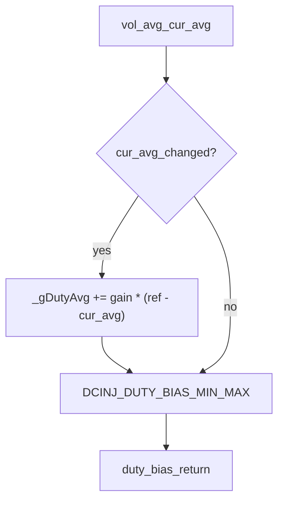
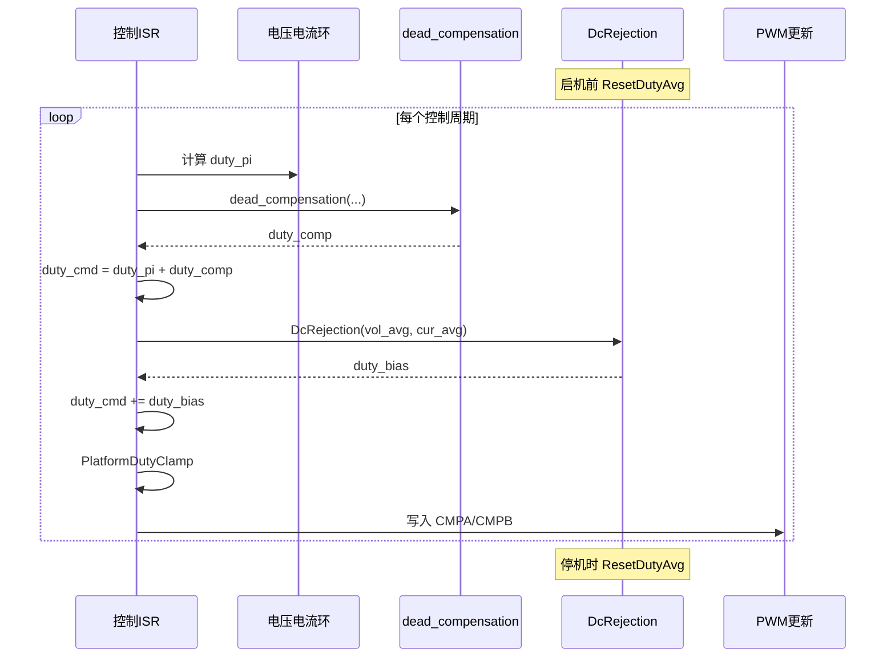

# 直流分量抑制平台设计说明（DC Component Rejection）

> **版本**：V1.0 | **日期**：2026-06-13 | **适用平台**：TI F2837xD 系列 DSP / 电压源逆变控制
> **参考实现**：`middleware/dc_injection.c`、`middleware/dc_injection.h`

---

## 目录

- [0. 文档说明](#0-文档说明)
- [1. 术语与定义](#1-术语与定义)
- [2. 文档约定](#2-文档约定)
- [3. 功能概述](#3-功能概述)
- [4. 系统架构](#4-系统架构)
- [5. 配置项总览](#5-配置项总览)
- [6. 配置项说明](#6-配置项说明)
- [7. 算法推导](#7-算法推导)
- [8. API 规范](#8-api-规范)
- [9. 生命周期与调用顺序](#9-生命周期与调用顺序)
- [10. 运行时模板](#10-运行时模板)
- [11. 移植检查清单](#11-移植检查清单)
- [12. 调试与排障](#12-调试与排障)
- [附录 A：状态变量与更新条件速查](#附录-a状态变量与更新条件速查)
- [附录 B：目录结构与配置示例](#附录-b目录结构与配置示例)
- [附录 C：参考实现已知限制](#附录-c参考实现已知限制)
- [附录 D：修订记录](#附录-d修订记录)

---

## 0. 文档说明

| 项目 | 内容 |
|------|------|
| 文档类型 | 平台化直流分量抑制设计说明 |
| 适用范围 | 电压源逆变器（H 桥 / 半桥）输出电流 DC 分量抑制 |
| 目标读者 | 逆变控制算法工程师、嵌入式驱动开发 |
| 关联源码 | `middleware/dc_injection.c` / `middleware/dc_injection.h` |
| 不在范围 | Modbus、并网状态、具体 main / 控制环工程调用链 |

本文档定义**平台层**直流分量抑制的配置命名、算法语义、接口约定与集成方式。移植时可对照参考实现，但以本文档约定为权威。

---

## 1. 术语与定义

| 术语 | 英文 | 定义 |
|------|------|------|
| 直流分量 | DC Component | 输出电流中的非交流（零频）成分，理想并网/离网输出应为 0 |
| 电流平均值 | `cur_avg` | 经低通或周期平均后的输出电流估计，反映 DC 分量 |
| 电压平均值 | `vol_avg` | 输出电压平均值（接口预留，参考实现未使用） |
| 占空比偏置 | `_gDutyAvg` | 模块内部积分状态，作为慢变占空比修正量输出 |
| 积分增益 | Integrator Gain | 每次有效更新时 `_gDutyAvg` 的增量系数 |
| 限幅区间 | Saturation Band | 占空比偏置上下限，防止积分器输出过大 |
| 变化门控 | Change Gate | 仅当 `cur_avg` 与上次不同时才执行积分更新 |
| 直流抑制 | DC Rejection | 通过占空比偏置将 `cur_avg` 拉回目标值（默认 0 A） |

---

## 2. 文档约定

### 2.1 配置宏命名

- 平台配置宏统一使用 **`DCINJ_`** 前缀（本文档权威命名）。
- 参考实现 `#define`（`DELTA_AVG`、`DC_DUTY_MAX`、`DC_DUTY_MIN`）仅在 [附录 C](#附录-c参考实现已知限制) 对照。

### 2.2 单位与数据类型

| 符号/参数 | 含义 | 单位 |
|-----------|------|------|
| 电流 | `cur_avg`、`DCINJ_CUR_REF_A` | A（安培） |
| 电压 | `vol_avg` | V（伏特，预留） |
| 占空比偏置 | `_gDutyAvg`、返回值 | pu（标幺，如 ±0.01 = ±1%） |
| 积分增益 | `DCINJ_INTEGRATOR_GAIN` | pu/A（每次有效更新） |

### 2.3 返回值约定

| 函数 | 返回值 |
|------|--------|
| `DcRejection` | 占空比偏置（pu），**加**到控制环占空比：`duty_out += DcRejection(...)` |
| `ResetDutyAvg` | 无返回值；清零内部积分状态 |

---

## 3. 功能概述

### 3.1 功能定位

逆变器因采样偏差、死区不对称、调制误差等因素，输出电流可能积累 DC 分量。DC 分量会导致变压器饱和、保护误动作等问题。本模块通过慢积分器监测 `cur_avg`，产生有界的占空比偏置，将直流电流拉回目标值（默认 0 A）。

### 3.2 设计目标

| 目标 | 说明 |
|------|------|
| 慢响应 | 小积分增益，不影响交流动态 |
| 有界输出 | 偏置限幅于 ±1%（默认），保护调制裕量 |
| 有状态 | 内部维护 `_gDutyAvg`，需 `ResetDutyAvg` 复位 |
| 平台可移植 | 增益与限幅可配置 |

### 3.3 与死区补偿的区别

| 对比项 | 直流抑制（本模块） | 死区补偿（`dead_compensation.c`） |
|--------|-------------------|-------------------------------------|
| 目的 | 抑制输出电流 DC 分量 | 修正死区引起的瞬时电压误差 |
| 时间尺度 | 慢积分（`DCINJ_INTEGRATOR_GAIN` 累积） | 每 PWM 周期快变修正 |
| 输入 | `vol_avg, cur_avg` | `ilf, duty_in, vbus, vo` |
| 输出 | 慢变占空比偏置 | 与 `duty_in` 同量级的瞬时修正 |
| 内部状态 | 有（`_gDutyAvg`） | 无 |
| 典型叠加 | `duty += DcRejection(...)` | `duty = duty_pi + dead_compensation(...)` |

详见 [DEAD_TIME_COMPENSATION.md](DEAD_TIME_COMPENSATION.md) 第 3.3 节。

---

## 4. 系统架构

### 4.1 信号流



### 4.2 与死区补偿的架构对比

| 特性 | 本模块 | `dead_compensation` |
|------|--------|---------------------|
| 状态 | 有静态变量 `_gDutyAvg` | 无状态 |
| 输入变化响应 | 仅 `cur_avg` 变化时积分 | 每周期根据瞬时量计算 |
| 复位 API | `ResetDutyAvg()` | 无 |
| `vol_avg` | 接口传入但未使用 | 全部输入均参与计算 |

### 4.3 输出语义

```
duty_bias = clamp(_gDutyAvg, DCINJ_DUTY_BIAS_MIN, DCINJ_DUTY_BIAS_MAX)
```

返回值可直接叠加至控制环占空比，经外部 `PlatformDutyClamp` 后再写入 PWM。

---

## 5. 配置项总览

| 分类 | 配置项 | 见章节 |
|------|--------|--------|
| 积分增益 | `DCINJ_INTEGRATOR_GAIN` | 6.1 |
| 偏置限幅 | `DCINJ_DUTY_BIAS_MAX` / `DCINJ_DUTY_BIAS_MIN` | 6.2 |
| 电流目标 | `DCINJ_CUR_REF_A` | 6.3 |

建议集中定义于 `dc_injection_cfg.h`（示例见 [附录 B](#附录-b目录结构与配置示例)）。

---

## 6. 配置项说明

### 6.1 积分增益

| 宏名 | 类型 | 默认值 | 说明 |
|------|------|--------|------|
| `DCINJ_INTEGRATOR_GAIN` | float32 | 0.0001 | 每次有效更新时 `_gDutyAvg` 的增量系数 |

参考实现中 `DELTA_AVG = 0.0001f`。增益越大，DC 抑制越快，但可能引起交流环耦合振荡。

### 6.2 占空比偏置限幅

| 宏名 | 类型 | 默认值 | 单位 | 说明 |
|------|------|--------|------|------|
| `DCINJ_DUTY_BIAS_MAX` | float32 | 0.01 | pu | 偏置上限（+1%） |
| `DCINJ_DUTY_BIAS_MIN` | float32 | -0.01 | pu | 偏置下限（-1%） |

参考实现中 `DC_DUTY_MAX = 0.01f`、`DC_DUTY_MIN = -0.01f`。限幅防止积分器饱和占满调制区间。

### 6.3 目标直流电流

| 宏名 | 类型 | 默认值 | 单位 | 说明 |
|------|------|--------|------|------|
| `DCINJ_CUR_REF_A` | float32 | 0.0 | A | 期望的 `cur_avg` 目标值 |

参考实现中 `cur_avg_ref = 0.0f`（局部 static 变量）。非零目标可用于有意注入 DC 的场景（一般不推荐）。

---

## 7. 算法推导

### 7.1 离散积分更新

设：

- `ref` = `DCINJ_CUR_REF_A`（默认 0 A）
- `gain` = `DCINJ_INTEGRATOR_GAIN`
- `cur_avg` = 当前周期电流平均值

**更新式（有效更新时）：**

```
_gDutyAvg = _gDutyAvg + gain × (ref - cur_avg)
```

等价于：`gain × (0 - cur_avg) = -gain × cur_avg`（默认 ref = 0）。

物理含义：当 `cur_avg > ref` 时，偏置减小（负向修正）；当 `cur_avg < ref` 时，偏置增大（正向修正），逐步消除 DC 偏差。

### 7.2 变化门控逻辑

参考实现（源码 32~36 行）：

```
if (cur_avg_old != cur_avg)
    _gDutyAvg += gain × (ref - cur_avg)
cur_avg_old = cur_avg
```

**特点：**

- 仅当 `cur_avg` 数值发生变化时才积分。
- 若 `cur_avg` 连续多周期保持不变，`_gDutyAvg` 不再更新（与典型连续积分器不同）。
- 移植时若 `cur_avg` 为浮点且每周期微变，则等效于连续积分；若量化后长时间不变，积分会暂停。

**平台建议：** 明确 `cur_avg` 的计算周期与量化精度；若需严格连续积分，可移除门控（参考实现未提供开关）。

### 7.3 限幅与稳态行为

```
if (_gDutyAvg > DCINJ_DUTY_BIAS_MAX)  _gDutyAvg = DCINJ_DUTY_BIAS_MAX
if (_gDutyAvg < DCINJ_DUTY_BIAS_MIN)  _gDutyAvg = DCINJ_DUTY_BIAS_MIN
```

**稳态：**

- 当 `cur_avg → ref` 且偏置未饱和时，`_gDutyAvg` 趋于稳定。
- 当 DC 偏差过大，偏置饱和于 ±`DCINJ_DUTY_BIAS_MAX`，无法完全消除 DC（需增大限幅或排查根因）。

### 7.4 vol_avg 未使用

`DcRejection(vol_avg, cur_avg)` 的 `vol_avg` 形参在参考实现中**未参与任何计算**。可能为接口预留（未来电压前馈）或历史遗留。调用方仍需传入合法值，但当前对输出无影响。详见 [8.2](#82-dcrejection) 与 [附录 C](#附录-c参考实现已知限制)。

### 7.5 数值示例（默认参数）

设 `cur_avg` 从 0 变为 +2.0 A（超出目标），`gain = 0.0001`，`ref = 0`：

| 步骤 | 计算 | 结果 |
|------|------|------|
| 第 1 次有效更新 | `_gDutyAvg += 0.0001 × (0 - 2.0)` | -0.0002 |
| 第 100 次等效累积 | 假设每次 cur_avg 均变化且均为 2.0 A | 约 -0.02 → 限幅至 -0.01 |
| 返回值 | clamp 后 | -0.01 pu |

（示例说明积分方向与限幅；实际 `cur_avg` 随偏置调整而变化。）

---

## 8. API 规范

### 8.1 接口总表

| 函数 | 参数 | 返回值 | 调用阶段 | 副作用 |
|------|------|--------|----------|--------|
| `DcRejection` | `vol_avg, cur_avg` | float32（pu） | 每控制周期 | 更新 `_gDutyAvg` |
| `ResetDutyAvg` | 无 | void | 停机 / 模式切换 / 故障恢复 | 清零 `_gDutyAvg` |

### 8.2 DcRejection

| 项目 | 说明 |
|------|------|
| **功能** | 计算直流抑制占空比偏置 |
| **前置条件** | `cur_avg` 已为同周期平均值；模块已按需 `ResetDutyAvg` |
| **后置条件** | 返回当前 `_gDutyAvg`（限幅后）；内部状态已更新 |
| **注意事项** | 有状态；`vol_avg` 当前无效；需周期性调用 |

**参数说明：**

| 参数 | 含义 | 单位 | 参考实现 |
|------|------|------|----------|
| `vol_avg` | 输出电压平均值 | V | **未使用** |
| `cur_avg` | 输出电流平均值 | A | 驱动积分更新 |

**返回值：**

| 值 | 含义 |
|----|------|
| 正数 | 增大占空比偏置 |
| 负数 | 减小占空比偏置 |
| 0 | 当前无偏置（或积分尚未累积） |

### 8.3 ResetDutyAvg

| 项目 | 说明 |
|------|------|
| **功能** | 将 `_gDutyAvg` 清零 |
| **调用时机** | 逆变启停、模式切换、故障清除后重新并网前 |
| **注意事项** | 不清除 `DcRejection` 内部 static 变量 `cur_avg_old`；下次调用时若 `cur_avg` 与 old 相同则暂不积分 |

---

## 9. 生命周期与调用顺序



**推荐叠加顺序（与 [DEAD_TIME_COMPENSATION.md](DEAD_TIME_COMPENSATION.md) 第 9 章一致）：**

1. 控制环输出 `duty_pi`
2. 死区补偿 `+ dead_compensation(...)`（若启用）
3. 直流抑制 `+ DcRejection(...)`（若启用）
4. 占空比限幅 `PlatformDutyClamp`

**复位顺序：**

1. 封锁 PWM / 进入故障态
2. 调用 `ResetDutyAvg()`
3. 重新启机后再进入控制循环

> 参考实现仓库内未包含完整控制环调用链；上述顺序为平台推荐，移植时以实测为准。

---

## 10. 运行时模板

### 10.1 基本用法

```c
float duty_cmd = duty_pi_out;
duty_cmd += DcRejection(vol_avg, cur_avg);
duty_cmd = PlatformDutyClamp(duty_cmd);
PlatformPwmSetDuty(duty_cmd);
```

### 10.2 与死区补偿叠加

```c
float duty_cmd = duty_pi_out;
duty_cmd += dead_compensation(ilf, duty_pi_out, vbus, vo);
duty_cmd += DcRejection(vol_avg, cur_avg);
duty_cmd = PlatformDutyClamp(duty_cmd);
PlatformPwmSetDuty(duty_cmd);
```

### 10.3 启停复位

```c
void PlatformInvStart(void)
{
    ResetDutyAvg();
    /* ... 使能 PWM ... */
}

void PlatformInvStop(void)
{
    /* ... 封锁 PWM ... */
    ResetDutyAvg();
}
```

### 10.4 平台钩子清单

| 钩子 | 职责 |
|------|------|
| `PlatformDutyClamp` | 占空比上下限（如 ±0.98） |
| `PlatformPwmSetDuty` | 写入 EPWM 比较寄存器 |
| `dead_compensation` | 可选，快变死区补偿（见 DEAD_TIME 文档） |
| `ResetDutyAvg` | 启停 / 故障恢复时清零 DC 偏置 |

---

## 11. 移植检查清单

### 11.1 输入信号

- [ ] `cur_avg` 计算周期与控制 ISR 一致或成整数倍关系
- [ ] `cur_avg` 极性与功率方向约定一致
- [ ] `cur_avg` 滤波时间常数远大于交流周期（反映 DC 分量）
- [ ] 了解 `vol_avg` 当前无效，无需额外标定

### 11.2 软件

- [ ] 每控制周期调用一次 `DcRejection`
- [ ] `duty_out += DcRejection(...)` 符号约定正确
- [ ] 启停 / 故障恢复调用 `ResetDutyAvg`
- [ ] 与 `dead_compensation` 叠加顺序已文档化并实测
- [ ] 输出经 `PlatformDutyClamp` 限幅

### 11.3 参数

- [ ] `DCINJ_INTEGRATOR_GAIN` 与调用频率匹配（过快易振荡）
- [ ] `DCINJ_DUTY_BIAS_MAX/MIN` 不超过调制裕量
- [ ] 偏置饱和时评估是否需增大限幅或修复采样

---

## 12. 调试与排障

### 12.1 静态检查

| 序号 | 检查项 | 期望 |
|------|--------|------|
| 1 | `cur_avg = 0`，多次调用 | 返回值保持 0 |
| 2 | `cur_avg` 阶跃后 | 偏置朝抑制方向缓慢变化 |
| 3 | `ResetDutyAvg` 后 | 返回值立即为 0 |

### 12.2 动态验证

| 序号 | 检查项 | 期望 |
|------|--------|------|
| 1 | 启用 DC 抑制前后对比 | 输出电流 DC 分量减小 |
| 2 | 长时间运行 | 偏置不持续饱和 |
| 3 | 停机再启机 | 无上次运行残留偏置 |

### 12.3 常见问题

| 现象 | 可能原因 | 处理 |
|------|----------|------|
| DC 电流消不掉 | 偏置饱和 | 增大 `DCINJ_DUTY_BIAS_MAX` 或查采样/死区根因 |
| 交流波形畸变 | 积分增益过大 | 减小 `DCINJ_INTEGRATOR_GAIN` |
| 偏置振荡 | 增益过大或与死区补偿耦合 | 降增益；调整叠加顺序 |
| 停机后再启有偏置 | 未调用 `ResetDutyAvg` | 启停流程加入复位 |
| 积分不更新 | `cur_avg` 量化后长期不变 | 检查门控逻辑与 `cur_avg` 精度 |
| 补偿方向反 | 电流极性反 | 取反 `cur_avg` 或调整符号 |

---

## 附录 A：状态变量与更新条件速查

| 变量 | 作用域 | 说明 |
|------|--------|------|
| `_gDutyAvg` | 文件 static | 积分状态 / 输出偏置；`ResetDutyAvg` 清零 |
| `cur_avg_ref` | 函数 static | 目标电流，默认 0 A |
| `delta_avg` | 函数 static | 积分增益，等于 `DELTA_AVG` |
| `cur_avg_old` | 函数 static | 上次 `cur_avg`，用于变化门控 |

**更新条件：**

```
cur_avg_old != cur_avg  →  执行积分
cur_avg_old == cur_avg  →  跳过积分，仅限幅并返回
```

**限幅：**

```
_gDutyAvg ∈ [DCINJ_DUTY_BIAS_MIN, DCINJ_DUTY_BIAS_MAX]
```

---

## 附录 B：目录结构与配置示例

```
middleware/
  dc_injection.c            # 驱动实现
  dc_injection.h            # 对外 API
  dc_injection_cfg.h        # 平台配置（建议新增）
docs/
  DC_COMPONENT_REJECTION.md
  DEAD_TIME_COMPENSATION.md
```

```c
/* dc_injection_cfg.h 示例 */
#ifndef DC_INJECTION_CFG_H
#define DC_INJECTION_CFG_H

#define DCINJ_INTEGRATOR_GAIN        (0.0001f)
#define DCINJ_DUTY_BIAS_MAX          (0.01f)
#define DCINJ_DUTY_BIAS_MIN          (-0.01f)
#define DCINJ_CUR_REF_A              (0.0f)

#endif
```

---

## 附录 C：参考实现已知限制

> 以下内容来自 `dc_injection.c`，**非平台强制要求**，供移植对照。

| 项目 | 参考实现现状 | 建议 |
|------|--------------|------|
| `vol_avg` | 形参未使用 | 文档标注预留；或移植时接入电压前馈 |
| 变化门控 | `cur_avg_old != cur_avg` 才积分 | 评估是否改为连续积分 |
| 配置参数 | `#define` 硬编码 | 迁移至 `DCINJ_*` 宏 |
| `cur_avg_ref` | 函数内 static 硬编码 0 | 迁移至 `DCINJ_CUR_REF_A` |
| cfg 头文件 | 不存在 | 新增 `dc_injection_cfg.h` |
| 头文件 | 重复 `#include "F28x_Project.h"` | 清理重复 include |
| 调用链 | 仓库内无 grep 命中 | 在控制环库中确认接入点 |

**参考实现与平台宏对照：**

| 参考实现 | 平台宏（建议） |
|----------|----------------|
| `DELTA_AVG` | `DCINJ_INTEGRATOR_GAIN` |
| `DC_DUTY_MAX` | `DCINJ_DUTY_BIAS_MAX` |
| `DC_DUTY_MIN` | `DCINJ_DUTY_BIAS_MIN` |
| `cur_avg_ref = 0.0f` | `DCINJ_CUR_REF_A` |

---

## 附录 D：修订记录

| 版本 | 日期 | 说明 |
|------|------|------|
| V1.0 | 2026-06-13 | 初始版本（基于 dc_injection.c，平台化结构） |
