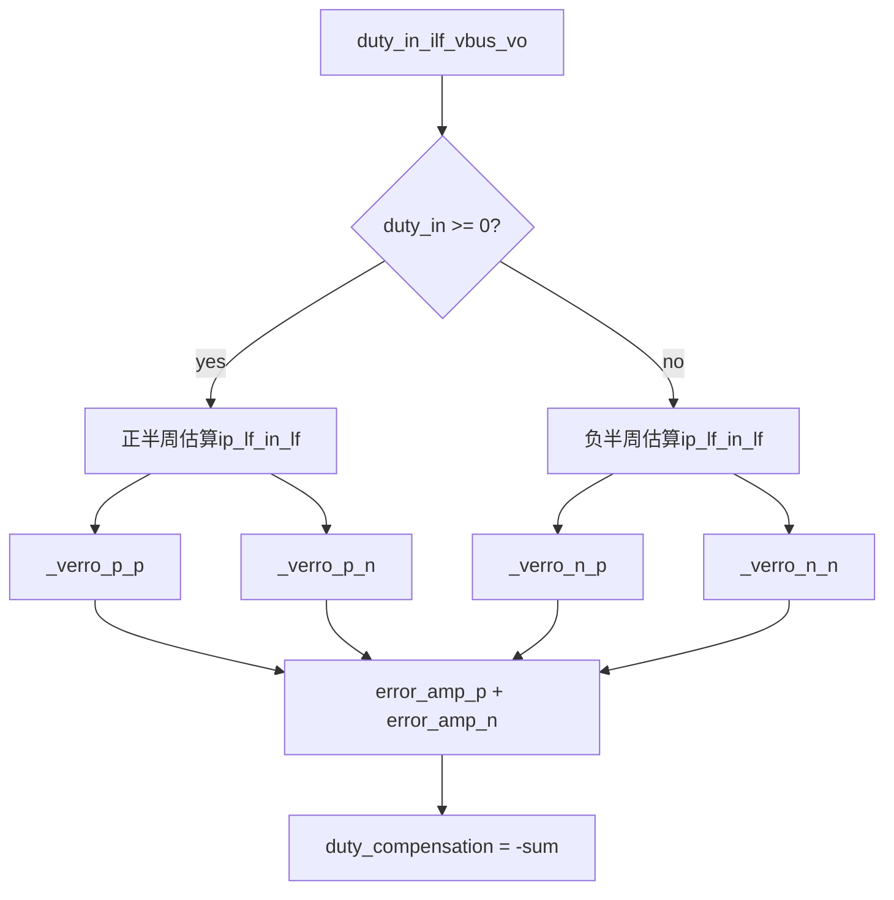
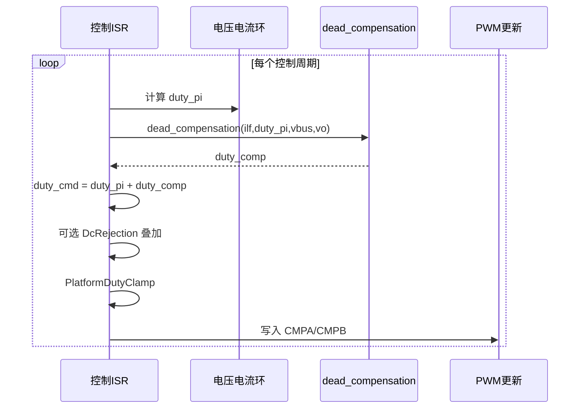

# 死区补偿平台设计说明（Dead Time Compensation）

> **版本**：V1.0 | **日期**：2026-06-13 | **适用平台**：TI F2837xD 系列 DSP / 电压源逆变控制
> **参考实现**：`middleware/dead_compensation.c`、`middleware/dead_compensation.h`

---

## 目录

- [0. 文档说明](#0-文档说明)
- [1. 术语与定义](#1-术语与定义)
- [2. 文档约定](#2-文档约定)
- [3. 功能概述](#3-功能概述)
- [4. 系统架构](#4-系统架构)
- [5. 配置项总览](#5-配置项总览)
- [6. 配置项说明](#6-配置项说明)
- [7. 算法推导](#7-算法推导)
- [8. API 规范](#8-api-规范)
- [9. 生命周期与调用顺序](#9-生命周期与调用顺序)
- [10. 运行时模板](#10-运行时模板)
- [11. 移植检查清单](#11-移植检查清单)
- [12. 调试与排障](#12-调试与排障)
- [附录 A：分段函数速查](#附录-a分段函数速查)
- [附录 B：目录结构与配置示例](#附录-b目录结构与配置示例)
- [附录 C：参考实现已知限制](#附录-c参考实现已知限制)
- [附录 D：修订记录](#附录-d修订记录)

---

## 0. 文档说明

| 项目 | 内容 |
|------|------|
| 文档类型 | 平台化死区时间补偿设计说明 |
| 适用范围 | 互补 PWM 逆变器（H 桥 / 半桥）控制环占空比修正 |
| 目标读者 | 逆变控制算法工程师、嵌入式驱动开发 |
| 关联源码 | `middleware/dead_compensation.c` / `middleware/dead_compensation.h` |
| 不在范围 | Modbus、并网状态、具体 main / 控制环工程调用链 |

本文档定义**平台层**死区补偿的配置命名、算法语义、接口约定与集成方式。移植时可对照参考实现，但以本文档约定为权威。

---

## 1. 术语与定义

| 术语 | 英文 | 定义 |
|------|------|------|
| 死区时间 | Dead Time | 互补 PWM 上下管切换间的强制关断间隔，避免直通 |
| 死区补偿 | Dead Time Compensation | 根据电流方向修正占空比，抵消死区引起的等效电压误差 |
| 占空比 | Duty Ratio | 控制环输出的 PWM 占空比，正半周为正值、负半周为负值（pu） |
| 滤波电感电流 | \(i_{lf}\) | 经低通滤波后的电感电流估计值，用于判断电流极性 |
| 等效上管电流 | \(i_p\) | 估算的上管（P 管）实际导通电流，记 `ip_lf` |
| 等效下管电流 | \(i_n\) | 估算的下管（N 管）实际导通电流，记 `in_lf` |
| 零电流过渡区 | Zero-Crossing Band | 电流绝对值小于 \(I_{th}\) 的区间，采用线性插值补偿 |
| 分段线性补偿 | Piecewise Linear Compensation | 四段 `_verro_*` 函数，在过渡区平滑切换补偿量 |
| 占空比修正量 | `duty_compensation` | 函数返回值，叠加至 `duty_in` 得到最终占空比 |

---

## 2. 文档约定

### 2.1 配置宏命名

- 平台配置宏统一使用 **`DCOMP_`** 前缀（本文档权威命名）。
- 参考实现硬编码（`COFF_RAMP`、`i_th`、`verror_th`）仅在 [附录 C](#附录-c参考实现已知限制) 对照。

### 2.2 单位与数据类型

| 符号/参数 | 含义 | 单位 |
|-----------|------|------|
| 电流 | \(i_{lf}\)、\(I_{th}\) | A（安培） |
| 电压 | \(V_{bus}\)、\(V_o\) | V（伏特） |
| 占空比 | `duty_in`、`duty_compensation` | pu（标幺，-1~1） |
| 补偿幅度上限 | `verror_th` | pu（如 0.01 = 1%） |

### 2.3 返回值约定

| 函数 | 返回值 |
|------|--------|
| `dead_compensation` | 占空比修正量（pu），**加**到 `duty_in`：`duty_out = duty_in + dead_compensation(...)` |

---

## 3. 功能概述

### 3.1 功能定位

互补 PWM 在上下管切换插入死区后，实际输出电压低于理想值，误差在**零电流附近**最显著。本模块根据滤波电感电流、占空比与母线/输出电压，估算上下管等效电流，经分段线性函数计算占空比修正量，用于抵消死区效应。

### 3.2 设计目标

| 目标 | 说明 |
|------|------|
| 零交叉平滑 | 在 \(\|i\| < I_{th}\) 区间线性过渡，避免补偿突变 |
| 正/负半周对称 | 按 `duty_in` 符号切换估算公式与分段函数 |
| 计算轻量 | 单周期内若干次浮点运算，适合 ISR 调用 |
| 平台可移植 | 系数与阈值可配置 |

### 3.3 与直流分量抑制的区别

| 对比项 | 死区补偿（本模块） | 直流抑制（`dc_injection.c`） |
|--------|-------------------|------------------------------|
| 目的 | 修正死区引起的瞬时电压误差 | 抑制输出电流 DC 分量 |
| 时间尺度 | 每 PWM 周期 | 慢积分（`DELTA_AVG` 累积） |
| 输入 | `ilf, duty_in, vbus, vo` | `vol_avg, cur_avg` |
| 输出 | 占空比修正（与 `duty_in` 同量级） | 慢变 DC 占空比偏置 |
| 典型叠加 | `duty = duty_pi + dead_compensation(...)` | `duty += DcRejection(...)` |

---

## 4. 系统架构

### 4.1 信号流



### 4.2 正/负半周分支

| 条件 | 等效电流估算 | 分段函数 |
|------|--------------|----------|
| `duty_in >= 0` | 正半周公式（见 7.1） | `_verro_p_p(ip_lf)` + `_verro_p_n(in_lf)` |
| `duty_in < 0` | 负半周公式（见 7.1） | `_verro_n_p(ip_lf)` + `_verro_n_n(in_lf)` |

### 4.3 输出合成

```
error2 = error_amp_p + error_amp_n
duty_compensation = -error2
```

修正量取负号：当分段函数输出为"需增加的等效电压误差"时，占空比修正方向与之相反。

---

## 5. 配置项总览

| 分类 | 配置项 | 见章节 |
|------|--------|--------|
| Ramp 系数 | `DCOMP_COFF_RAMP` | 6.1 |
| 零电流区 | `DCOMP_CUR_THRESH_A` | 6.2 |
| 补偿上限 | `DCOMP_DUTY_ERR_MAX` | 6.2 |

建议集中定义于 `dead_compensation_cfg.h`（示例见 [附录 B](#附录-b目录结构与配置示例)）。

---

## 6. 配置项说明

### 6.1 Ramp 系数

| 宏名 | 类型 | 默认值 | 说明 |
|------|------|--------|------|
| `DCOMP_COFF_RAMP` | float | 0.0265957 | 死区/开关周期相关 ramp 系数，用于等效电流估算 |

参考实现中 `COFF_RAMP = 0.0265957`，物理含义与硬件死区时间 \(T_{dead}\) 及 PWM 周期 \(T_{sw}\) 相关，移植时应按板级参数标定。典型关系：

```
DCOMP_COFF_RAMP ≈ k × T_dead / T_sw
```

其中 \(k\) 为与拓扑、采样延迟相关的经验系数，需实测整定。

### 6.2 零电流区与补偿上限

| 宏名 | 类型 | 默认值 | 单位 | 说明 |
|------|------|--------|------|------|
| `DCOMP_CUR_THRESH_A` | float | 1.0 | A | 零电流过渡区半宽 \(I_{th}\) |
| `DCOMP_DUTY_ERR_MAX` | float | 0.01 | pu | 单段最大补偿幅度 `verror_th` |

分段函数斜率：

```
ramp = DCOMP_DUTY_ERR_MAX / DCOMP_CUR_THRESH_A
```

默认：`ramp = 0.01 / 1.0 = 0.01`（pu/A）。

---

## 7. 算法推导

### 7.1 等效电流估算

设 `k = DCOMP_COFF_RAMP`。

**正半周（`duty_in >= 0`）：**

```
ip_lf = ilf + k × duty_in × (vbus - vo)
in_lf = ip_lf - 2 × k × (1 - duty_in) × vo
```

**负半周（`duty_in < 0`）：**

```
ip_lf = ilf + k × duty_in × (vbus + vo)
in_lf = ip_lf - 2 × k × (1 + duty_in) × vo
```

物理含义简述：

- `ip_lf`：上管支路等效电流，叠加了占空比与母线/输出电压耦合项。
- `in_lf`：下管支路等效电流，由 `ip_lf` 减去与 `(1±duty_in)` 及 `vo` 相关的耦合项。

### 7.2 分段线性函数概要

四个内部函数分别处理正/负半周下 P 管、N 管电流，输出 `error`（补偿误差分量）。公共参数：

- `ith` = `DCOMP_CUR_THRESH_A`
- `verror_th` = `DCOMP_DUTY_ERR_MAX`
- `ramp` = `verror_th / ith`

完整区间划分见 [附录 A](#附录-a分段函数速查)。

### 7.3 合成与输出

```
error_amp_p = verro_*(ip_lf)    // P 管分段函数
error_amp_n = verro_*(in_lf)    // N 管分段函数
duty_compensation = -(error_amp_p + error_amp_n)
```

### 7.4 数值示例（默认参数）

设 `ilf = 0.5 A`，`duty_in = 0.6`，`vbus = 400 V`，`vo = 230 V`，`k = 0.0265957`：

| 步骤 | 计算 | 结果 |
|------|------|------|
| `ip_lf` | 0.5 + 0.0265957×0.6×(400-230) | ≈ 3.21 A |
| `in_lf` | 3.21 - 2×0.0265957×0.4×230 | ≈ -1.68 A |
| `_verro_p_p(3.21)` | ip ≥ 0 | -0.01 |
| `_verro_p_n(-1.68)` | in < -1.0 | 0.01 |
| `duty_compensation` | -(-0.01 + 0.01) | 0 |

（示例仅说明计算链路；实际值随工况变化。）

---

## 8. API 规范

### 8.1 接口总表

| 函数 | 参数 | 返回值 | 调用阶段 | 副作用 |
|------|------|--------|----------|--------|
| `dead_compensation` | `ilf, duty_in, vbus, vo` | float（pu） | 每 PWM / 控制周期 | 无 |

### 8.2 dead_compensation

| 项目 | 说明 |
|------|------|
| **功能** | 计算死区补偿占空比修正量 |
| **前置条件** | `ilf`、`vbus`、`vo` 已为同周期采样/滤波值；`duty_in` 与控制环输出一致 |
| **后置条件** | 返回 `duty_compensation`，调用方叠加：`duty_out = duty_in + duty_compensation` |
| **注意事项** | 纯计算函数，无内部状态；需外部限幅 |

**参数说明：**

| 参数 | 含义 | 单位 | 约定 |
|------|------|------|------|
| `ilf` | 滤波后电感电流 | A | 正方向与逆变功率方向一致 |
| `duty_in` | 控制环输出占空比 | pu | ≥0 正半周，<0 负半周 |
| `vbus` | 直流母线电压 | V | 瞬时值或滤波值，与实现一致 |
| `vo` | 逆变输出电压 | V | 同相分量或瞬时值，与实现一致 |

**返回值：**

| 值 | 含义 |
|----|------|
| 正数 | 增大占空比修正 |
| 负数 | 减小占空比修正 |
| 0 | 当前工况无需补偿 |

---

## 9. 生命周期与调用顺序



**推荐叠加顺序（平台建议）：**

1. 控制环输出 `duty_pi`
2. 死区补偿 `+ dead_compensation(...)`
3. 直流抑制 `+ DcRejection(...)`（若启用）
4. 占空比限幅 `PlatformDutyClamp`

> 参考实现仓库内未包含完整控制环调用链；上述顺序为平台推荐，移植时以实测为准。

---

## 10. 运行时模板

### 10.1 基本用法

```c
float duty_cmd = duty_pi_out + dead_compensation(ilf, duty_pi_out, vbus, vo);
duty_cmd = PlatformDutyClamp(duty_cmd);
PlatformPwmSetDuty(duty_cmd);
```

### 10.2 与直流抑制叠加

```c
float duty_cmd = duty_pi_out;
duty_cmd += dead_compensation(ilf, duty_pi_out, vbus, vo);
duty_cmd += DcRejection(vol_avg, cur_avg);
duty_cmd = PlatformDutyClamp(duty_cmd);
PlatformPwmSetDuty(duty_cmd);
```

### 10.3 平台钩子清单

| 钩子 | 职责 |
|------|------|
| `PlatformDutyClamp` | 占空比上下限（如 ±0.98） |
| `PlatformPwmSetDuty` | 写入 EPWM 比较寄存器 |
| `DcRejection` | 可选，慢变 DC 分量抑制 |

---

## 11. 移植检查清单

### 11.1 硬件

- [ ] 死区时间 \(T_{dead}\) 与 `DCOMP_COFF_RAMP` 标定关系已验证
- [ ] 电感电流采样极性与 `ilf` 正方向一致
- [ ] `vbus`、`vo` 采样延迟与 PWM 更新时刻对齐

### 11.2 软件

- [ ] 每控制周期调用一次，与 `duty_in` 同周期
- [ ] `duty_out = duty_in + dead_compensation(...)` 符号约定正确
- [ ] 输出经 `PlatformDutyClamp` 限幅
- [ ] 与 `DcRejection` 叠加顺序已文档化并实测

### 11.3 参数

- [ ] `DCOMP_CUR_THRESH_A` 覆盖零交叉过渡区宽度
- [ ] `DCOMP_DUTY_ERR_MAX` 不超过允许占空比裕量
- [ ] 正/负半周切换点无补偿突变（示波器验证）

---

## 12. 调试与排障

### 12.1 静态检查

| 序号 | 检查项 | 期望 |
|------|--------|------|
| 1 | `ilf = 0`，`duty_in = 0` | 返回接近 0 |
| 2 | `ilf` 从负到正扫过 ±`I_th` | 补偿量连续无阶跃 |
| 3 | `\|ilf\| >> I_th` | 补偿量饱和于 ±`verror_th` 组合 |

### 12.2 动态验证

| 序号 | 检查项 | 期望 |
|------|--------|------|
| 1 | 低功率零交叉波形 | 电流过零点畸变减小 |
| 2 | 正/负半周 | 补偿极性正确 |
| 3 | 关闭补偿对比 | 零交叉处 THD / 电流尖峰恶化 |

### 12.3 常见问题

| 现象 | 可能原因 | 处理 |
|------|----------|------|
| 零交叉振荡 | `DCOMP_DUTY_ERR_MAX` 过大 | 减小 `verror_th` |
| 补偿方向反 | 电流采样极性反 | 取反 `ilf` 或调整公式符号 |
| 半周切换突变 | `duty_in` 符号与半周不同步 | 检查极性判断逻辑 |
| 无效果 | 未叠加到 `duty_in` | 确认 `duty_out = duty_in + comp` |
| 过补偿 | `DCOMP_COFF_RAMP` 过大 | 重新标定 ramp 系数 |

---

## 附录 A：分段函数速查

公共定义：`ramp = verror_th / ith`。

### A.1 `_verro_p_p`（正半周，P 管，输入 `ip_p`）

| 条件 | 输出 error |
|------|------------|
| `ip_p >= 0` | `-verror_th` |
| `ip_p < -ith` | `0` |
| 否则 | `-(ip_p + ith) × ramp` |

### A.2 `_verro_p_n`（正半周，N 管，输入 `ip_n`）

| 条件 | 输出 error |
|------|------------|
| `ip_n >= 0` | `0` |
| `ip_n < -ith` | `verror_th` |
| 否则 | `-ip_n × ramp` |

### A.3 `_verro_n_p`（负半周，P 管，输入 `in_p`）

| 条件 | 输出 error |
|------|------------|
| `in_p < 0` | `verror_th` |
| `in_p >= ith` | `0` |
| 否则 | `-(in_p - ith) × ramp` |

### A.4 `_verro_n_n`（负半周，N 管，输入 `in_n`）

| 条件 | 输出 error |
|------|------------|
| `in_n < 0` | `0` |
| `in_n >= ith` | `-verror_th` |
| 否则 | `-in_n × ramp` |

---

## 附录 B：目录结构与配置示例

```
middleware/
  dead_compensation.c       # 驱动实现
  dead_compensation.h       # 对外 API
  dead_compensation_cfg.h   # 平台配置（建议新增）
docs/
  DEAD_TIME_COMPENSATION.md
```

```c
/* dead_compensation_cfg.h 示例 */
#ifndef DEAD_COMPENSATION_CFG_H
#define DEAD_COMPENSATION_CFG_H

#define DCOMP_COFF_RAMP             (0.0265957f)
#define DCOMP_CUR_THRESH_A           (1.0f)
#define DCOMP_DUTY_ERR_MAX           (0.01f)

#define DCOMP_RAMP_SLOPE             (DCOMP_DUTY_ERR_MAX / DCOMP_CUR_THRESH_A)

#endif
```

---

## 附录 C：参考实现已知限制

> 以下内容来自 `dead_compensation.c`，**非平台强制要求**，供移植对照。

| 项目 | 参考实现现状 | 建议 |
|------|--------------|------|
| 配置参数 | `i_th`、`verror_th` 为局部变量硬编码 | 迁移至 `DCOMP_*` 宏 |
| `COFF_RAMP` | 宏定义，物理来源未注释 | 按 \(T_{dead}/T_{sw}\) 标定并文档化 |
| 未使用变量 | `error1` 声明未使用 | 代码清理（可选） |
| cfg 头文件 | 不存在 | 新增 `dead_compensation_cfg.h` |
| 调用链 | 仓库内无直接 grep 命中 | 在控制环库中确认接入点 |

**参考实现与平台宏对照：**

| 参考实现 | 平台宏（建议） |
|----------|----------------|
| `COFF_RAMP` | `DCOMP_COFF_RAMP` |
| `i_th = 1.0f` | `DCOMP_CUR_THRESH_A` |
| `verror_th = 0.01f` | `DCOMP_DUTY_ERR_MAX` |

---

## 附录 D：修订记录

| 版本 | 日期 | 说明 |
|------|------|------|
| V1.0 | 2026-06-13 | 初始版本（基于 dead_compensation.c，平台化结构） |
