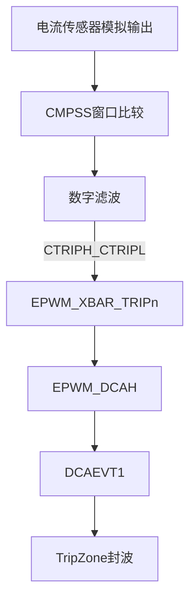
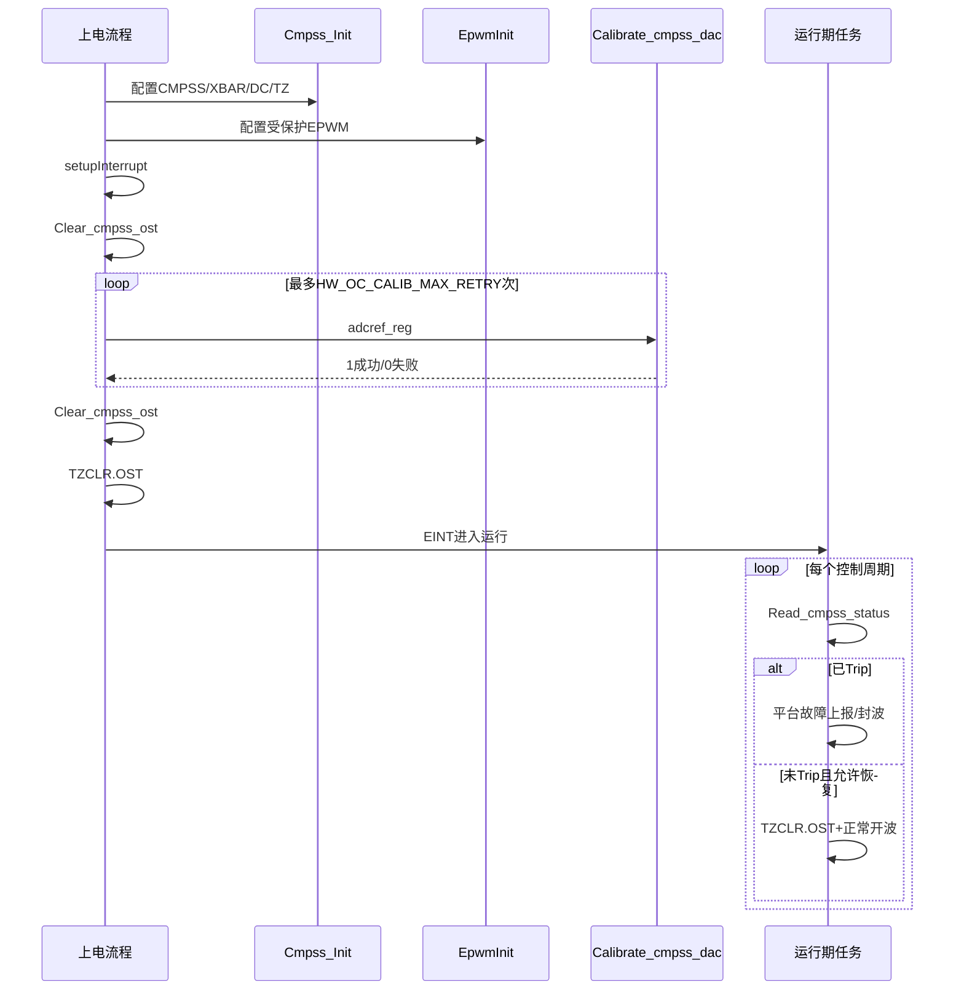

# 硬件过流保护平台设计说明（CMPSS）

> **版本**：V2.0 | **日期**：2026-06-13 | **适用平台**：TI F2837xD 系列 DSP
> **参考实现**：`middleware/hard_cmpss.c`、`middleware/hard_cmpss.h`

---

## 目录

- [0. 文档说明](#0-文档说明)
- [1. 术语与定义](#1-术语与定义)
- [2. 文档约定](#2-文档约定)
- [3. 功能概述](#3-功能概述)
- [4. 系统架构](#4-系统架构)
- [5. 配置项总览](#5-配置项总览)
- [6. 配置项说明](#6-配置项说明)
- [7. 阈值计算](#7-阈值计算)
- [8. API 规范](#8-api-规范)
- [9. 生命周期与调用顺序](#9-生命周期与调用顺序)
- [10. 运行时模板](#10-运行时模板)
- [11. 移植检查清单](#11-移植检查清单)
- [12. 调试与排障](#12-调试与排障)
- [附录 A：F2837xD 寄存器速查](#附录-af2837xd-寄存器速查)
- [附录 B：目录结构与配置示例](#附录-b目录结构与配置示例)
- [附录 C：参考实现已知限制](#附录-c参考实现已知限制)
- [附录 D：修订记录](#附录-d修订记录)

---

## 0. 文档说明

| 项目 | 内容 |
|------|------|
| 文档类型 | 平台化硬件过流保护设计说明 |
| 适用范围 | 基于 CMPSS + EPWM Trip Zone 的功率级硬件过流保护 |
| 目标读者 | 嵌入式驱动开发、硬件工程师、平台移植人员 |
| 关联源码 | `middleware/hard_cmpss.c` / `middleware/hard_cmpss.h`（参考实现，非强制目录结构） |
| 不在范围 | 本项目业务逻辑（Modbus 故障码、并网状态、具体 main 调用链等） |

本文档定义**平台层**应遵循的配置命名、接口语义、集成顺序与验证方法。移植时可对照参考实现，但以本文档约定为权威。

---

## 1. 术语与定义

| 术语 | 英文 | 定义 |
|------|------|------|
| 硬件过流 | HW OC (Hardware Overcurrent) | 由 CMPSS 窗口比较触发的过流保护，信号不经过 ADC 软件采样路径 |
| CMPSS | Comparator Subsystem | TI C2000 片上比较器子系统，含内部 DAC 与高低双比较器 |
| 窗口比较 | Window Comparator | 以 DACH 为上限、DACL 为下限构成的电流允许区间；超出任一侧即 Trip |
| Trip | Trip Signal | 比较器输出经数字滤波后的硬件触发信号，如 CTRIPH、CTRIPL |
| XBAR | Crossbar | 片上信号路由，将 CMPSS Trip 汇聚至 EPWM TRIPn 输入 |
| DCAH | Digital Compare A High | EPWM 数字比较模块 A 路高输入，可接 XBAR Trip |
| DCAEVT1 | Digital Compare A Event 1 | EPWM 数字比较事件 1，连接触发条件与 Trip Zone |
| Trip Zone (TZ) | — | EPWM 故障保护区，触发后可强制 PWM 输出为指定电平 |
| OST | One-Shot Trip | EPWM 单次封波锁存；需软件清 `TZCLR.OST` 才能恢复 |
| 零点校准 | Zero Calibration | 无负载时对 DAC 偏置的边界搜索；成功后使能 `TZSEL.DCAEVT1` |
| DAC 码 | DAC Code | CMPSS 内部 12 位 DAC 数值，满量程对应 `HW_OC_DAC_FULLSCALE_V` |

---

## 2. 文档约定

### 2.1 配置宏命名

- 平台配置宏统一使用 **`HW_OC_`** 前缀（本文档权威命名）。
- 参考实现中的历史宏（如 `IND_CUR_OVER_HIGH`、`REF_1_5V`）仅在 [附录 C](#附录-c参考实现已知限制) 对照，正文不再混用。

### 2.2 API 返回值

| 类型 | 约定 |
|------|------|
| `void` | 无返回值 |
| `uint16_t` 状态查询 | `1` = 条件成立（已 Trip / 操作成功）；`0` = 条件不成立 / 操作失败 |
| `uint16_t` 配置更新 | `1` = 参数有效且已写入；`0` = 参数无效或未写入 |

### 2.3 单位与数据类型

| 符号 | 含义 | 单位 |
|------|------|------|
| 电流 \(I\) | 被测电流 | A（安培） |
| 电压 \(V\) | 模拟电压 | V（伏特） |
| 灵敏度 \(K_{sen}\) | 电流传感器增益 | V/A |
| DAC 分辨率 \(N_{dac}\) | DAC 满量程 LSB 数 | LSB（如 4096 对应 12 bit） |

---

## 3. 功能概述

### 3.1 功能定位

硬件过流保护对功率级**电流传感器模拟输出**进行 CMPSS 窗口比较。当电流超过 ±\(I_{limit}\) 时，通过 **CMPSS → XBAR → EPWM DCA → Trip Zone** 硬件链路**立即关断 PWM**，响应不依赖 CPU 中断或主循环。

### 3.2 设计目标

| 目标 | 说明 |
|------|------|
| 硬件级保护 | 过流触发到 PWM 关断由片上外设完成 |
| 双向检测 | 正向过流（DACH）与负向过流（DACL）同时覆盖 |
| 可校准 | 上电 DAC 零点校准，补偿传感器偏置 |
| 平台可移植 | 配置表适配不同功率等级与硬件映射 |
| 软硬协同 | 硬件封波 + 软件读状态 + 故障上报 + 条件恢复 |

### 3.3 与软件过流对比

| 对比项 | 硬件 CMPSS 过流 | 软件 ADC 过流 |
|--------|----------------|---------------|
| 信号路径 | 模拟量 → CMPSS → EPWM TZ | ADC → 算法判断 |
| 响应时间 | 纳秒~微秒级 | 控制周期级（如 50 us） |
| 触发动作 | 硬件强制拉低 PWM | 软件置故障并封波 |
| 阈值来源 | CMPSS 内部 DAC | 浮点运算 + 软件阈值 |
| 典型场景 | 短路、直通等极端故障 | 正常运行过载保护 |

---

## 4. 系统架构

### 4.1 硬件信号链



**链路说明：**

1. CMPSS 内部 DAC 设定 DACH（上限）与 DACL（下限），与模拟输入比较。
2. 比较结果经 SAMPWIN/THRESH 数字滤波后输出 CTRIPH / CTRIPL。
3. XBAR 将 Trip 信号路由至 EPWM TRIPn，接入 DCAH。
4. DCAH 满足条件产生 DCAEVT1，Trip Zone 执行 `TZ_FORCE_LO` 封波。

### 4.2 软件职责

硬件封波后，平台层软件负责：

| 步骤 | 职责 | 典型接口 |
|------|------|----------|
| 读状态 | 查询是否发生过 Trip | `Read_cmpss_status()` |
| 清标志 | 清除 CMPSS 锁存与 DCAEVT1 事件标志 | `Clear_cmpss_ost()` |
| 故障上报 | 周期任务中置位平台故障码 | 平台钩子（见第 10 章） |
| 恢复 PWM | Trip 消失且允许恢复时，清 OST 并重新开波 | 平台钩子 + `TZCLR.OST` |

### 4.3 清标志与解封波的区别

| 操作 | 清除对象 | 是否解除 PWM 封波 |
|------|----------|-------------------|
| `Clear_cmpss_ost()` | CMPSS 锁存、`TZCLR.DCAEVT1` | **否** |
| `TZCLR.OST` | EPWM One-Shot Trip 锁存 | **是** |

> 仅调用 `Clear_cmpss_ost()` 后，若 OST 仍置位，PWM 输出保持封波状态。

---

## 5. 配置项总览

| 分类 | 配置项示例 | 见章节 |
|------|------------|--------|
| 硬件映射 | `HW_OC_CMPSS_INSTANCE`、`HW_OC_EPWM_TRIP_NUM`、`HW_OC_EPWM_LIST` | 6.1 |
| 电流阈值 | `HW_OC_CUR_LIMIT_A`、`HW_OC_SENSOR_SENS_VPA`、`HW_OC_ZERO_REF_V` | 6.2 |
| DAC 参数 | `HW_OC_DAC_FULLSCALE_V`、`HW_OC_DAC_RESOLUTION` | 6.2 |
| 数字滤波 | `HW_OC_FIL_SAMPWIN`、`HW_OC_FIL_THRESH`、`HW_OC_FIL_CLKPRE` | 6.3 |
| 校准参数 | `HW_OC_ADC_REF_NOMINAL`、`HW_OC_CALIB_MAX_RETRY`、`HW_OC_CALIB_HYST_MAX` | 6.4 |

建议集中定义于 `hard_cmpss_cfg.h`（示例见 [附录 B](#附录-b目录结构与配置示例)）。

---

## 6. 配置项说明

### 6.1 硬件映射

| 宏名 | 类型 | 默认值 | 说明 |
|------|------|--------|------|
| `HW_OC_CMPSS_INSTANCE` | uint8 | 2 | CMPSS 模块编号（参考：Cmpss2） |
| `HW_OC_EPWM_TRIP_NUM` | uint8 | 4 | XBAR TRIP 通道（参考：TRIP4） |
| `HW_OC_EPWM_TRIP_MUX_EN` | uint16 | 0x0C | XBAR MUX 使能位（G2/G3 → CMPSS2 CTRIPL/CTRIPH） |
| `HW_OC_EPWM_DCAH_SEL` | uint8 | 3 | DCAH 输入选择（3 = TRIP4） |
| `HW_OC_EPWM_TZDCSEL` | uint16 | 0x02 | DCAH 高电平触发 DCAEVT1 |
| `HW_OC_EPWM_LIST` | 数组 | {2, 3} | 受保护的 EPWM 模块编号列表 |

### 6.2 电流与 DAC 阈值

| 宏名 | 类型 | 默认值 | 单位 | 说明 |
|------|------|--------|------|------|
| `HW_OC_CUR_LIMIT_A` | float | 50.0 | A | 硬件过流阈值（绝对值，正/负对称） |
| `HW_OC_SENSOR_SENS_VPA` | float | 0.0125 | V/A | 电流传感器灵敏度 |
| `HW_OC_ZERO_REF_V` | float | 1.5 | V | 零电流对应偏置电压 |
| `HW_OC_DAC_FULLSCALE_V` | float | 3.3 | V | CMPSS DAC 参考满量程 |
| `HW_OC_DAC_RESOLUTION` | uint16 | 4096 | LSB | DAC 位数（12 bit） |

### 6.3 数字滤波

| 宏名 | 类型 | 默认值 | 说明 |
|------|------|--------|------|
| `HW_OC_FIL_SAMPWIN` | uint8 | 4 | 采样窗口长度 = 值 + 1（默认 5 点） |
| `HW_OC_FIL_THRESH` | uint8 | 2 | 触发阈值 = 值 + 1（默认至少 3 点有效） |
| `HW_OC_FIL_CLKPRE` | uint8 | 0 | 滤波时钟分频（0 = 最快） |

滤波含义：`SAMPWIN=4, THRESH=2` 表示在 5 个采样点窗口内，至少 3 次比较有效才输出 Trip，用于抑制开关噪声误触发。

### 6.4 校准参数

| 宏名 | 类型 | 默认值 | 说明 |
|------|------|--------|------|
| `HW_OC_ADC_REF_NOMINAL` | uint16 | 2047 | 1.5 V 在 ADC 12 bit / 3.0 V 量程下的标称码值 |
| `HW_OC_ADC_REF_MIN` | uint16 | 2000 | 校准输入有效下限 |
| `HW_OC_ADC_REF_MAX` | uint16 | 2100 | 校准输入有效上限 |
| `HW_OC_ADC_TO_DAC_SCALE` | float | 3/3.3 | ADC 域到 CMPSS DAC 域换算系数 |
| `HW_OC_CALIB_MAX_RETRY` | uint16 | 101 | 校准最大重试次数 |
| `HW_OC_CALIB_HYST_MAX` | int16 | 10 | 校准迟滞宽度上限（DAC LSB） |

---

## 7. 阈值计算

### 7.1 计算步骤

```
步骤 1（物理量 → 电压偏移）
    V_offset = K_sen × I_limit

步骤 2（电压 → DAC 码偏移）
    DAC_offset = V_offset × N_dac / V_fs
               = I_limit × (K_sen × N_dac / V_fs)

步骤 3（零点 → 窗口阈值）
    DACH = DAC_zero + DAC_offset + cal_offset
    DACL = DAC_zero - DAC_offset + cal_offset
```

其中 `cal_offset` 来自 `Calibrate_cmpss_dac()` 校准输出；未校准时 `cal_offset = 0`。

### 7.2 符号说明

| 符号 | 含义 | 对应宏 |
|------|------|--------|
| \(I_{limit}\) | 过流阈值电流 | `HW_OC_CUR_LIMIT_A` |
| \(K_{sen}\) | 传感器灵敏度 | `HW_OC_SENSOR_SENS_VPA` |
| \(V_{fs}\) | DAC 满量程电压 | `HW_OC_DAC_FULLSCALE_V` |
| \(N_{dac}\) | DAC 分辨率 | `HW_OC_DAC_RESOLUTION` |
| \(V_{zero}\) | 零电流偏置电压 | `HW_OC_ZERO_REF_V` |
| `DAC_zero` | 零电流 DAC 码 | `HW_OC_REF_ZERO_DAC` |
| `DAC_offset` | 过流阈值 DAC 偏移 | `HW_OC_DAC_OFFSET(I_limit)` |
| `cal_offset` | 校准补偿量 | 校准函数输出 |

### 7.3 合并公式

```
HW_OC_DAC_SCALE = K_sen × N_dac / V_fs
DAC_offset      = (uint16_t)(I_limit × HW_OC_DAC_SCALE)
DAC_zero        = (uint16_t)(V_zero / V_fs × N_dac)

DACH = DAC_zero + DAC_offset + cal_offset
DACL = DAC_zero - DAC_offset + cal_offset
```

### 7.4 数值示例（默认参数）

| 计算项 | 算式 | 结果 |
|--------|------|------|
| 比例系数 | 0.0125 × 4096 / 3.3 | 15.515（约） |
| `DAC_offset` | 50 × 15.515 | 776（约） |
| `DAC_zero` | 1.5 / 3.3 × 4096 | 1862（约） |
| DACH（无校准） | 1862 + 776 | 2638 |
| DACL（无校准） | 1862 - 776 | 1086 |

对应：**零电流 1.5 V，±50 A 对称窗口**。

---

## 8. API 规范

### 8.1 接口总表

| 函数 | 参数 | 返回值 | 调用阶段 | 副作用 |
|------|------|--------|----------|--------|
| `Cmpss_Init` | 无 | void | 上电，EPWM Init 之前 | 配置 CMPSS/XBAR/DC/TZ；**不**使能 TZ One-Shot |
| `Calibrate_cmpss_dac` | `adcref_reg` | 1/0 | 上电，中断向量就绪后 | 成功则写 DACH/DACL 并使能 `TZSEL.DCAEVT1` |
| `Updata_cmpss_dac` | `adcref_reg` | 1/0 | 运行期（可选） | 刷新 DACH/DACL |
| `Read_cmpss_status` | 无 | 1/0 | 运行期 | 只读 |
| `Clear_cmpss_ost` | 无 | void | 校准/运行期 | 清 CMPSS 锁存与 DCAEVT1 标志 |

### 8.2 Cmpss_Init

| 项目 | 说明 |
|------|------|
| **功能** | 初始化 CMPSS 比较器、DAC 阈值、数字滤波、XBAR 路由及 EPWM Digital Compare / Trip Zone |
| **前置条件** | 系统时钟与 CMPSS 外设时钟已使能 |
| **后置条件** | DACH/DACL 已写入初始阈值；`TZSEL.DCAEVT1 = 0`（校准前不封波） |
| **注意事项** | 必须在受保护 EPWM 模块初始化**之前**调用 |

### 8.3 Calibrate_cmpss_dac

| 项目 | 说明 |
|------|------|
| **功能** | 无负载时对 DAC 零点边界搜索，写入校准偏移并启用硬件 One-Shot 封波 |
| **前置条件** | `Cmpss_Init` 已完成；被测电流 ≈ 0；`HW_OC_ADC_REF_MIN < adcref_reg < HW_OC_ADC_REF_MAX` |
| **后置条件（成功）** | DACH/DACL 含 `cal_offset`；`TZSEL.DCAEVT1 = 1` |
| **后置条件（失败）** | 恢复默认阈值；`TZSEL.DCAEVT1` 保持 0；返回 0 |

**校准步骤：**

| 步骤 | 操作 | 终止条件 |
|------|------|----------|
| 1 | DACH 从 `ref - 50` 起逐步抬高，每次检测 Trip | 首次不 Trip → 记下 `dac_Loffset` |
| 2 | DACH 从 `ref + 50` 起逐步降低，每次检测 Trip | 首次 Trip → 记下 `dac_Hoffset` |
| 3 | 计算 `cal_offset = (dac_Hoffset + dac_Loffset) / 2` | — |
| 4 | 判定 `\|dac_Hoffset - dac_Loffset\| < HW_OC_CALIB_HYST_MAX` | 成立 → 成功；否则 → 失败 |

**判定汇总：**

| 结果 | 条件 | 动作 |
|------|------|------|
| 成功 | 迟滞宽度 < `HW_OC_CALIB_HYST_MAX` | 写最终 DACH/DACL；`TZSEL.DCAEVT1 = 1`；返回 1 |
| 失败 | 迟滞宽度过大或参数无效 | 写默认阈值；返回 0 |

### 8.4 Updata_cmpss_dac

| 项目 | 说明 |
|------|------|
| **功能** | 根据 ADC 参考通道实时采样，刷新 CMPSS 零点与阈值窗口 |
| **前置条件** | `adcref_reg` 在有效范围内 |
| **后置条件** | DACH/DACL 已更新 |
| **注意事项** | 可选接口；建议在慢任务（如 100 ms）周期调用以补偿温漂 |

### 8.5 Read_cmpss_status

| 项目 | 说明 |
|------|------|
| **功能** | 查询硬件过流 Trip 是否有效 |
| **实现** | 读受保护 EPWM 的 `TZFLG.DCAEVT1`；任一路为 1 则返回 1 |
| **返回值** | 1 = 已 Trip；0 = 未 Trip |

### 8.6 Clear_cmpss_ost

| 项目 | 说明 |
|------|------|
| **功能** | 清除 CMPSS 高低比较器锁存及 EPWM `DCAEVT1` 事件标志 |
| **不清除** | EPWM OST 封波位（需另行 `TZCLR.OST`） |
| **典型用途** | 校准循环内、Trip 标志复位；**不能**单独作为 PWM 恢复手段 |

---

## 9. 生命周期与调用顺序



**阶段要点：**

| 阶段 | 关键动作 |
|------|----------|
| 初始化 | `Cmpss_Init` → `EpwmInit` → `setupInterrupt` |
| 校准 | `Clear_cmpss_ost` → 循环 `Calibrate_cmpss_dac` → 再次 `Clear_cmpss_ost` → `TZCLR.OST` |
| 运行 | 周期读状态；Trip 时平台层封波与上报；恢复时清 OST |

---

## 10. 运行时模板

以下为**平台层需实现的钩子**，不绑定具体工程函数名。

### 10.1 周期检测任务

```c
void PlatformHwOcTask(void)
{
    if (Read_cmpss_status() == 1)
    {
        PlatformFaultSet(HW_OC_FAULT);
    }
    PlatformPwmOnHwOcUpdate();
    /* 可选：慢任务中调用 Updata_cmpss_dac(AdcReadRefChannel()) */
}
```

### 10.2 PWM 更新与恢复

```c
void PlatformPwmOnHwOcUpdate(void)
{
    if (PlatformFaultActive(HW_OC_FAULT))
    {
        PlatformPwmEmergencyStop();
        return;
    }
    if (Read_cmpss_status() == 0)
    {
        PlatformPwmClearOst();  /* 内部执行 TZCLR.OST */
    }
    PlatformPwmNormalUpdate();
}
```

### 10.3 平台钩子清单

| 钩子 | 职责 |
|------|------|
| `PlatformFaultSet` | 置位硬件过流故障 |
| `PlatformFaultActive` | 查询故障是否激活 |
| `PlatformPwmEmergencyStop` | 封断相关 PWM |
| `PlatformPwmClearOst` | 清除 OST，允许重新开波 |
| `PlatformPwmNormalUpdate` | 正常 PWM 占空比更新 |

---

## 11. 移植检查清单

### 11.1 硬件

- [ ] CMPSS 模拟输入与电流传感器输出连接正确
- [ ] CMPSS 模块编号与原理图一致
- [ ] 受保护 EPWM 与功率级 H 桥对应
- [ ] XBAR TRIP 路由与 TRM 输入选择表一致
- [ ] \(K_{sen}\)、\(V_{zero}\) 与硬件设计一致

### 11.2 软件

- [ ] `Cmpss_Init` 在 EPWM 初始化之前调用
- [ ] 校准时被测电流接近 0
- [ ] 校准成功后 `TZSEL.DCAEVT1 = 1`
- [ ] 运行期周期调用 `Read_cmpss_status`
- [ ] 故障时封波；恢复时清 OST
- [ ] 校准失败有明确处理（禁止带故障开波）

### 11.3 参数

- [ ] `HW_OC_CUR_LIMIT_A` 与产品规格一致
- [ ] DAC 阈值手算与示波器实测一致
- [ ] 正/负向过流均能触发 Trip

---

## 12. 调试与排障

### 12.1 静态验证（无负载）

| 序号 | 检查项 | 期望结果 |
|------|--------|----------|
| 1 | `Calibrate_cmpss_dac` 返回值 | 1 |
| 2 | `TZSEL.DCAEVT1` | 1 |
| 3 | `Read_cmpss_status` | 0 |

### 12.2 动态验证（带载）

| 序号 | 检查项 | 期望结果 |
|------|--------|----------|
| 1 | 电流逼近 ±\(I_{limit}\) | CTRIPH/CTRIPL 或 DCAEVT1 变化 |
| 2 | 超过阈值 | PWM 立即拉低 |
| 3 | `Read_cmpss_status` | 返回 1 |
| 4 | `Clear_cmpss_ost` + `TZCLR.OST` | PWM 可恢复 |

### 12.3 常见问题

| 现象 | 可能原因 | 处理 |
|------|----------|------|
| 上电即 Trip | 零点偏差大 / 校准失败 | 检查传感器零偏；重做校准 |
| 误触发 | 开关噪声 / 滤波不足 | 增大 SAMPWIN/THRESH 或加 Blank Window |
| 过流不封波 | `TZSEL.DCAEVT1` 未使能 | 确认校准成功 |
| 清标志后仍封波 | 未清 OST | 补充 `TZCLR.OST` |
| 负向过流无效 | DACL 符号错误 | 确认 `DACL = DAC_zero - DAC_offset` |

---

## 附录 A：F2837xD 寄存器速查

### A.1 CMPSS 比较器

| 寄存器位 | 参考值 | 含义 |
|----------|--------|------|
| `COMPDACE` | 1 | 使能比较器与 DAC |
| `SELREF` | 0 | DAC 参考 VCCA（3.3 V） |
| `COMPHINV` | 0 | 高比较器不反相 |
| `COMPLINV` | 1 | 低比较器反相 |
| `ASYNCHEN` / `ASYNCLEN` | 1 | 异步路径参与滤波 |
| `CTRIPHSEL` / `CTRIPLSEL` | 2 | 滤波输出驱动 Trip |

### A.2 EPWM Digital Compare / Trip Zone

| 寄存器位 | 参考值 | 含义 |
|----------|--------|------|
| `DCTRIPSEL.DCAHCOMPSEL` | 3 | DCAH ← TRIP4 |
| `TZDCSEL` | 0x02 | DCAH 高 → DCAEVT1 |
| `DCACTL.EVT1FRCSYNCSEL` | 1 | 异步强制 |
| `TZCTL.DCAEVT1` | TZ_FORCE_LO | 过流强制 PWM 低 |
| `TZSEL.DCAEVT1` | 0→1 | 校准前关，校准后开 |

---

## 附录 B：目录结构与配置示例

```
middleware/
  hard_cmpss.c          # 驱动实现
  hard_cmpss.h          # 对外 API
  hard_cmpss_cfg.h      # 平台配置（建议新增）
docs/
  HARDWARE_OVERCURRENT_CMPSS.md
```

```c
/* hard_cmpss_cfg.h 示例 */
#ifndef HARD_CMPSS_CFG_H
#define HARD_CMPSS_CFG_H

#define HW_OC_CUR_LIMIT_A           (50.0f)
#define HW_OC_SENSOR_SENS_VPA       (0.0125f)
#define HW_OC_ZERO_REF_V            (1.5f)
#define HW_OC_DAC_FULLSCALE_V       (3.3f)
#define HW_OC_DAC_RESOLUTION        (4096)

#define HW_OC_DAC_SCALE             (HW_OC_SENSOR_SENS_VPA * HW_OC_DAC_RESOLUTION / HW_OC_DAC_FULLSCALE_V)
#define HW_OC_DAC_OFFSET(I_A)       ((uint16_t)((I_A) * HW_OC_DAC_SCALE))
#define HW_OC_REF_ZERO_DAC          ((uint16_t)(HW_OC_ZERO_REF_V / HW_OC_DAC_FULLSCALE_V * HW_OC_DAC_RESOLUTION))

#define HW_OC_CMPSS_INSTANCE        (2)
#define HW_OC_EPWM_TRIP_NUM         (4)
#define HW_OC_EPWM_LIST             {2, 3}

#define HW_OC_FIL_SAMPWIN           (4)
#define HW_OC_FIL_THRESH            (2)
#define HW_OC_FIL_CLKPRE            (0)

#define HW_OC_ADC_REF_NOMINAL       (2047)
#define HW_OC_ADC_REF_MIN           (2000)
#define HW_OC_ADC_REF_MAX           (2100)
#define HW_OC_CALIB_MAX_RETRY       (101)
#define HW_OC_CALIB_HYST_MAX        (10)

#endif
```

---

## 附录 C：参考实现已知限制

> 以下内容来自 `hard_cmpss.c` 参考实现，**非平台强制要求**，供移植对照。

| 项目 | 参考实现现状 | 建议 |
|------|--------------|------|
| 阈值宏 | `IND_CUR_OVER_HIGH` 硬编码 50 A | 迁移至 `HW_OC_*` 配置 |
| `Cmpss_Init` 中 DACL | 使用 `+ IND_CUR_OVER`（与 Update 不一致） | 统一为 `DAC_zero - offset` |
| `Updata_cmpss_dac` | 未接入运行流程 | 慢任务周期刷新 |
| 校准失败 | 可静默继续运行 | 报自检故障并禁止开波 |
| Blank Window | 未实现 | 大功率 PWM 边沿建议加入 |

**参考实现宏对照：**

| 参考实现宏 | 平台宏（建议） |
|------------|----------------|
| `IND_CUR_OVER_HIGH` / `IND_CUR_OVER_LOW` | `HW_OC_DAC_OFFSET(HW_OC_CUR_LIMIT_A)` |
| `REF_1_5V` | `HW_OC_REF_ZERO_DAC` |
| `CMPSS_STATUS` | `Read_cmpss_status()` 内部实现 |

---

## 附录 D：修订记录

| 版本 | 日期 | 说明 |
|------|------|------|
| V1.0 | 2024-07-29 | 初始版本（基于 hard_cmpss.c） |
| V1.1 | 2026-06-13 | 平台化整理，修复 UTF-8 编码 |
| V2.0 | 2026-06-13 | 文档结构规范化：术语表、配置/API 约定、章节重组 |
