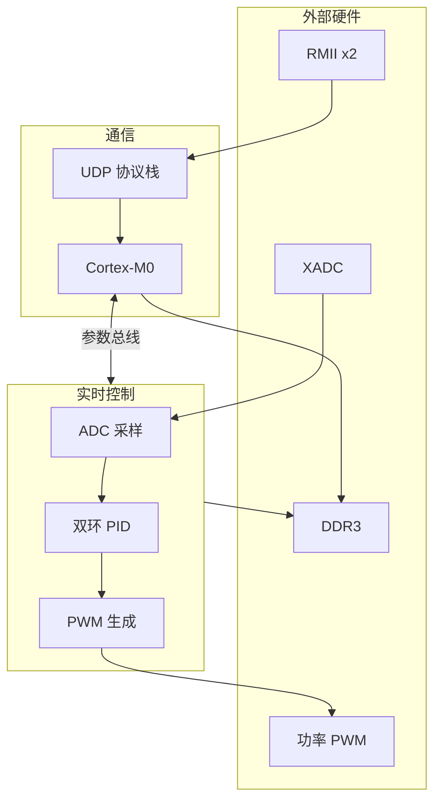
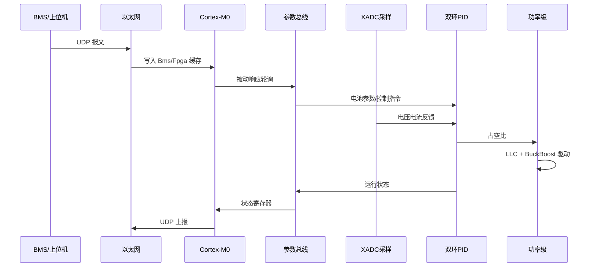
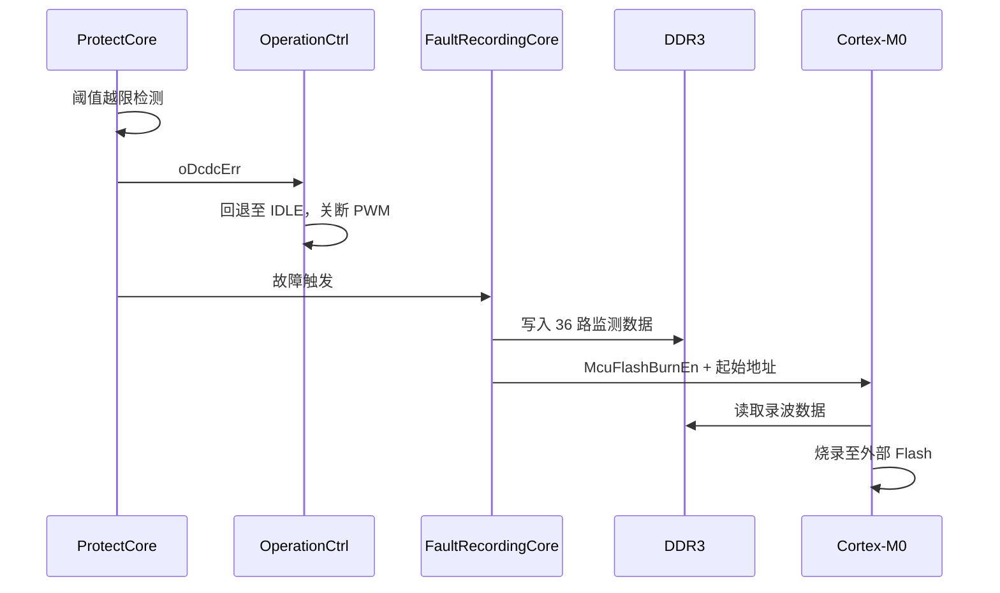

# RockDcCtrl FPGA 系统框架文档

> 文档版本：Rev 0.1  
> 对应工程：`RockDcCtrlTop`  
> 目标器件：Xilinx Artix-7 `xc7a50tfgg484-2`  
> 顶层模块：`RockDcCtrlTop.v`

---

## 目录

1. [系统概述](#1-系统概述)
2. [总体架构](#2-总体架构)
3. [时钟与复位子系统](#3-时钟与复位子系统)
4. [Cortex-M0 处理器子系统](#4-cortex-m0-处理器子系统)
5. [以太网通信子系统](#5-以太网通信子系统)
6. [参数总线子系统](#6-参数总线子系统)
7. [ADC 采样子系统](#7-adc-采样子系统)
8. [信号滤波子系统](#8-信号滤波子系统)
9. [运行状态机](#9-运行状态机)
10. [自检子系统](#10-自检子系统)
11. [软启动子系统](#11-软启动子系统)
12. [功率控制环路](#12-功率控制环路)
13. [PWM 输出子系统](#13-pwm-输出子系统)
14. [保护子系统](#14-保护子系统)
15. [DDR 与故障录波](#15-ddr-与故障录波)
16. [辅助功能模块](#16-辅助功能模块)
17. [Cortex-M0 固件](#17-cortex-m0-固件)
18. [监测数据打包](#18-监测数据打包)
19. [外部引脚分类](#19-外部引脚分类)
20. [源码目录结构](#20-源码目录结构)
21. [系统数据流](#21-系统数据流)

---

## 1. 系统概述

### 1.1 功能定位

RockDcCtrl 是一套面向 **大电流 DCDC / 储能 PCS** 的 FPGA 控制器，实现电池侧直流功率变换的实时控制与通信管理。核心能力包括：

- **功率变换控制**：LLC 谐振变换 + Buck-Boost 双路拓扑，支持串联/并联/裂相/三相配置
- **闭环调节**：电压外环 + 电流内环双环 PID，100 MHz 实时执行
- **电池管理协同**：通过 BMS 参数总线获取 SOC、充放电限流、关机指令
- **网络通信**：双路 RMII 以太网，UDP 协议，支持多板级联转发
- **安全机制**：软硬件保护、故障自动恢复、DDR 故障录波

### 1.2 设计特点

| 特点 | 说明 |
|------|------|
| 软硬协同 | 实时控制（100/200 MHz 纯逻辑）与通信管理（50 MHz M0 软核）分离 |
| 双路对称 | A/B 两路 `AutoCtrlCore` 独立控制，适配多相拓扑 |
| 安全启动 | 自检 → LLC 软启动 → 闭环运行，每步有明确使能条件 |
| 级联扩展 | 双 RMII + `ForwardEn` 支持多板组网 |
| 故障追溯 | 36 路实时监测数据 + DDR 录波 + MCU Flash 持久化 |

---

## 2. 总体架构

### 2.1 层次结构

```
RockDcCtrlTop
├── 基础设施层
│   ├── SysPllCore / SSCPllCore     时钟产生
│   ├── DelayTimeCore               时基节拍
│   └── SysCore / SysStatusDisplay  复位与状态指示
│
├── 通信管理层（50 MHz）
│   ├── CortexMCore                 Cortex-M0 + AHB 外设
│   ├── RmiiDrvCore                 RMII 物理层驱动
│   ├── EthProtocalAnalysisCore     UDP/ARP/ICMP 协议栈
│   └── NetworkMonitorCore          网络链路监测
│
├── 参数交互层（100 MHz）
│   ├── BmsParamCore                BMS 参数轮询（0x0100_0000）
│   └── FpgaParamCore               FPGA 参数双向交换（0x0200_0000）
│
├── 实时控制层（100/200 MHz）
│   ├── AdcSampleCore               XADC 采样
│   ├── FilterCore                  信号滤波
│   ├── OperationCtrl               运行状态机
│   ├── SelfInspectionCore          上电自检
│   ├── SlowLaunchCtrlCore          LLC 软启动
│   ├── AutoCtrlCore A/B            双环 PID
│   ├── BuckBoostCtrlCore           Buck-Boost 占空比
│   ├── BatteryPackActiveBalance    主动均衡
│   ├── BatteryPowerLimit           功率限流
│   ├── VirtualResCtrlCore          虚拟阻抗
│   └── PwmTransferCore             PWM 波形生成
│
├── 安全与记录层
│   ├── ProtectCore                 阈值保护与故障恢复
│   ├── FaultRecordingCore          故障数据录波
│   └── DdrCtrlCore                 DDR3 控制器
│
└── 人机交互层
    ├── FanCtrlCore                 风扇温控
    ├── LedLampStripCtrlCore        LED 灯带
    ├── SoftReBoot                  MCU 软重启
    └── DebugTest                   调试数据 UART 输出
```

### 2.2 架构关系图



---

## 3. 时钟与复位子系统

### 3.1 模块组成

| 模块 | 路径 | 功能 |
|------|------|------|
| `SysPllCore` | `Src/Core/` | 主 PLL，由 `iSysClkIn`（50 MHz）倍频 |
| `SSCPllCore` | `Src/Core/` | 扩频 PLL，供风扇 PWM 使用 |
| `DelayTimeCore` | `DelayCnt/` | 各时钟域 1µs/1ms/1s 节拍产生 |
| `SysCore` | `SysCore/` | 多域复位管理与系统 LED |
| `SysStatusDisplay` | `SysCore/` | 以太网/故障状态综合判断 |

### 3.2 时钟分配

| 信号 | 频率 | 主要负载 |
|------|------|----------|
| `wSysClk1` | 50 MHz | Cortex-M0、RMII 参考时钟、SysStatusDisplay |
| `wSysClk2` | 100 MHz | 主控制逻辑、以太网 MAC、ADC、滤波、保护、参数总线 |
| `wSysClk3` | 200 MHz | PWM 生成、DDR MIG 参考时钟 |
| `wSysClk4` | 20 MHz | ADC 调试采样 |
| `wSysClk5` | 50 MHz 180° | RMII 发送时钟 |
| `wSysClkSSC50M` | 50 MHz | 风扇 PWM（扩频） |

### 3.3 复位策略

- PLL 全部锁定（`wPllLocked = wPllLocked1 & wPllLocked2`）后，`SysCore` 按各时钟域依次释放复位
- `SysStatusDisplay` 综合 `NoEthNet` 与 `ErrDisplay`，输出 `SrcStable` 参与系统稳定判断
- 各域独立复位：`wSysClk1RstP` ~ `wSysClk4RstP`，高有效（Release = 1 表示正常运行）

---

## 4. Cortex-M0 处理器子系统

### 4.1 模块结构

**顶层模块**：`CortexMCore.v`（`CortexMCore/`）

```
CortexMCore
├── CortexM0Integration      ARM Cortex-M0 软核（50 MHz）
├── CortexRstCore            软核复位管理
├── CortexDbgCore            SWD 调试接口
├── AhbLiteCore              AHB-Lite 总线仲裁
│   ├── AhbLiteDecoder       地址译码
│   └── AhbLiteMux           读数据多路复用
└── AhbSlaveCore             AHB 从设备集合
    ├── AhbSlaveSram         程序/数据 RAM（32 KB）
    ├── AhbSlaveDdr          DDR3 映射（256 MB）
    ├── AhbSlaveUdp          UDP 收发缓存
    ├── AhbSlaveBms          BMS 参数缓存
    ├── AhbSlaveFpga         FPGA 参数缓存
    ├── AhbSlaveGpio         GPIO + PHY 控制
    ├── AhbSlaveApb          APB 桥（Timer/UART/SPI）
    └── AhbSlaveDefault      默认从设备（未映射地址）
```

### 4.2 AHB 地址映射

| AHB 地址范围 | 从设备 | 容量/说明 |
|-------------|--------|-----------|
| `0x0000_0000` ~ `0x0000_3FFF` | AhbSlaveSram | 32 KB，预加载 M0 固件 |
| `0x2000_0000` ~ `0x2FFF_FFFF` | AhbSlaveDdr | 256 MB DDR3 |
| `0x3000_0000` ~ `0x3000_07FF` | UdpRxDataCache | 2 KB |
| `0x3000_1000` ~ `0x3000_17FF` | UdpTxDataCache | 2 KB |
| `0x3001_0000` ~ `0x3001_07FF` | BmsParamCache | 映射 FPGA `0x0100_0000` |
| `0x3002_0000` ~ `0x3002_07FF` | FpgaParamCache | 映射 FPGA `0x0200_0000` |
| `0x4000_0000` ~ `0x4000_001F` | AhbSlaveGpio | GPIO、PHY MDIO、UDP 发送控制 |
| `0x4100_0000` ~ `0x4100_0FFF` | ApbSlaveTimer | 定时器 |
| `0x4100_1000` ~ `0x4100_1FFF` | ApbSlaveUart | UART |
| `0x4100_2000` ~ | ApbSlaveSpi | SPI Master |

### 4.3 中断分配

| IRQ 位 | 来源 |
|--------|------|
| IRQ[0] | Timer |
| IRQ[1] | UART RX |
| IRQ[2] | 以太网 RX |

### 4.4 对外接口

- **UART**：`iArmUartRx` / `oArmUartTx`（与调试口复用）
- **SPI**：通过 APB 桥输出，连接外部 Flash 等
- **SWD**：`iSwdClk` / `ioSwdData`，在线调试
- **以太网 PHY**：MDIO/MDC 配置 RTL8201
- **DDR**：通过 AhbSlaveDdr 间接访问，供故障数据读出

---

## 5. 以太网通信子系统

### 5.1 通信链路

```
PHY (RMII) ──► RmiiDrvCore ──► GMII ──► EthProtocalAnalysisCore ──► CortexM0
                (双路)              (ARP/ICMP/UDP)
```

### 5.2 RmiiDrvCore

- **路径**：`RmiiDrvCore/`
- **功能**：RMII ↔ GMII 协议转换，双通道（`RMII_CH=2`）
- **时钟**：接收侧 50 MHz，发送侧 50 MHz 180° 相移
- **级联**：`iForwardEn=1` 时转发上游指令至下游板卡；`iBoardSelf` 决定本板是否回包

### 5.3 EthProtocalAnalysisCore

- **路径**：`EthProtocalAnalysisCore/`
- **子模块**：`eth_ctrl`、`arp`、`icmp`、`udp`
- **默认参数**：MAC `00:11:22:33:44:55`，IP 可通过 `FpgaParamCore` 动态配置
- **接口**：GMII 侧接入，应用侧输出 `oEthRxData`/`oEthRxDataVld`，接收 `iEthTxData`/`iEthTxLen`
- **复位**：`EthUdpRst` 由 `FpgaParamCore.oEthUdpRstN` 控制，IP 变更时自动复位协议栈

### 5.4 NetworkMonitorCore

- **路径**：`NetworkMonitorCore/`
- **功能**：监测 RMII 接收活动，120 秒无数据则置 `oNoEthNet`
- **影响**：`NoEthNet` 触发 `OperationCtrl` 回退至 IDLE 状态

---

## 6. 参数总线子系统

FPGA 逻辑与 Cortex-M0 通过两条独立参数总线交互，均采用 **逻辑侧主动轮询、MCU 侧被动响应** 的模式。

### 6.1 BmsParamCore

- **路径**：`BmsParamCore/`
- **逻辑侧地址**：`0x0100_0000`（轮询地址 `{16'h0100, 5'd0, addr[10:0]}`）
- **MCU 侧缓存**：`0x3001_0000`（AhbSlaveBms）

#### 轮询参数列表

| 缓存偏移 | 参数 | 位宽 | 说明 |
|----------|------|------|------|
| `0x022` | 电池电压 | 32 bit | 单位 0.01 V |
| `0x0F0` | 平均电压 | 32 bit | 单位 0.01 V |
| `0x023` | 电池电流 | 32 bit | 充放电电流 |
| `0x025` | SOC | 16 bit | 荷电状态 |
| `0x028` | 最大充电电流 | 32 bit | BMS 限流 |
| `0x029` | 最大放电电流 | 32 bit | BMS 限流 |
| `0x0EC` | BMS 关机指令 | 8 bit | bit[3:2] 触发状态机回退 |

轮询一圈（地址到达 `0x7FF`）后，所有参数同步更新至输出寄存器。

### 6.2 FpgaParamCore

- **路径**：`FpgaParamCore/`
- **逻辑侧地址**：`0x3002_00xx`（轮询地址 `{16'h3002, 8'h00, addr[7:0]}`）
- **MCU 侧缓存**：`0x3002_0000`（AhbSlaveFpga）

#### MCU → FPGA（控制指令，逻辑读 MCU 缓存）

| 偏移 | 参数 | 说明 |
|------|------|------|
| `0x90`~`0x91` | 板卡 IP | 高/低 16 位，变更后触发 UDP 协议栈复位 |
| `0x92` | PCS 设备类型 | 低 2 位为软件 ID |
| `0x93`~`0x96` | LED 控制 | 方向、RGB 值、模式、周期 |
| `0x97` | 手动重启 | `0x50` APP 区 / `0x51` BOOT 区 |
| `0x98` | 故障烧录完成标志 | MCU 写回 |
| `0xA0` | 开关机 | bit[0] |
| `0xA1` | 级联转发使能 | `=1` 开启 ForwardEn |
| `0xA2` | DC 开关 | |
| `0xA3` | 均衡使能 | `+1` 均衡充电 / `-1` 均衡放电 |
| `0xA4` | 升级状态 | |
| `0xA5` | 故障清除 | `=1` 清除 |
| `0xA6` | 风扇强制运行 | `=0x55` 强制开启 |

#### FPGA → MCU（状态上报，逻辑写 MCU 缓存）

| 偏移 | 参数 | 说明 |
|------|------|------|
| `0x20` | DC 输出总电压 | 0.1 V |
| `0x21` | DC 输出总电流 | 0.1 A |
| `0x22` | DC 输出总功率 | |
| `0x23`~`0x26` | LLC1/2 电压电流 | |
| `0x27`~`0x2A` | BuckBoost1/2 电压电流 | |
| `0x40` | 风扇 1 状态 | 含故障位与转速 |
| `0x44`~`0x45` | 散热器温度 1/2 | |
| `0x48` | DCDC 工作状态 | `CurrentState[1:0]` |
| `0x49` | PCS 硬件 ID | |
| `0x60`~`0x62` | 故障信息 1/2/3 | |
| `0x70`~`0x72` | 故障录波地址 | MCU 读 DDR 用 |

串联模式下，总电流/总功率自动除以 2 后上报。

---

## 7. ADC 采样子系统

### 7.1 模块信息

- **模块**：`AdcSampleCore.v`（`AdcSampleCore/`）
- **时钟**：主采样 100 MHz（`wSysClk2`），调试 20 MHz（`wSysClk4`）
- **硬件**：FPGA 内置 XADC，通过 `iVP/iVN`（片内温度）和 `iVauxP/N[15:0]`（16 路外部模拟输入）

### 7.2 通道映射

| XADC 通道 | 信号名 | 物理量 | 单位 |
|-----------|--------|--------|------|
| VAUX0 | ResonanceCurrentB | LLC2 谐振电流 | 1 mA |
| VAUX2 | BusTotalVoltage | 继电器后总电压 | 0.1 V |
| VAUX3 | BusVoltageB | BuckBoost2 母线电压 | 0.1 V |
| VAUX5 | ResonanceCurrentA | LLC1 谐振电流 | 1 mA |
| VAUX6 | LlcBusCurrentA | BuckBoost 电流 1 | 1 mA |
| VAUX7 | LlcBusCurrentB | BuckBoost 电流 2 | 1 mA |
| VAUX9 | LlcBusVoltageA | LLC1 电压 | 0.1 V |
| VAUX10 | BusVoltageA | BuckBoost1 母线电压 | 0.1 V |
| VAUX11 | BusTotalVoltagePre | 继电器前总电压 | 0.1 V |
| VAUX12 | LlcBusVoltageB | LLC2 电压 | 0.1 V |
| VAUX13 | BusTotalCurrentB | 总电流 B 路 | 1 mA |
| VAUX15 | BusTotalCurrentA | 总电流 A 路 | 1 mA |
| VAUX3 轮换 | Temp1~6 | NTC 温度采样 | 12 bit ADC 原始值 |

### 7.3 数据处理流程

1. XADC 顺序轮询各 VAUX 通道
2. `Adcnormalization` 模块将 12 bit 原始值归一化为 16 bit 有符号工程量
3. 电压/电流参考通道（`VoltageSampVref`/`CurrentSampVref`）用于零点校准
4. 一轮采样完成产生 `oAdcSampleSequenceDone`，作为 PID 和滤波器的同步节拍

### 7.4 NtcSampleCore

- 对 `Temp1`、`Temp3` 两路 NTC 原始 ADC 值进行温度换算
- 输出 `wNtcTemp1/2`，单位 0.1 ℃，供风扇控制和保护使用

---

## 8. 信号滤波子系统

### 8.1 FilterCore

- **路径**：`FilterCore/`
- **时钟**：100 MHz，采样节拍 `iAdcSampleSequenceDone`
- **算法**：Tustin 双线性变换低通滤波器（`LPFtustin`）
- **截止频率**：WC = 3140，采样频率 FS = 53418

#### 滤波通道

| 输出 | 输入源 |
|------|--------|
| `oLlcBusVolFilterA/B` | LLC 母线电压 A/B |
| `oBusVolFilterA/B` | BuckBoost 母线电压 A/B |
| `oBusTotalVolFilter` | 继电器后总电压 |
| `oBusTotalVolFilterPre` | 继电器前总电压 |
| `oLlcBusCurFilterA/B` | LLC 母线电流 A/B |
| `oBusTotalCurFilterA/B` | 总电流 A/B |

### 8.2 LowSpeedFilterCore

- **路径**：`FilterCore/LowSpeedFilterCore.v`
- **对象**：电池电压、平均电压
- **节拍**：1 秒脉冲（`wSysClk2Delay1S`），慢速平滑

---

## 9. 运行状态机

### 9.1 模块信息

- **模块**：`OperationCtrl.v`（`OperationCtrl/`）
- **时钟**：100 MHz

### 9.2 状态定义

| 状态 | 编码 | 说明 |
|------|------|------|
| IDLE | `2'b00` | 上电等待，需使能信号与上电延时 |
| SELF_INSPECTION | `2'b01` | ADC 校准与硬件识别 |
| SLOW_LAUNCH | `2'b10` | LLC 软启动 |
| WORKING | `2'b11` | 双环闭环正常运行 |

### 9.3 状态转移

```
IDLE ──(延时完成 & DmosAndCmosEn)──► SELF_INSPECTION
SELF_INSPECTION ──(SelfInspectionEnd)──► SLOW_LAUNCH
SLOW_LAUNCH ──(SlowLaunchEnd)──► WORKING
任意状态 ──(故障/无网络/BMS关机/失能)──► IDLE
```

**回退条件**（`wGotoIdle`）：
- `iDcdcErr`：DCDC 故障
- `iNoEthNet`：120 秒无以太网数据
- `iBmsShutdown[3:2] != 0`：BMS 关机指令
- `!iDmosAndCmosEn`：功率器件未使能

### 9.4 各状态使能输出

| 状态 | ProtectEn | SelfInspectionEn | SlowLaunchEn | WorkingEn |
|------|-----------|------------------|--------------|-----------|
| IDLE | 0 | 0 | 0 | 0 |
| SELF_INSPECTION | 1 | 1 | 0 | 0 |
| SLOW_LAUNCH | 1 | 1 | 1 | 0 |
| WORKING | 1 | 1 | 1 | 1 |

---

## 10. 自检子系统

### 10.1 模块信息

- **模块**：`SelfInspectionCore.v`（`SelfInspectionCore/`）
- **时钟**：100 MHz

### 10.2 功能

1. **ADC 参考校准**：对电压/电流采样参考通道做 128 次平均，输出 `oVoltageSampVrefAvera` / `oCurrentSampVrefAvera`
2. **硬件 ID 识别**：读取 `iPcsHardwareId[1:0]` 与 `iPcsSoftWareId[1:0]`
   - `00`：默认
   - `01`：单相（SplitPhase）
   - `10`：裂相（SP）
   - `11`：三相（ThreePhase）
3. **继电器配置**：根据硬件/软件 ID 决定 `oSeriesRelayEn`（串联）/ `oParallelRelayEn`（并联）
4. **PCS 使用 ID**：输出 `oPcsUsingId` 供后续 BuckBoost 控制与保护判断

自检完成后 `oSelfInspectionEnd` 置位，状态机进入 SLOW_LAUNCH。

---

## 11. 软启动子系统

### 11.1 SlowLaunchCtrlCore

- **路径**：`SlowLaunchCtrlCore/`
- **功能**：LLC PWM 占空比从 0 渐升至目标值
- **参数**：`SLOW_LAUNCH_TIME = 1024×10 ms`（顶层实例化），分 1024 步递增
- **输出**：`oPwmDuty[9:0]`（0~1023 对应 0~50% 占空比）
- **完成标志**：`oSlowLaunchEnd`（映射为 `wStateLlcOk`）

### 11.2 环路使能条件

```verilog
wStateLoopEn = wStateLlcEn && (wLLCPwmDuty > 70);  // 占空比 > ~7% 后开启电流环
wLLCPwmEn    = (!wDcdcErr) && wStateLlcEn;
wBuckBoostPwmEn = wLLCPwmEn && (wLLCPwmDuty > 70);
```

LLC 占空比超过阈值后，才允许 Buck-Boost 和双环 PID 投入运行。

---

## 12. 功率控制环路

### 12.1 控制链路总览

```
BmsParamCore ──► BatteryPowerLimit ──► 电流限幅
                      │
BatteryPackActiveBalance ──► 均衡电压偏置 ──┐
VirtualResCtrlCore ──► 虚拟阻抗偏置 ────────┤
                                            ▼
                              AutoCtrlCore A/B（电压外环 + 电流内环）
                                            │
                              BuckBoostCtrlCore（占空比映射）
                                            │
                              SlowLaunchCtrlCore（LLC 占空比）
                                            ▼
                              PwmTransferCore
```

### 12.2 AutoCtrlCore（双环 PID）

- **路径**：`AutoCtrlCore/`
- **实例**：`U_AutoCtrlCoreA`（A 路）、`U_AutoCtrlCoreB`（B 路）
- **时钟**：100 MHz

#### 电压外环

| 项目 | 串联模式 | 并联模式 |
|------|----------|----------|
| 参考电压 | 400.0 V（`VOL_REF_SERIES=4000`） | 470.0 V（`VOL_REF_PARALLEL=4700`） |
| Kp | 512 | 1024 |
| Ki | 64 | 32 |
| 输出限幅 | `TargetCurrentParamMax/Min` | 同左 |
| 输出增益 | 128 | 128 |

参考电压 = 模式基准 + 主动均衡偏置 - 虚拟阻抗偏置

#### 电流内环

| 项目 | 串联模式 | 并联模式 |
|------|----------|----------|
| Kp | 64 | 128 |
| Ki | 1 | 2 |
| 输出限幅 | 100 ~ 900 | 同左 |
| 输出增益 | 8192 | 8192 |

#### 采样节拍

`PidSampling` 模块根据 `iAdcSampleSequenceDone` 产生两级触发：
- `wPidOpEn[0]`：电压外环计算触发
- `wPidOpEn[1]`：电流内环计算触发

### 12.3 BatteryPackActiveBalance

- **路径**：`BatteryPackActiveBalance/`
- **功能**：电池包间主动均衡电压偏置

| 均衡指令 | 偏置 |
|----------|------|
| `+1` / `+2` | 均衡充电，参考电压 -5V / -10V |
| `-1` / `-2` | 均衡放电，参考电压 +5V / +10V |
| 其他 | 0 |

最终偏置按输出功率比例缩放：`(3000 - P_actual) × offset / 2048`，避免大功率时叠加均衡导致 BMS 过流。

### 12.4 BatteryPowerLimit

- **路径**：`BatteryPackActiveBalance/BatteryPowerLimit.v`（或同级目录）
- **输入**：SOC、串联模式、电池电流、BMS 充放电限流
- **输出**：`oTargetCurrentParamMax/Min`，作为电压外环输出限幅

### 12.5 VirtualResCtrlCore

- **路径**：`VirtualResistanceCore/VirtualResCtrlCore.v`
- **功能**：根据总电流和输出功率计算虚拟阻抗电压偏置
- **节拍**：1 秒更新一次
- **输出**：`oTargetVoltageOffsetA/B`，分别作用于 A/B 路

### 12.6 BuckBoostCtrlCore

- **路径**：`SlowLaunchCtrlCore/BuckBoostCtrlCore.v`
- **功能**：将 PID 输出的 PWM 参数映射为 Buck-Boost 占空比
- **输入**：`iPidControlPwmParamA/B`、`iLLCPwmDuty`、`iPcsHardwareIdUsing`
- **输出**：`oBuckBoostPwmDutyA/B[9:0]`

---

## 13. PWM 输出子系统

### 13.1 PwmTransferCore

- **路径**：`PwmTransferCore/`
- **时钟**：200 MHz（`wSysClk3`）
- **子模块**：
  - `PwmGenBuckBoost`：Buck-Boost 差分 PWM（P/N 互补）
  - `PwmGenLLC`：LLC 全桥 PWM（LV 低压侧 + HV 高压侧）

### 13.2 输出信号

| 输出 | 说明 |
|------|------|
| `oBuckBoost1PwmOutP/N` | Buck-Boost 1 差分 PWM |
| `oBuckBoost2PwmOutP/N` | Buck-Boost 2 差分 PWM |
| `oLLC1LVPwm1/2OutP` | LLC1 低压侧半桥 |
| `oLLC1HVPwm1/2OutP` | LLC1 高压侧半桥 |
| `oLLC2LVPwm1/2OutP` | LLC2 低压侧半桥 |
| `oLLC2HVPwm1/2OutP` | LLC2 高压侧半桥 |
| `oDrvOutEn[2:0]` | 驱动使能（固定为全 1） |

### 13.3 使能逻辑

- `iLLCPwmEn`：LLC PWM 总使能（无故障且软启动中/运行中）
- `iBuckBoostPwmEn`：Buck-Boost PWM 使能（LLC 占空比 > 阈值）

---

## 14. 保护子系统

### 14.1 ProtectCore

- **路径**：`ProtectCore/`
- **时钟**：100 MHz
- **恢复时间**：5 秒（`FAILURE_RECOVERY_TIME`）

### 14.2 保护阈值（主要）

#### 电压保护（单位 0.1 V）

| 项目 | 上限 | 下限 |
|------|------|------|
| LLC 母线电压 A/B | 370.0 V | 160.0 V |
| BuckBoost 母线电压 A/B | 550.0 V | 340.0 V |
| 总电压 | — | 350.0 V |
| 继电器前后压差 | ±200.0 V / ±100.0 V | |

#### 电流保护（单位 1 mA）

| 项目 | 上限（1 级/2 级） |
|------|-------------------|
| 谐振电流 A/B | ±16000（±20 A） |
| LLC 母线电流 A/B | ±10000 / ±14500 |
| 总电流 A/B | — / -6000 |

#### 其他保护

- 6 路温度采样 + 2 路 NTC 温度
- 硬件过流 `iLlcOverCurrent`（180 A）
- 硬件过压 `iLlcOverVoltage`
- ADC 参考电压漂移检测
- LLC 占空比异常

### 14.3 输出

| 信号 | 说明 |
|------|------|
| `oDcdcErr` | DCDC 故障总标志，关断 PWM 并触发状态机回退 |
| `oFailRecovery` | 故障恢复中标志 |
| `oDCFailureInformation1/2/3` | 三组 16 位故障码，上报 MCU |
| `oErrDisplay[1:0]` | 故障显示等级，驱动 SysStatusDisplay |
| `oDbgMsg[31:0]` | 调试信息，打入监测数据 |

---

## 15. DDR 与故障录波

### 15.1 DdrCtrlCore

- **路径**：`DdrCtrlCore/`
- **配置**：DDR3 1 Gb × 16 bit（row:13, col:10, bank:3）
- **时钟**：系统时钟 100 MHz，参考时钟 200 MHz
- **IP**：Xilinx MIG（`Src/Core/MigCore/`）

#### 端口分配

| 端口 | 使用者 | 用途 |
|------|--------|------|
| wr0 / rd0 | CortexM0（AhbSlaveDdr） | MCU 读写 DDR |
| wr1 | FaultRecordingCore | 故障数据写入 |

### 15.2 FaultRecordingCore

- **路径**：`Fault RecordingCore/`
- **子模块**：
  - `MonitorDataStorage`：环形缓存 + 故障触发写 DDR
  - `MonitorDataRead`：MCU 读 DDR 辅助

#### 触发条件

- `iDcDcErr`：DCDC 故障
- `iBmsShutdown`：BMS 关机

#### 数据内容

36 路 × 32 bit 监测数据（见第 18 章），在故障时刻写入 DDR。

#### MCU 交互

1. 故障后 `oMcuFlashBurnEn` 通知 MCU 开始读取
2. `oMcuRdStartAddr` 给出 DDR 起始地址
3. MCU 通过 DDR 读接口（rd0）读取数据
4. MCU 烧录至外部 Flash 后写回 `McuFaultBurnFinish`

---

## 16. 辅助功能模块

### 16.1 FanCtrlCore

- **路径**：`AutoCtrlCore/FanCtrlCore.v`
- **时钟**：SSC 50 MHz（PWM）+ 100 MHz（逻辑）
- **输入**：NTC 温度 1/2、风扇转速反馈 `iFanPwmFedBack`
- **控制**：温控曲线 + `FanForceEn` 强制运行（`0x55`）
- **输出**：`oFanPwm`（PWM 驱动）、`oFanSpeed`（转速 rpm）、`oFanErr`（故障）

### 16.2 LedLampStripCtrlCore

- **路径**：`Led5050CtrlCore/`
- **LED 数量**：21 颗
- **输入**：SOC、网络状态、MCU 配置的 RGB/模式/周期
- **输出**：`oRGBOut[1:0]`（WS2812 类时序）

### 16.3 SoftReBoot

- **路径**：`SoftReBoot/`
- **触发**：`iMCURebootEn`（APP 区重启）或 `iManualReboot`（`0x50`/`0x51`）
- **实现**：通过 FPGA 配置寄存器控制 MCU 复位向量

### 16.4 DebugTest

- **路径**：`DebugTest/`
- **功能**：将 36 路监测数据通过 UART 串口输出，用于在线调试
- **时钟**：以太网时钟域（`wEthClk`）

### 16.5 SysStatusDisplay

- **路径**：`SysCore/SysStatusDisplay.v`
- **输入**：`NoEthNet`、`ErrDisplay`
- **输出**：`SrcStable[1:0]`，参与系统复位释放判断

---

## 17. Cortex-M0 固件

### 17.1 工程信息

- **路径**：`Software/`
- **IDE**：Keil MDK（`Prj/CortexM0.uvprojx`）
- **入口**：`Src/UserCode/main.c`

### 17.2 初始化流程

```c
UartInit() → GpioInit() → DevPhy8201Init() → SpiInit()
→ TimerInit() → BmsCacheInit() → DdrCacheInit() → EthUdpInit()
```

### 17.3 外设驱动

| 驱动 | 文件 | 对应 AHB 外设 |
|------|------|---------------|
| Gpio | `Peripheral/src/Gpio.c` | AhbSlaveGpio |
| Uart | `Peripheral/src/Uart.c` | ApbSlaveUart |
| Timer | `Peripheral/src/Timer.c` | ApbSlaveTimer |
| Spi | `Peripheral/src/Spi.c` | ApbSlaveSpi |
| EthUdp | `Peripheral/src/EthUdp.c` | AhbSlaveUdp |
| BmsCache | `Peripheral/src/BmsCache.c` | AhbSlaveBms |
| DdrCache | `Peripheral/src/DdrCache.c` | AhbSlaveDdr |
| mdio | `Peripheral/src/mdio.c` | PHY 配置 |

### 17.4 固件加载

编译产物经 `BinToCoe` 工具转换为 `.coe` 文件，初始化 `AhbSlaveSram` 中的程序存储器。

---

## 18. 监测数据打包

顶层将 36 路信号打包为 `wAdcData[32*36-1:0]`，供故障录波和调试 UART 使用。

| 索引 | 内容 |
|------|------|
| [0] | LLC 母线电压 A |
| [1] | LLC 母线电压 B |
| [2] | BuckBoost 母线电压 A |
| [3] | BuckBoost 母线电压 B |
| [4] | 总电压（滤波后） |
| [5] | 继电器前总电压 |
| [6] | 谐振电流 A |
| [7] | 谐振电流 B |
| [8] | LLC 母线电流 A |
| [9] | LLC 母线电流 B |
| [10] | 总电流 A |
| [11] | 总电流 B |
| [12] | 电池平均电压 |
| [13] | 保护调试信息 |
| [14] | DcdcErr 标志 |
| [15] | FailRecovery 标志 |
| [16]~[19] | PID 参考/积分量 A/B |
| [20]~[21] | BuckBoost 占空比 A/B |
| [22] | 当前状态 |
| [23] | LLC 占空比 |
| [24] | 系统状态字（32 bit） |
| [25]~[27] | 滤波电流 B/A/B |
| [28]~[31] | 电池电压/电流/功率/SOC |
| [32]~[33] | 充放电限流 |
| [34]~[35] | NTC 温度 1/2 |

---

## 19. 外部引脚分类

### 19.1 功率与控制

| 类别 | 信号 | 说明 |
|------|------|------|
| Buck-Boost PWM | `oBuckBoost1/2PwmOutP/N` | 差分 PWM 驱动 |
| LLC PWM | `oLLC1/2LV/HVPwm1/2OutP` | 全桥 PWM（8 路） |
| 继电器 | `oSeries/Parallel/MainRelayEn` | 串/并联/主继电器 |
| 预充电 | `oPrechargeRelayDis` | 预充电继电器禁用 |
| 驱动使能 | `oDrvOutEn[2:0]` | 功率驱动使能 |
| 器件使能 | `iDmosAndCmosEn` | 外部功率器件使能 |

### 19.2 采样与保护

| 类别 | 信号 | 说明 |
|------|------|------|
| XADC | `iVP/iVN`, `iVauxP/N[15:0]` | 模拟采样输入 |
| 温度选择 | `oTempSel[2:0]` | NTC 通道轮换指示 |
| 硬件保护 | `iLlcOverCurrent/Voltage` | 快速硬件保护输入 |
| PCS ID | `iPcsHardwareId[1:0]` | 硬件拓扑识别 |

### 19.3 通信与调试

| 类别 | 信号 | 说明 |
|------|------|------|
| RMII | `iRmiiRxDv/Data`, `oRmiiTxEn/Data/Clk` | 双路以太网 |
| PHY | `oEhtPhyRstN`, `oEthPhyMdclk`, `ioEthPhyMdio` | PHY 管理 |
| UART | `iArmUartRx`, `oArmUartTx`, `oUartTxd` | 通信 + 调试 |
| SWD | `iSwdClk`, `ioSwdData` | Cortex-M0 调试 |
| SPI | `oSpiCs/Mosi`, `iSpiMiso` | 外部 Flash |
| DDR3 | `ioDdrDq/Dqs`, `oDdrAddr/Ba/...` | 故障录波存储 |

### 19.4 人机交互

| 类别 | 信号 | 说明 |
|------|------|------|
| 系统 LED | `oSysLed` | 运行状态 |
| ARM LED | `oArmLed` | M0 心跳 |
| RGB 灯带 | `oRGBOut[1:0]` | 21 颗 LED |
| 风扇 | `oFanPwmOutP`, `iFanPwmFedBack` | PWM 驱动与反馈 |

---

## 21. 系统数据流

### 21.1 正常运行数据流



### 21.2 故障处理数据流



### 21.3 启动时序

```
上电 → PLL 锁定 → 系统复位释放
     → IDLE 等待（DmosAndCmosEn + 上电延时）
     → 自检（ADC 校准 + 拓扑识别 + 继电器配置）
     → LLC 软启动（占空比 0→目标，约 10s）
     → 占空比 > 7% → 开启电流环 + BuckBoost
     → WORKING 双环闭环运行
```

---

## 附录 A：关键信号互连表

| 信号 | 生产者 | 消费者 | 说明 |
|------|--------|--------|------|
| `wAdcSampleSequenceDone` | AdcSampleCore | FilterCore, AutoCtrlCore, ProtectCore | ADC 采样节拍 |
| `wStateLlcEn/Ok` | OperationCtrl, SlowLaunchCtrlCore | PwmTransferCore, ProtectCore | LLC 启动状态 |
| `wWorkingEn` | OperationCtrl | BatteryPowerLimit, RelayCtrl | 运行使能 |
| `wDcdcErr` | ProtectCore | OperationCtrl, PwmTransferCore, FaultRecordingCore | 故障总标志 |
| `wNoEthNet` | NetworkMonitorCore | OperationCtrl, LedLampStripCtrlCore | 网络断开 |
| `oSeriesRelayEn` | SelfInspectionCore | AutoCtrlCore, FpgaParamCore, VirtualResCtrlCore | 串联模式 |

---

## 附录 B：相关文档

| 文档 | 路径 |
|------|------|
| 系统框图（DrawIO） | `Doc/方案文档/大电流DCDC.drawio` |
| UDP 调试指令 | `Doc/方案文档/UDP调试指令.txt` |
| 原理图 | `Doc/SCH/` |
| 引脚约束 | `Src/Ucf/RockDcCtrlTop_Pins.xdc` |
| 时序约束 | `Src/Ucf/RockDcCtrlTop_Timing.xdc` |

---

*文档根据 `RockDcCtrlTop.v` 及各子模块 RTL 源码整理，如有工程变更请同步更新本文档。*
