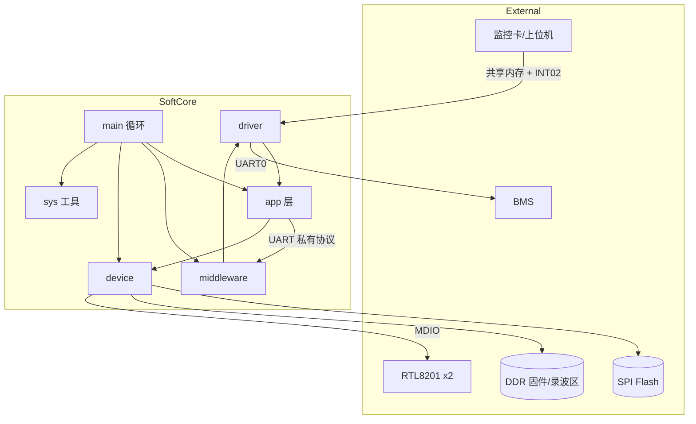
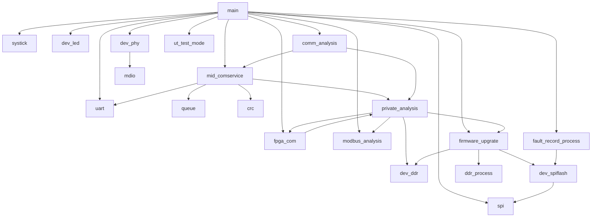

# 01 软件总体设计与架构

## 1. 项目定位

本固件运行于 **FPGA 内嵌 ARM Cortex-M0 软核**，对应产品线 **Roca2-16KH**，在系统中承担通信与管控中间层角色：

| 能力 | 说明 |
|------|------|
| BMS 通信 | UART 私有协议读写 BMS 寄存器、轮询、固件升级 |
| 监控卡代理 | FPGA 共享内存 + 中断，承接 UDP 风格读写请求 |
| 以太网 PHY | MDIO 位 bang 配置 RTL8201（双 PHY） |
| Flash 存储 | SPI NOR：FPGA 固件、版本信息、故障录波 |
| DDR 固件区 | 接收监控卡下发的 FPGA/BMS 升级包并校验 |
| 寄存器镜像 | BMS/DCDC Modbus 风格结构体，映射到 FPGA Cache 地址 |

工程产物名：`Roca2-16KH_Fpga_Softcore`（`.axf` / `.hex` / `.bin`）。

## 2. 目标平台与工程配置

### 2.1 硬件/编译环境

| 项 | 值 |
|----|-----|
| CPU | ARM Cortex-M0（`CORTEX_M0`） |
| 设备模型 | ARMCM0 / CMSDK_CM0 |
| CMSIS Pack | ARM.CMSIS 5.9.0 |
| 编译器 | ARM Compiler 5.06 update 7 (build 960) |
| Keil 工程 | `softcore.uvprojx`，Target=`Debug` |
| `SystemCoreClock` | **50 MHz**（`system_CMSDK_CM0.c` 中 `XTAL=50000000`） |
| Keil CLOCK 字段 | 12000000（与源码不一致，**以源码 50MHz 为准**） |

### 2.2 内存布局

| 来源 | IROM | IRAM |
|------|------|------|
| Keil 工程 `Cpu` 字段 | `0x00000000`, 256KB | `0x20000000`, 128KB |
| 实际 Scatter（`.sct`） | `0x00000000`, **16KB** (`0x4000`) | `0x00004000`, **16KB** (`0x4000`) |

**文档与联调应以 Scatter / `.map` 为准。**

Startup（`startup_CMSDK_CM0.s`）：

- Stack = `0x200`（512 字节）
- Heap = `0x100`（256 字节）

### 2.3 编译输出

| 项 | 值 |
|----|-----|
| 输出目录 | `.\output\` |
| 输出名 | `Roca2-16KH_Fpga_Softcore` |
| Post-build | `fromelf --bin` 生成 `.bin`；另调用 `Keil5_disp_size_bar_v0.3.exe` |

Include 路径：`cmsis\CMSIS\Include`、`cmsis\Device\ARM\CMSDK_CM0\Include`、`device`、`driver`、`sys`、`middleware`、`app`、`common\retarget`。

源码分组：`app` / `sys` / `middleware` / `driver` / `device` / `Startup`。

## 3. 目录结构与分层职责

```
FPGA_SoftCore/
├── app/           应用层：协议解析、轮询、升级、录波、测试
├── middleware/    中间件：UART 帧解析、SCI 接收队列
├── driver/        驱动：UART、SPI、MDIO、FPGA COM
├── device/        设备：LED、PHY8201、SPI Flash、DDR 写入
├── sys/           系统：main、systick、queue、crc
├── cmsis/         CMSIS + CMSDK_CM0 启动/系统文件
├── RTE/           Keil RTE 自动生成
├── output/        编译产物
└── Software/Doc/  本软件文档
```

| 层 | 职责 |
|----|------|
| **app** | BMS/DCDC 镜像、UDP 分发、升级状态机、故障录波、DDR 校验 |
| **middleware** | UART RX 环形缓冲、Nova 私有响应帧（`0xA5`）状态机、SCI 队列 |
| **driver** | CMSDK 外设寄存器、FPGA 共享内存、GPIO 模拟 MDIO |
| **device** | RTL8201 初始化、SPI Flash 读写擦除、LED、DDR 固件区写入 |
| **sys** | 入口/工具：主循环、SysTick 1ms、环形队列、CRC/字节序 |
| **cmsis** | 向量表、`SystemInit`、标准外设头文件 |

## 4. 启动与主循环

### 4.1 启动链路

```
Reset_Handler → SystemInit() → __main → main()
```

- `SystemInit()`：设置 `SystemCoreClock = 50MHz`
- 关键中断向量：
  - `INT01_Handler`：UART0 TX/RX
  - `INT02_Handler`：FPGA 通信
  - `SysTick_Handler`：1ms 节拍

### 4.2 初始化顺序（`sys/main.c`）

```c
SystickInit();        // 1ms SysTick
DevLedInit();         // 系统 LED 1s 闪烁（低电平有效）
Uart0Init();          // 115200, MCLK=50MHz
MidComserviceInit();  // UART RX 回调 + SCI 队列
SlaveCommInit();      // BMS/UDP 写队列
FpgaComInit();        // FPGA 通信中断
SpiInit();            // SPI Mode3 + 读 Flash JEDEC ID
DevPhy8201Init();     // RTL8201 x2 (addr 0x00/0x01)
BmsRegInit();         // BMS 寄存器镜像初始化
DCDCRegInit();        // DCDC 镜像 + 从 Flash 读版本扩展字段
```

### 4.3 主循环（无 RTOS，协作式）

```c
while (1) {
    ut_test_process();      // UT 测试（默认关闭）
    DevLedProcess();        // LED 闪烁
    MidComserviceHandle();  // UART 帧解析 → SCI 队列
    SlaveCommProcess();     // BMS 轮询 + UDP 分发
    UpdataStatusAnalysis(); // DDR 校验 + 升级 + 通信超时
    FPGARecordPorcess();    // 故障录波 DDR→Flash
}
```

各任务均为非抢占轮询；耗时任务需自行切片（如升级、录波按块推进）。

## 5. 系统架构图



## 6. 模块依赖关系



## 7. 设计注意点

1. **内存配置矛盾**：Keil 工程 256KB/128KB 与 Scatter 16KB/16KB 不一致，以 Scatter 为准。
2. **时钟不一致**：源码 50MHz，Keil CPU CLOCK 12MHz；UART 波特率按 **50MHz** 计算。
3. **Modbus**：结构体与 CRC 工具保留，主机轮询 `ModbusCommProcess()` 已注释，运行时走 Nova 私有协议。
4. **device_type**：`INT02_Handler` 接受 `0x0001~0x0005`，但 `UdpProtopackJudge()` 仅处理 **`0x0003`**。
5. **`common\retarget`**：在 include 路径中，仓库内可能为空或缺外部文件。
6. 源码头注释版本多为 **V1.0.0 / 2024-2-4**。
