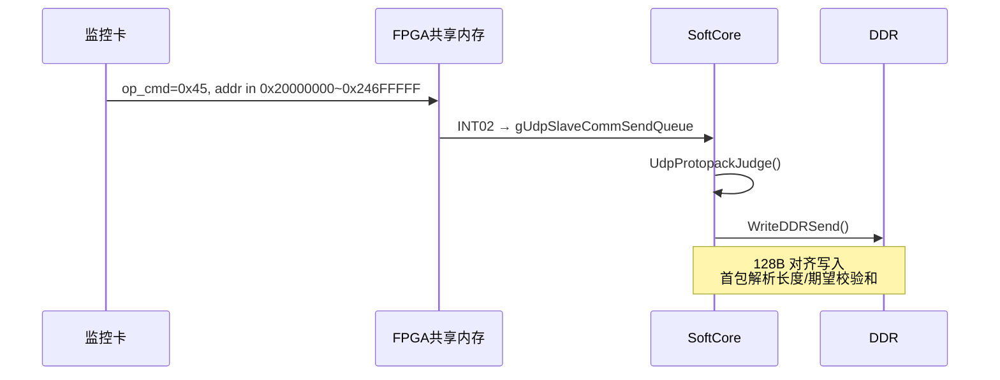
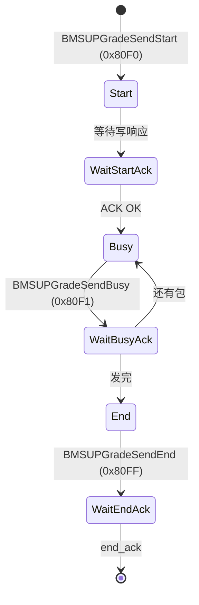

# 05 关键业务流程

---

## 1. DDR 固件接收与校验

### 1.1 接收



要点：

1. 监控卡经 UDP 写 `0x20000000`~`0x246FFFFF`（`op_cmd=0x45`）。
2. `WriteDDRSend()` 写入 DDR 并累计 `CheckSumFun()`。
3. 首包地址：
   - FPGA：`0x24000000`
   - BMS：`0x24400000`
4. 首包解析：固件长度（offset 7–10）、期望校验和（offset 252–255）。

### 1.2 校验（`DDRFirmwareAnalysis`）

| 项 | BMS | FPGA |
|----|-----|------|
| 魔数 | `0C 0C 0C 03` | `0C 0C 0C 04` |
| 成功条件 | com/rece checksum 相等且非 0 | 同左 |
| 结果标志 | `ddr_bms_firmware_success` | `ddr_fpga_firmware_success` |

通过后由 `UpdataStatusAnalysis()` 根据 `updata_status` 位启动对应升级。

---

## 2. FPGA 固件升级（DDR → SPI Flash）

### 2.1 启动条件（概念）

`updata_status` 相关位（bit0 / bit10 / bit12 等）置位，且 `ddr_fpga_firmware_success=1`。

### 2.2 状态机（`FPGAFirmwareAnalysis`）

```text
擦除 64K 块
    → 从 DDR+256 起按块拷贝
    → 写入 Flash 0x00261000
    → 校验通过后写版本头到 0x00C00000
    → gFPGAFirmwareUpgrateInfo.upgrate_success_flag
    → FirmwareUpgrate() 回写 updata_status
         成功 |= 0x2000
         失败 |= 0x4000
```

包/块大小：升级数据缓冲 1024 字节；Flash 擦除按 64KB Block。

### 2.3 升级标志

| 项 | 值 |
|----|-----|
| 地址 | `0x00BFF000` |
| 标志 | `0xA0` |

软复位：写 `0x40000030 = 1`（`SoftReboot()`）。

---

## 3. BMS 固件升级（DDR → UART）

### 3.1 触发时机

- FPGA 升级完成后继续 BMS；或
- 仅有 BMS 包且校验成功时启动。

数据源：`BMS_DDR_FIRMWARE_ADDR = 0x24400000`。

### 3.2 状态机（`BMSUpgrateFirmwareProcess`）



要点：

1. Start：总长度 4B + `space_num=0x02`
2. Busy：`index(2)` + 最多 1024B 数据 + checksum 低 16 位
3. End：无数据域
4. ACK 由 mid_comservice 识别 `0x80F0/F1/FF` 后回调 `RevBMSUpdataAnalysis()`
5. 单步超时参考 `UPGRATE_TIME_OUT = 3000 ms`

---

## 4. 升级主调度（`UpdataStatusAnalysis`）

主循环每轮调用，典型职责：

1. 调用 `DDRFirmwareAnalysis()` 做完整性判断
2. 根据 `updata_status` 与 success 标志推进 FPGA/BMS 升级状态机
3. 调用 `FirmwareUpgrate()` 回写成功/失败位
4. 调用 `Commovertime()` 做监控卡通信超时保护

`updata_status` 位定义见 [04_内存映射与常量速查.md](./04_memory_map_constants.md)。

---

## 5. 故障录波（DDR 环 → Flash → 监控卡读回）

### 5.1 触发与落盘（`FPGARecordPorcess` / `FPGAFaultAnalysis`）

| 项 | 值 |
|----|-----|
| 触发 | DCDC 只读区 `recorden==1` 且 `recorden_status==0` |
| 起始地址 | `record_addr_high:low` 映射到 DDR 环形区 |
| DDR 环 | `0x21000000`~`0x2108FFFF` |
| 总量 | 589824 字节（`144*4096`） |
| 块大小 | 每次 1024B |
| Flash 目标 | `0x004C2000` |
| 完成 | `recorden_status=1` |

流程：按环读满一圈（地址卷回起点）后完成落盘。

### 5.2 监控卡读回

- 地址窗口：`0x30030000`~`0x300CFFFF`，`op_cmd=0x43`
- 从 Flash `0x004C2000` 起读取
- 每帧 **0x90（144）字节**，帧头 `A5 5A FE 01`，帧尾 `00 00 80 7F`

---

## 6. BMS/DCDC 寄存器镜像与轮询

### 6.1 镜像初始化

- `BmsRegInit()`：初始化 `gstBmsReg @ 0x30010000`
- `DCDCRegInit()`：初始化 `gstDCDCReg @ 0x30020000`，并从 Flash `0x00C00000` 读 24 字节扩展版本

### 6.2 `SlaveCommProcess` 优先级

```text
1) 处理 gUdpSlaveCommSendQueue → UdpProtopackJudge
2) 若空闲且 gBmsSendQueue 非空 → WriteBmsData（UART）
3) 否则按 300ms 轮询：
      - ReadDCDCReg：本地 memcpy 镜像
      - ReadBMSReg：UART 发 0x0001 读请求
4) 等待 gstSciRevQueue → ProtoUnpackJudge
5) BMS 连续 3 次超时 → 清零 BMS 镜像
```

写 BMS：`WriteBmsData(reg, len, data)`，寄存器映射为 `reg*2 + 0x30010000`。

---

## 7. PHY 初始化流程

```text
DevPhy8201Init()
  → MDIO 复位（约 100ms）
  → ConfigRtl8201(0x00)  // 重试至多 3 次
  → ConfigRtl8201(0x01)
  → 强制 100M 全双工 RMII
  → 失败则 DevLedInitFailure()（5s 慢闪）
```

底层为 `mdio.c` GPIO 位 bang。

---

## 8. LED 指示流程

| 场景 | 行为 |
|------|------|
| 正常运行 | 1s 周期闪烁，低电平有效 |
| PHY 初始化失败 | 5s 慢闪（`DevLedInitFailure`） |
| FPGA 通信失败（`comm_fail_flag`） | 100ms 快闪 |

主循环中 `DevLedProcess()` 持续刷新。

---

## 9. 通信超时保护

```text
Commovertime()
  → 连续多次无 INT02
  → ~100s：告警/计数
  → ~120s：comm_fail_flag=1
         写 BMS 0x300100EC = {0x08} 关机
         LED 进入 100ms 快闪
```

---

## 10. UT 测试模式（默认关闭）

`ut_test_process()`：

- `ut_mode=0` 时直接返回
- 开启时每 2s 向 `0x20000000` 写 16 字节并读回比较

仅用于 DDR 通路自检，量产默认关闭。

---

## 11. 端到端场景速查

| 场景 | 入口 | 关键模块 |
|------|------|----------|
| 监控卡读 BMS/DCDC | UDP 0x43 + 镜像地址 | fpga_com → private_analysis |
| 监控卡写 BMS | UDP 0x45 → 队列 → UART | private_analysis → uart |
| 监控卡下发固件 | UDP 0x45 → DDR | WriteDDRSend → ddr_process → firmware_upgrate |
| SoftCore 轮询 BMS | 主循环 300ms | comm_analysis → private_analysis |
| 故障录波 | recorden 触发 | fault_record_process → spiflash |
| 读回录波 | UDP 0x43 @ 0x30030000 | private_analysis → Flash |

更细的协议字段见 [03_通信协议规范.md](./03_communication_protocol.md)，地址与常量见 [04_内存映射与常量速查.md](./04_memory_map_constants.md)。
