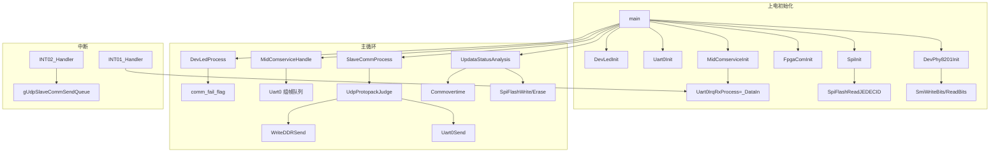

# driver/device 层源码超详细解析

> **说明**：本文基于仓库 `e:\FPGA_SoftCore` 真实源码及 Keil 编译产物（`output/*.lst`、`output/*.i`）整理。  
> 当前工作区中 `driver/uart.c`、`driver/uart.h`、`device/dev_spiflash.h` 在磁盘上缺失，但工程仍引用它们；下文 uart 与 dev_spiflash.h 宏定义来自编译列表文件，与 `.c` 实现一致。

---

## 目录

1. [总览与分层关系](#1-总览与分层关系)
2. [driver/uart — CMSDK UART0 驱动](#2-driveruart--cmsdk-uart0-驱动)
3. [driver/spi — FPGA SPI 控制器驱动](#3-driverspi--fpga-spi-控制器驱动)
4. [driver/mdio — 软件位操作 MDIO/SMI 驱动](#4-drivermdio--软件位操作-mdiosmi-驱动)
5. [driver/fpga_com — FPGA UDP 共享内存通信](#5-driverfpga_com--fpga-udp-共享内存通信)
6. [device/dev_led — 系统 LED 设备层](#6-devicedev_led--系统-led-设备层)
7. [device/dev_phy — RTL8201 PHY 设备层](#7-devicedev_phy--rtl8201-phy-设备层)
8. [device/dev_spiflash — SPI Flash 设备层](#8-devicedev_spiflash--spi-flash-设备层)
9. [device/dev_ddr — DDR 固件落盘与校验](#9-devicedev_ddr--ddr-固件落盘与校验)
10. [跨层调用关系图](#10-跨层调用关系图)

---

## 1. 总览与分层关系

```
┌─────────────────────────────────────────────────────────────┐
│  app: private_analysis / firmware_upgrate / comm_analysis   │
│  middleware: mid_comservice                                  │
└───────────────────────────┬─────────────────────────────────┘
                            │ 调用
┌───────────────────────────▼─────────────────────────────────┐
│  device: dev_led / dev_phy / dev_spiflash / dev_ddr         │
│  （设备语义：LED、PHY、Flash、DDR 固件区）                     │
└───────────────────────────┬─────────────────────────────────┘
                            │ 调用
┌───────────────────────────▼─────────────────────────────────┐
│  driver: uart / spi / mdio / fpga_com                        │
│  （寄存器/位带/共享内存等硬件抽象）                            │
└───────────────────────────┬─────────────────────────────────┘
                            │ MMIO
┌───────────────────────────▼─────────────────────────────────┐
│  FPGA 映射：0x4000xxxx GPIO/握手  0x4100xxxx CMSDK 外设      │
│             0x3000xxxx Cache 镜像  0x2000xxxx / 0x24xxxxxx DDR│
└─────────────────────────────────────────────────────────────┘
```

**main 初始化顺序**（`sys/main.c`）：

| 顺序 | 函数 | 层 |
|------|------|-----|
| 1 | `DevLedInit()` | device |
| 2 | `Uart0Init()` | driver |
| 3 | `MidComserviceInit()` → 注册 `Uart0IrqRxProcess` | middleware |
| 4 | `FpgaComInit()` | driver |
| 5 | `SpiInit()` → 内部读 JEDEC ID | driver + device |
| 6 | `DevPhy8201Init()` | device |

**主循环**：`DevLedProcess()`、`MidComserviceHandle()`、`SlaveCommProcess()`、`UpdataStatusAnalysis()`（内含 `Commovertime()`）。

---

## 2. driver/uart — CMSDK UART0 驱动

### 2.1 文件作用

| 文件 | 作用 |
|------|------|
| `driver/uart.h` | UART0 基址宏、时钟/波特率宏、API 声明、RX 中断回调函数指针 |
| `driver/uart.c` | UART0 初始化、阻塞发送、RX 中断服务、单字节读取 |

UART0 是 SoftCore 与 **BMS 主控** 的串口物理链路（115200 8N1），帧格式由 `mid_comservice` 解析（帧头 `0x5A` / 应答 `0xA5`）。

### 2.2 寄存器/地址映射

**UART0 基址**：`0x41001000`（`CMSDK_APB_BASE + 0x4000`）

| 偏移 | 寄存器 | 访问 | 说明 |
|------|--------|------|------|
| `+0x00` | `DATA` | R/W | 发送/接收数据，低 8 位有效 |
| `+0x04` | `STATE` | R | bit0 `TXBF`：1=发送缓冲满；bit1 `RXBF`：1=接收缓冲满 |
| `+0x08` | `CTRL` | R/W | 使能与中断使能 |
| `+0x0C` | `INTSTATUS` / `INTCLEAR` | R / W | 读状态 / 写 1 清中断 |
| `+0x10` | `BAUDDIV` | R/W | 波特率分频：`BAUD = MCLK / BAUDDIV` |

**宏定义**（`uart.h`）：

| 宏 | 值 | 含义 |
|----|-----|------|
| `MCLK` | `50*1000*1000` (50 MHz) | UART 模块时钟 |
| `UART_BUAD` | `115200` | 目标波特率（拼写保留源码） |
| `UART0` | `(CMSDK_UART_TypeDef*)0x41001000` | 控制器指针 |

**BAUDDIV 计算**：`50000000 / 115200 ≈ 434`（`0x1B2`）。

**CTRL = 0x0B 位域**：

| Bit | 名称 | 值 | 含义 |
|-----|------|-----|------|
| 0 | TXEN | 1 | 发送使能 |
| 1 | RXEN | 1 | 接收使能 |
| 2 | TXIRQEN | 0 | 关闭 TX 中断 |
| 3 | RXIRQEN | 1 | **开启 RX 中断** |

**中断**：使能 `INT01_IRQn`（CMSDK 命名表为 UART0 TX，本工程实际在 `INT01_Handler` 中处理 **RX 中断位**）。

**CMSDK_UART_TypeDef**（CMSDK 标准 + uart 使用）：

```c
typedef struct {
    __IO  uint32_t DATA;      // +0x00
    __IO  uint32_t STATE;     // +0x04
    __IO  uint32_t CTRL;      // +0x08
    union {
        __I  uint32_t INTSTATUS;
        __O  uint32_t INTCLEAR;
    };                        // +0x0C
    __IO  uint32_t BAUDDIV;   // +0x10
} CMSDK_UART_TypeDef;
```

### 2.3 全局变量

| 符号 | 类型 | 说明 |
|------|------|------|
| `Uart0IrqRxProcess` | `void (*Uart0IrqRxProcess)()` | RX 中断回调；`MidComserviceInit()` 赋值为 `_DataIn` |

### 2.4 函数逐步逻辑

#### `Uart0SendByte(char dat)`

1. **忙等**：`while (UART0->STATE & 1)` — 等待 TX 缓冲非满（TXBF=0）。
2. **写数据**：`UART0->DATA = dat`。
3. **时序**：纯轮询，无中断；每字节阻塞直到硬件可接受。

#### `Uart0Init(void)`

1. `UART0->BAUDDIV = MCLK / UART_BUAD` → 115200 bps。
2. `UART0->CTRL = 0x0B` → 开 TX/RX + RX 中断。
3. `NVIC_EnableIRQ(INT01_IRQn)` → 允许 NVIC 向量 1。

**副作用**：UART 硬件开始工作；若线路有数据且回调已注册，将触发 RX 中断链。

#### `Uart0Send(uint8_t *data, uint16_t len)`

循环 `len` 次调用 `Uart0SendByte(data[i])` — 整帧阻塞发送。

#### `Uart0DataGet(void)`

直接 `return UART0->DATA` — 通常在中断上下文读取 RX 字节。

#### `INT01_Handler(void)` — RX 中断服务

```
FPGA/CPU 收到 UART RX 字节
        │
        ▼
INT01_Handler 入口
        │
        ├─ INTSTATUS bit1 (RXIRQ) == 0 ? ──? 直接返回
        │
        ├─ while (!(STATE & 2))  等待 RXBF=1（接收缓冲有数据）
        │
        ├─ INTCLEAR = 2           清除 RX 中断
        │
        └─ Uart0IrqRxProcess()    调用 middleware 注册的 _DataIn
```

**与上层关系**：`_DataIn()` 内 `Uart0DataGet()` 取 1 字节 → `mid_comservice_data_in()` 写入环形缓冲 → `MidComserviceHandle()` 组帧后入队 `gstSciRevQueue`。

### 2.5 上层调用关系

| 调用者 | 接口 | 用途 |
|--------|------|------|
| `main.c` | `Uart0Init()` | 启动初始化 |
| `mid_comservice.c` | `Uart0IrqRxProcess = _DataIn` | 注册 RX 回调 |
| `mid_comservice.c` | `Uart0DataGet()` | 中断内读字节 |
| `private_analysis.c` | `Uart0Send()` | BMS 读写、Modbus 请求 |
| `firmware_upgrate.c` | `Uart0Send()` | BMS 固件升级 Start/Busy/End |

### 2.6 代码片段

```c
#define MCLK            (50*1000*1000)
#define UART_BUAD       (115200)
#define UART0           ((CMSDK_UART_TypeDef*)0x41001000)

void Uart0Init(void) {
    UART0->BAUDDIV = MCLK / UART_BUAD;  // ≈434
    UART0->CTRL    = 0x0B;              // TXEN|RXEN|RXIRQEN
    NVIC_EnableIRQ(INT01_IRQn);
}
```

---

## 3. driver/spi — FPGA SPI 控制器驱动

### 3.1 文件作用

| 文件 | 作用 |
|------|------|
| `driver/spi.h` | SPI 寄存器结构体、`CMSDK_SPI` 基址、收发 API |
| `driver/spi.c` | SPI 初始化、单字节/缓冲发送、接收 |

本 SPI **不是** 裸 GPIO 位带，而是 FPGA 内的 **CMSDK SPI 外设 IP**，由 `dev_spiflash` 通过片选宏控制 Flash/FPGA 从设备。

### 3.2 寄存器/地址映射

**SPI 基址**：`0x41002000`

| 偏移 | 字段 | 访问 | 说明 |
|------|------|------|------|
| `+0x00` | `reg_spi_mode` | W | SPI 模式（CPOL/CPHA 等编码） |
| `+0x04` | `reg_freq_coe` | W | 时钟分频系数 |
| `+0x08` | `reg_cs` | W | 片选：`0`=选中，`1`=释放 |
| `+0x0C` | `reg_txd` | W | 写发送 FIFO/移位寄存器 |
| `+0x10` | `reg_rxd` | R | 读接收数据 |
| `+0x14` | `write_tx_ready` | R | `1`=可写下一发送字节 |

```c
#define SPI  ((CMSDK_SPI_TypeDef*)0x41002000)
```

### 3.3 结构体 `CMSDK_SPI_TypeDef`

| 成员 | 说明 |
|------|------|
| `reg_spi_mode` | 初始化写 `3` → **SPI Mode 3**（CPOL=1, CPHA=1） |
| `reg_freq_coe` | 初始化写 `1` → 最小分频 |
| `reg_cs` | 片选，由 dev_spiflash 宏 `_SpiFlashSelect/UnSelect` 控制 |
| `reg_txd` | 发送数据 |
| `reg_rxd` | 接收数据（全双工时与发送同步） |
| `write_tx_ready` | 发送就绪标志；驱动中 `(write_tx_ready - 1)` 为 0 时继续等待 |

### 3.4 函数逐步逻辑

#### `SpiSendByte(uint8_t dat)`

1. `SPI->reg_txd = dat`
2. `while ((SPI->write_tx_ready - 1))` — 等待 `write_tx_ready == 1`
3. 无中断，纯轮询

#### `SpiInit(void)`

1. `SPI->reg_cs = 0x01` — 默认释放片选（Flash 未选中）
2. `SPI->reg_freq_coe = 1`
3. `SPI->reg_spi_mode = 3` — Mode 3
4. **`SpiFlashReadJEDECID(&gDevSpiFlash)`** — 探测 Flash 容量（副作用！）

**初始化副作用**：SPI 总线上完成对 Flash 的 JEDEC ID 读取；填充全局 `gDevSpiFlash.n_capacity_MB`，后续 3/4 字节地址命令分支依赖此值。

#### `SpiSend` / `SpiRead`

循环调用 `SpiSendByte` / `SPIDataGet()`，无 DMA、无中断。

#### `SPIDataGet(void)`

`return SPI->reg_rxd` — 读最近接收字节。

### 3.5 上层调用关系

| 调用者 | 接口 |
|--------|------|
| `main.c` | `SpiInit()` |
| `dev_spiflash.c` | `SpiSend`, `SpiRead`, `SpiSendByte`（间接） |
| `spi.c` | `SpiFlashReadJEDECID`（Init 内） |

### 3.6 代码片段

```c
void SpiSendByte(uint8_t dat) {
    SPI->reg_txd = dat;
    while ((SPI->write_tx_ready - 1));  // 等到 ready==1
}

void SpiInit(void) {
    SPI->reg_cs = 0x01;
    SPI->reg_freq_coe = 1;
    SPI->reg_spi_mode = 3;
    SpiFlashReadJEDECID(&gDevSpiFlash);
}
```

---

## 4. driver/mdio — 软件位操作 MDIO/SMI 驱动

### 4.1 文件作用

| 文件 | 作用 |
|------|------|
| `driver/mdio.h` | SMI/MDIO 位操作 API（头文件 guard 名为 `__GPIO_H_`，历史命名） |
| `driver/mdio.c` | 通过 FPGA GPIO 映射寄存器 **软件模拟** IEEE 802.3 Clause 22 MDIO 时序 |

无专用 MDIO 硬件控制器；`dev_phy` 在其上实现 RTL8201 寄存器读写。

### 4.2 寄存器/地址映射（FPGA GPIO 位带）

| 地址 | 宏/函数 | 写值 | 说明 |
|------|---------|------|------|
| `0x40000020` | `SmiRstLow/High` | 0 / 1 | PHY 硬件复位脚（低有效，低保持 ≥10ms） |
| `0x40000024` | `_MdcLow/High` | 0 / 1 | MDIO 时钟 MDC |
| `0x40000028` | `_MdioLow/High/Get` | 0 / 1 / 读 | MDIO 数据/双向 |
| `0x4000002C` | `MdioSet2Input/Output` | 0 / 1 | 方向：0=输入，1=输出（读 PHY 时可切换，当前读路径中注释掉） |

### 4.3 函数逐步逻辑

#### `_SmiDelay(void)`

空循环递减 `TimeIsOver=20` — **软件延时**，决定 MDC 半周期宽度；无精确 μs 保证，依赖 CPU 主频。

#### `_MdcLow/High`、`_MdioLow/High`、`_MdioInputGet`

直接 MMIO 写/读 `0x40000024` / `0x40000028`。

#### `SmiWriteBits(uint8_t *tx_data, uint16_t tx_bit_size)`

**时序（每位）**：

```
for i in 0..tx_bit_size-1:
    取 tx_data[i/8] 的第 (7 - i%8) 位
    MDC = 0
    MDIO = bit
    _SmiDelay()
    MDC = 1
    _SmiDelay()
最后 MDIO = 1（空闲拉高）
```

MSB 先发，符合 MDIO 帧内位序。

#### `SmiReadBits(uint8_t *rx_data, uint16_t rx_bit_size)`

**时序**：

```
value = 0
for i in 0..rx_bit_size-1:
    value <<= 1
    MDC = 1 → delay → MDC = 0 → delay
    if MDIO==1: value |= 1
rx_data[0] = value & 0xFF
rx_data[1] = (value >> 8) & 0xFF   // 支持最多 16bit
```

#### `SmiSendTa(void)` — Turnaround 检测（读操作）

Clause 22 读帧后 PHY 驱动 MDIO；主机采样 TA 位应为 **0**：

1. 两个 MDC 脉冲后读 MDIO
2. 若不为 0，再试一组 MDC 脉冲
3. 仍为非 0 则返回 `false`（读失败）

#### `SmiIdleState(void)`

MDIO 拉高 → MDC 高 → delay → MDC 低 — 回到 IDLE（MDIO 上拉）。

#### `SmiRstLow/High`、`MdioSet2Input/Output`

PHY 复位与方向控制；`MdioSet2Input` 注释“可不用”。

### 4.4 中断关系

**无中断**；全部同步位带，在 `DevPhy8201Init` 或配置过程中 **阻塞 CPU**。

### 4.5 上层调用关系

| 调用者 | 接口 |
|--------|------|
| `dev_phy.c` | `SmiWriteBits`, `SmiReadBits`, `SmiSendTa`, `SmiIdleState`, `SmiRstLow/High` |

### 4.6 代码片段

```c
void SmiWriteBits(uint8_t *tx_data, uint16_t tx_bit_size) {
    for (i = 0; i < tx_bit_size; i++) {
        writeData = tx_data[i / 8];
        _MdcLow();
        (writeData >> (7 - i % 8) & 1) ? _MdioHigh() : _MdioLow();
        _SmiDelay();
        _MdcHigh();
        _SmiDelay();
    }
    _MdioHigh();
}
```

---

## 5. driver/fpga_com — FPGA UDP 共享内存通信

### 5.1 文件作用

| 文件 | 作用 |
|------|------|
| `driver/fpga_com.h` | UDP 请求/响应共享区地址、握手寄存器、数据结构 |
| `driver/fpga_com.c` | ETH/UDP 中断处理、通信初始化、**通信超时看门狗** |

FPGA 将以太网 UDP  payload 写入 SoftCore 可读的 **Cache 区**；SoftCore 通过 `INT02_Handler` 取包并送入 `gUdpSlaveCommSendQueue`，由 `SlaveCommProcess` → `UdpProtopackJudge` 解析。

> 源文件头注释仍写 `uart.c`，实为 **FPGA 侧 UDP 通信驱动**，与 UART0 无关。

### 5.2 寄存器/地址映射

**共享内存（RX 请求头）**：

| 符号 | 地址 | 说明 |
|------|------|------|
| `CACHE_UDPDATA_RX` | `0x30000000` | UDP 请求区（结构体映射） |
| `CACHE_UDPDATA_TX` | `0x30001000` | UDP 响应区（发送时写入） |
| `WEWE` | `0x30020100` | 扩展镜像区（头文件定义，本 .c 未用） |

**握手/控制寄存器**：

| 符号 | 地址 | 说明 |
|------|------|------|
| `LEN` | `0x40000010` | UDP 长度（本 .c 未直接使用） |
| `READY` | `0x40000014` | 就绪握手；Init 写 0 |
| `EthIrqClr` | `0x40000018` | 写 1 清除以太网/UDP 中断 |

### 5.3 结构体 `CACHE_UDPDATA_TypeDef`（`#pragma pack(1)`）

| 字段 | 类型 | 说明 |
|------|------|------|
| `device_type` | `uint16_t` | 设备类型；`0x0001`~`0x0005` 才处理 |
| `reserved` | `uint8_t` | 寄存器宽度编码：0→1 寄存器，1→2，2→3，3→4（16bit 为单位） |
| `op_cmd` | `uint8_t` | 操作码 |
| `addr` | `uint32_t` | 目标地址 |
| `len` | `uint16_t` | 寄存器个数（不含头） |

**payload 总字节**：`(len * reg_num) + 10`，其中 `10 = sizeof(头)`。

### 5.4 全局变量

| 变量 | 说明 |
|------|------|
| `fpga_count` | 中断计数（调试/统计） |
| `comm_overtime_flag` | 1=本周期未收到中断；0=收到过 |
| `comm_fail_flag` | 通信失败标志；**dev_led** 闪烁加速 |
| `comm_overtime_count` | 连续超时周期计数 |
| `comm_timeout` | 上次成功通信时间戳 |
| `shutdown[5]` | `{0x08}` 写入 BMS 寄存器触发关机 |
| `count` | 中断总计数 |

### 5.5 函数逐步逻辑

#### `INT02_Handler(void)` — **INT02_IRQn**

```
Eth 收到 UDP 并写入 CACHE_UDPDATA_RX
        │
        ▼
INT02_Handler
        │
        ├─ EthIrqClr = 1                    清中断
        ├─ comm_overtime_flag = 0           标记本周期有通信
        ├─ count++
        │
        ├─ device_type ∈ {1,2,3,4,5} ?
        │      ├─ 根据 reserved 算 reg_num (1~4)
        │      ├─ data_size = len*reg_num + 10
        │      ├─ data_size > COM_RX_SIZE(1100) → return
        │      ├─ memcpy → gUdpPara[index].pData
        │      ├─ QueuePut(gUdpSlaveCommSendQueue, &gUdpPara[index])
        │      └─ index = (index+1) % SCI_REV_QUEUE_DEPTH(2)
        └─ 结束
```

**中断关系**：唯一入口为 **INT02**；与 UART INT01 独立。

#### `FpgaComInit(void)`

1. `READY = 0`
2. `EthIrqClr = 0x01` — 清 pending 中断
3. `NVIC_EnableIRQ(INT02_IRQn)`

#### `Commovertime(void)` — 由 `UpdataStatusAnalysis()` 周期调用

**逻辑**：

1. 若 `comm_overtime_flag==1`：`comm_overtime_count++`
2. 否则：清 `comm_fail_flag`，重置 count，记录 `comm_timeout = TimGetSystime()`
3. **每周期末尾** `comm_overtime_flag = 1`（等待下次中断清零）
4. 若 `comm_overtime_count > 10` 且距上次成功 **>100000**（systick 单位）：`comm_fail_flag = 1`
5. 若 count>10 且 **>120000**：`comm_fail_flag = 1`，并 `BMSWriteDataSeed(0x300100EC, 2, shutdown)` — 写 BMS 镜像寄存器 **关机**

### 5.6 上层调用关系

| 调用者 | 接口 |
|--------|------|
| `main.c` | `FpgaComInit()` |
| `firmware_upgrate.c` | `Commovertime()` |
| `dev_led.c` | 读 `comm_fail_flag`（经 include 链） |
| `private_analysis.c` | 消费 `gUdpSlaveCommSendQueue` |

### 5.7 代码片段

```c
#define CACHE_UDPDATA_RX  ((CACHE_UDPDATA_TypeDef*)0x30000000)
#define EthIrqClr         (*(volatile int*)0x40000018)

void INT02_Handler(void) {
    EthIrqClr = 1;
    comm_overtime_flag = 0;
    // ... device_type 过滤 → memcpy → QueuePut
}

void FpgaComInit(void) {
    READY = 0;
    EthIrqClr = 0x01;
    NVIC_EnableIRQ(INT02_IRQn);
}
```

---

## 6. device/dev_led — 系统 LED 设备层

### 6.1 文件作用

| 文件 | 作用 |
|------|------|
| `device/dev_led.h` | LED 源、硬件模式、状态枚举与 `LedInfo_t` |
| `device/dev_led.c` | GPIO LED 驱动、闪烁状态机、通信失败快闪 |

### 6.2 寄存器/地址映射

| 符号 | 地址 | 说明 |
|------|------|------|
| `LED_IO` | `0x40000000` | 写 0/1 控制 LED 物理电平 |

### 6.3 枚举与结构体

**`EN_LED_SRC`**

| 值 | 含义 |
|----|------|
| `LED_SRC_SYS` | 系统 LED（当前唯一实例） |
| `LED_SRC_NUM` | 数组长度 |

**`EN_LED_HW_MODE`**

| 值 | 含义 |
|----|------|
| `LED_HW_GPIO` | GPIO 直接驱动（当前使用） |
| `LED_HW_PWM` | PWM（代码注释掉，未实现） |

**`EN_LED_HW_ACTIVE_LEVEL`**

| 值 | 含义 |
|----|------|
| `LED_HW_ACTIVE_HIGH` | 高电平点亮 |
| `LED_HW_ACTIVE_LOW` | **低电平点亮**（Init 选用） |

**`EN_LED_STATUS`**

| 值 | 含义 |
|----|------|
| `LED_STATUS_IDLE/OFF/ON/BLINK/BREATHING/SOS` | 状态机；当前仅 **BLINK** 分支在 `DevLedProcess` 实现 |

**`LedInfo_t`**

| 字段 | 说明 |
|------|------|
| `led_src` | 源 ID |
| `led_hw_mode` | GPIO/PWM |
| `led_active_level` | 有效电平 |
| `led_status` | 当前状态 |
| `led_status_period` | 闪烁周期（ms 级，与 `TimGetSystime` 配合） |
| `led_brightness` | 0~100（PWM 用，未用） |
| `tim_ch` | PWM 通道（未用） |

### 6.4 内部函数

#### `_LedOFF` / `_LedON`

- GPIO 模式：根据 `led_active_level` 写 `LED_IO` 0 或 1。
- PWM 分支为空。

#### `_LedBlink(index, first_flag)`

| 阶段 | 行为 |
|------|------|
| `comm_fail_flag==1` | 周期强制 **100**（快闪告警） |
| `first_flag==1` | 重置计时，`led_flag=0`，先 `_LedOFF` |
| 半周期 | 点亮 |
| 全周期 | 熄灭，重置 `timecount` |

#### `DevLedInit` / `DevLedInitSuccess`

相同：GPIO、BLINK、周期 **1000ms**、低有效。

#### `DevLedInitFailure`

BLINK 周期 **5000ms**（慢闪表示 PHY 等初始化失败）。

#### `DevLedProcess`

遍历 `LED_SRC_NUM`；仅当状态为 `LED_STATUS_BLINK` 时驱动 `_LedBlink`；用 `pre_status[]` 检测进入 BLINK 时初始化计时。

#### `LedCtlOn/Off/Blink`

设置 `_gstLedInfo[src].led_status` 与周期。

#### `LedBlinkTime`

硬编码 index 0/1 周期为 10000（第二路 LED 未在 `LED_SRC_NUM` 中启用，属遗留）。

### 6.5 初始化副作用

`DevLedInit()` 仅填 `_gstLedInfo[]` **软件状态**，不写 `LED_IO`；首次 `DevLedProcess` 才拉脚。

### 6.6 上层调用

| 调用者 | 接口 |
|--------|------|
| `main.c` | `DevLedInit`, `DevLedProcess` |
| `dev_phy.c` | `DevLedInitFailure()` PHY 配置失败时 |

### 6.7 代码片段

```c
#define LED_IO  (*(volatile int*)0x40000000)

static void _LedON(EN_LED_SRC index) {
    if (_gstLedInfo[index].led_active_level == LED_HW_ACTIVE_LOW)
        LED_IO = 0;  // 低有效
    else
        LED_IO = 1;
}
```

---

## 7. device/dev_phy — RTL8201 PHY 设备层

### 7.1 文件作用

| 文件 | 作用 |
|------|------|
| `device/dev_phy.h` | `DevPhy8201Init`, `ConfigRtl8201` 声明 |
| `device/dev_phy.c` | RTL8201 复位、MDIO 帧封装、100M 全双工 RMII 配置、LED 页寄存器 |

### 7.2 PHY 地址与 MDIO 帧

- 初始化尝试 PHY 地址 **`0x00`** 和 **`0x01`**（各最多 3 次重试）。
- 内部 `_SmiReadReg` / `_SmiSetReg` 实现 **Clause 22** 帧：
  - 32bit 前导 `1`
  - ST `01`
  - OP：读 `10`，写 `01`
  - 5bit PHY 地址 + 5bit 寄存器地址
  - 读：TA + 16bit 数据；写：TA `10` + 16bit 数据

### 7.3 函数逐步逻辑

#### `DevPhy8201Init(void)`

```
SmiRstLow() → DelayMs(100) → SmiRstHigh() → SoftDelayms(100)
    │
    ├─ ConfigRtl8201(0x00) ×最多3次 ─失败→ DevLedInitFailure(), return false
    └─ ConfigRtl8201(0x01) ×最多3次 ─失败→ DevLedInitFailure(), return false
return true
```

#### `ConfigRtl8201(phy_addr)`

| 步骤 | 寄存器 | 写入值 | 含义 |
|------|--------|--------|------|
| 1 | Reg0 | `0xA100` | 软件复位 |
| 2 | — | DelayMs(100) | 等待复位 |
| 3 | Reg0 | `0x2100` | 100M 全双工，关自协商 |
| 4 | Reg31 | `7` | 换页 |
| 5 | Reg16 | `0x1FFE` | RMII 模式 |
| 6 | Reg31 | `0` | 默认页 |
| 7 | — | `_ConfigRtl8201Led` | LED 引脚功能 |
| 8 | — | DelayMs(20) | |
| 9 | 回读 Reg0 | 期望 `0x2100` | 失败 return false |

#### `_ConfigRtl8201Led(phy_addr)`

- 页 7：Reg17=`0x0038`；Reg19 `|= 0x0008`；页 0。

#### `_SmiReadReg` / `_SmiSetReg`

见第 4 节 MDIO 时序；读失败 TA 时返回 `0xFFFF`。

### 7.4 中断关系

无；阻塞延时 + 位带 MDIO。

### 7.5 上层调用

| 调用者 | 接口 |
|--------|------|
| `main.c` | `DevPhy8201Init()` |

### 7.6 代码片段

```c
bool ConfigRtl8201(uint8_t phy_addr) {
    _SmiSetReg(phy_addr, 0, 0xA100);  // reset
    DelayMs(100);
    _SmiSetReg(phy_addr, 0, 0x2100);  // 100M FD
    _SmiSetReg(phy_addr, 31, 7);
    _SmiSetReg(phy_addr, 16, 0x1FFE); // RMII
    _SmiSetReg(phy_addr, 31, 0);
    _ConfigRtl8201Led(phy_addr);
    return (_SmiReadReg(phy_addr, 0) == 0x2100);
}
```

---

## 8. device/dev_spiflash — SPI Flash 设备层

### 8.1 文件作用

| 文件 | 作用 |
|------|------|
| `device/dev_spiflash.h` | Flash 命令字、`DevSpiFlash_t`、读写擦 API |
| `device/dev_spiflash.c` | W25Q 类 SPI NOR 操作、JEDEC 容量识别、FPGA SPI 从机读写 |

依赖 `driver/spi` 收发；片选由本文件宏控制 **同一 SPI 总线** 上的 Flash。

### 8.2 本地宏（dev_spiflash.c）

| 宏 | 值 | 说明 |
|----|-----|------|
| `_SpiFlashSelect/UnSelect` | `reg_cs=0/1` | Flash 片选 |
| `_SpiFpgaSelect/UnSelect` | 同左 | FPGA SPI 从机（与 Flash 共用 cs） |
| `FLASH_PAGE_SIZE` | 256 | 页编程上限 |
| `FLASH_ERASE_SECTOR_SIZE` | `0x1000` (4KB) | 扇区 |
| `FLASH_ERASE_BLOCK_SIZE` | `0x10000` (64KB) | 块 |

### 8.3 Flash 命令字（dev_spiflash.h）

| 宏 | 值 | 说明 |
|----|-----|------|
| `FLASH_LOW_READ` | `0x03` | 3 字节地址读 |
| `FLASH_LOW_READ_4BYTE` | `0x13` | 4 字节地址读 |
| `FLASH_HIGH_READ` | `0x0B` | 快速读 + dummy |
| `FLASH_HIGH_READ_4BYTE` | `0x0C` | 4 字节快速读 |
| `FLASH_PAGE_PROGRAM` | `0x02` | 页编程 |
| `FLASH_PAGE_PROGRAM_4BYTE` | `0x12` | 4 字节页编程 |
| `FLASH_SECTOR_ERASE` | `0x20` | 4KB 擦除 |
| `FLASH_SECTOR_ERASE_4BYTE` | `0x21` | 4 字节地址扇区擦 |
| `FLASH_BLOCK_ERASE_32K` | `0x52` | 32KB 块擦 |
| `FLASH_BLOCK_ERASE_64K` | `0xD8` | 64KB 块擦 |
| `FLASH_BLOCK_ERASE_64K_4BYTE` | `0xDC` | 4 字节 64K 擦 |
| `FLASH_CHIP_ERASE` | `0xC7` | 全片擦 |
| `FLASH_READ_STATUS_REG` | `0x05` | 读 SR |
| `FLASH_WRITE_ENABLE` | `0x06` | WEL |
| `FLASH_JEDEC_ID` | `0x9F` | JEDEC ID |
| `DUMMY_BYTE` | `0xFF` | 空读 |

**容量分支**：`gDevSpiFlash.n_capacity_MB >= 32` 时使用 **4 字节地址** 命令集。

### 8.4 结构体 `DevSpiFlash_t`

| 字段 | 说明 |
|------|------|
| `arr_id[4]` | JEDEC：Manufacturer, MemoryType, Capacity |
| `n_capacity_MB` | 由 `arr_id[2]` 推断的容量 MB |

**JEDEC 容量字节映射**（`arr_id[2]`）：

| 值 | 容量 |
|----|------|
| 0x14 | 1 MB |
| 0x15 | 2 MB |
| 0x16 | 4 MB |
| 0x17 | 8 MB |
| 0x18 | 16 MB |
| 0x19 | 32 MB |
| 0x20/0x1A/0x3A | 64 MB |
| 其他 | 默认 8 MB |
| `arr_id[0]==0` | 容量 0（未检测到） |

### 8.5 内部函数

#### `_SpiFlashWriteEnable`

片选 → 发 `0x06` → 取消片选。

#### `_SpiFlashReadStatusReg`

循环：发 `0x05` + dummy，读 SR，直到 **bit0 BUSY=0** 或 timeout=`0xFFFF`。

#### `_SpiFlashWrite24bitAddr` / `_SpiFlashWrite32bitAddr`

高字节先发。

### 8.6 主要 API 时序

#### `SpiFlashReadData(start, p, len)`

```
Select → CMD(03/13) → Addr(3/4) → 发 len 个 0xFF → SpiRead(p,len) → UnSelect
```

#### `SpiFlashPageProgram`

```
WriteEnable → Select → CMD(02/12) → Addr → SpiSend(data,len) → UnSelect → WaitBusy
```

#### `SpiFlashEraseSector/Block/Chip`

均：WriteEnable → Select → CMD → Addr（Chip 无地址）→ UnSelect → WaitBusy。

#### `SpiFlashWriteBytesWithoutErasenoAligned`

按 **页边界** 拆分：首 partial 页 → 中间整页 → 尾 partial 页。

#### `SpiFlashWriteBytesWithErase`

`SpiFlashAutoEraseSectors` + `SpiFlashWriteBytesWithoutErasenoAligned`。

#### `SpiFlashAutoEraseSectors`

若起始非扇区对齐或跨扇区，则 **向上对齐到下一扇区边界** 擦除 **一个** 4KB 扇区（简化策略，非整段擦除）。

#### `SpiWriteFpga` / `SpiReadFpga`

| 操作 | 命令 | 地址 | 数据 |
|------|------|------|------|
| 写 | `0x45` | 16bit 大端 | payload + `0x00` 尾字节 |
| 读 | `0x43` | 16bit 大端 | dummy `0x00` + SpiRead |

用于 SoftCore 经 SPI 访问 FPGA 内部寄存器窗口（与 Doc 中 UDP SPI 读写码一致）。

#### `SpiFlashReadJEDECID`

Select → `0x9F` → 3 字节 dummy 发 → 读 3 字节 ID → UnSelect → 解析容量。

### 8.7 全局变量

`DevSpiFlash_t gDevSpiFlash` — `SpiInit` 时填充。

### 8.8 上层调用

| 模块 | 接口 |
|------|------|
| `firmware_upgrate.c` | `SpiFlashWriteBytesWithErase`, `SpiFlashEraseBlock64K`, `SpiFlashReadAllData` |
| `modbus_analysis.c` (DCDCRegInit) | `SpiFlashReadAllData` |
| `spi.c` | `SpiFlashReadJEDECID` |
| `ut_test_mode.c` | 可能 `WriteDDRSend` 并行测试 |

### 8.9 代码片段

```c
void SpiFlashReadData(uint32_t start_addr, uint8_t *p, uint32_t len) {
    _SpiFlashSelect();
    if (gDevSpiFlash.n_capacity_MB >= 32) {
        tx_cmd = FLASH_LOW_READ_4BYTE;  // 0x13
        SpiSend(&tx_cmd, 1);
        _SpiFlashWrite32bitAddr(start_addr);
    } else { /* 0x03 + 24bit addr */ }
    tx_cmd = 0xFF;
    SpiSend(&tx_cmd, len);
    SpiRead(p, len);
    _SpiFlashUnSelect();
}
```

---

## 9. device/dev_ddr — DDR 固件落盘与校验

### 9.1 文件作用

| 文件 | 作用 |
|------|------|
| `device/dev_ddr.h` | DDR MMIO 结构、固件区地址、`WriteDDRSend` |
| `device/dev_ddr.c` | UDP 写 DDR 固件包时的 **memcpy 落盘 + 分包校验状态机** |

### 9.2 地址映射

| 符号 | 地址 | 说明 |
|------|------|------|
| `DDR` | `0x20000000` | CMSDK DDR 访问端口（结构体数组） |
| `FPGA_DDR_FIRMWARE_ADDR` | `0x24000000` | FPGA 固件在 DDR 中的逻辑地址 |
| `BMS_DDR_FIRMWARE_ADDR` | `0x24400000` | BMS 固件在 DDR 中的逻辑地址 |
| `bms_ddr_temp[256]` | `0x00007070` | 固定 RAM 缓冲（读首包头） |
| `fpga_ddr_temp[256]` | `0x00007170` | 同上 |
| `arr_buff[1050]` | BSS | 写 DDR 前对齐/拷贝缓冲 |

**索引换算**（`CMSDK_DDR_TypeDef` 为 16 字节/单元）：

```c
start_addr = (start_addr - 0x20000000) / sizeof(CMSDK_DDR_TypeDef);
fpga_start_addr = (0x24000000 - 0x20000000) / 16 = 0x00400000;
bms_start_addr  = (0x24400000 - 0x20000000) / 16 = 0x00440000;
```

**`CMSDK_DDR_TypeDef`**：4×`uint32_t`（DATA1~4），仅作 **128 字节对齐 memcpy 单元** 使用，字段名不具独立语义。

### 9.3 结构体 `DDR_Firmware_Info_t`

| 字段 | 说明 |
|------|------|
| `ddr_bms_check_sum_com` | BMS 包累计计算校验和 |
| `ddr_bms_check_sum_rece` | 首包头中携带的期望校验和 |
| `ddr_bms_pack_count` | 已收 BMS 包计数 |
| `ddr_bms_firmware_success` | 成功标志 |
| `ddr_bms_len` | 固件总长度（首包解析） |
| `ddr_fpga_*` | FPGA 固件对称字段 |

### 9.4 `WriteDDRSend(start_addr, p, len)` 逐步逻辑

1. **地址转索引**：`(start_addr - 0x20000000) / 16`
2. **4 字节对齐拷贝**到 `arr_buff`（`len` 非 4 倍数则向上取整）
3. **128 字节对齐** `memcpy` 到 `&DDR[start_addr]`
4. **FPGA 固件区**（`start_addr >= fpga_start_addr && < bms_start_addr`）：
   - 非首包：累加 `CheckSumFun(arr_buff, len, 1)`
   - **首包**（`== fpga_start_addr`）：清零计数；校验和从 **偏移 256** 起算；从 `FPGA_DDR_FIRMWARE_ADDR` 拷 256B 到 `fpga_ddr_temp`；解析 offset 252 校验和、offset 7 长度
   - `ddr_fpga_pack_count++`
5. **BMS 固件区**（`>= bms_start_addr && < 0x00450000`）：对称逻辑，首包不跳过前 256 校验累加（BMS 从 0 累加）

### 9.5 中断关系

无；由 `UdpProtopackJudge` 在任务上下文调用（UDP 写 DDR 命令 `0x45` 等）。

### 9.6 上层调用

| 调用者 | 场景 |
|--------|------|
| `private_analysis.c` `UdpProtopackJudge` | 以太网 UDP 写固件到 DDR |
| `ut_test_mode.c` | 测试写 DDR |

### 9.7 未实现声明

`dev_ddr.h` 声明 `DDRSendByte(char dat)`，**dev_ddr.c 中无实现**（链接若未使用则无影响）。

### 9.8 代码片段

```c
#define DDR  ((CMSDK_DDR_TypeDef*)0x20000000)

void WriteDDRSend(uint32_t start_addr, uint8_t *p, uint32_t len) {
    start_addr = (start_addr - 0x20000000) / sizeof(CMSDK_DDR_TypeDef);
    memcpy(arr_buff, p, (len % 4) ? ((len/4)+1)*4 : len);
    memcpy((uint8_t*)&DDR[start_addr], arr_buff,
           (len % 128) ? ((len/128)+1)*128 : len);
    // ... FPGA/BMS 首包检测与 gDDRFirmwareInfo 更新
}
```

---

## 10. 跨层调用关系图



### 10.1 数据通路摘要

| 通路 | 物理层 | 协议/设备层 | 应用 |
|------|--------|-------------|------|
| BMS 串口 | uart | mid_comservice | ReadBMSReg, 升级, Modbus |
| 以太网 UDP | fpga_com | private_analysis | 寄存器镜像、DDR 固件 |
| SPI Flash | spi + dev_spiflash | firmware_upgrate | FPGA 固件落 Flash |
| PHY 链路 | mdio + dev_phy | — | 100M RMII |
| 状态指示 | dev_led | fpga_com 超时 | 通信失败快闪 |

### 10.2 关键全局状态

| 变量 | 定义位置 | 消费者 |
|------|----------|--------|
| `gDevSpiFlash` | dev_spiflash.c | 地址模式、升级 |
| `gDDRFirmwareInfo` | dev_ddr.c | firmware_upgrate 校验 |
| `comm_fail_flag` | fpga_com.c | dev_led 快闪 |
| `Uart0IrqRxProcess` | uart.c | mid_comservice |

---

## 附录 A：文件清单与仓库状态

| 路径 | 工作区 | 说明 |
|------|--------|------|
| `driver/uart.c`, `uart.h` | 缺失 | 工程/编译产物存在 |
| `device/dev_spiflash.h` | 缺失 | 宏定义见 `output/dev_spiflash.lst` |
| 其余 driver/device `.c/.h` | 存在 | 本文直接解析 |

---

## 附录 B：SPI 寄存器绝对地址速查

| 绝对地址 | 字段 |
|----------|------|
| `0x41002000` | reg_spi_mode |
| `0x41002004` | reg_freq_coe |
| `0x41002008` | reg_cs |
| `0x4100200C` | reg_txd |
| `0x41002010` | reg_rxd |
| `0x41002014` | write_tx_ready |

---

## 附录 C：UART0 寄存器绝对地址速查

| 绝对地址 | 寄存器 |
|----------|--------|
| `0x41001000` | DATA |
| `0x41001004` | STATE |
| `0x41001008` | CTRL |
| `0x4100100C` | INTSTATUS/INTCLEAR |
| `0x41001010` | BAUDDIV |

---

*文档生成依据：driver/*.c/h、device/*.c/h、output/uart.lst、output/dev_spiflash.lst、output/*.map、Software/Doc/04_memory_map_constants.md。*
