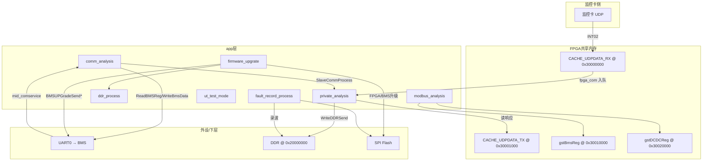

# app 层源码超详细解析

> **说明**：本文基于仓库 `e:\FPGA_SoftCore\app\` 下真实源码编写。  
> **异常**：`ddr_process.c` 当前工作区缺失（仅有 `ddr_process.h` 与编译产物 `output/ddr_process.o`），`DDRFirmwareAnalysis()` 依据预编译文件 `output/ddr_process.i` 还原。  
> **主循环调用关系**（`sys/main.c`）：

```text
while(1) {
    ut_test_process();
    DevLedProcess();
    MidComserviceHandle();      // UART 协议解析 → gstSciRevQueue
    SlaveCommProcess();       // comm_analysis.c
    UpdataStatusAnalysis();   // firmware_upgrate.c
    FPGARecordPorcess();      // fault_record_process.c
}
```

---

## 0. 总体架构与数据流



**app 层职责划分**：

| 模块 | 核心职责 |
|------|----------|
| `modbus_analysis` | BMS/DCDC 寄存器镜像结构定义、镜像区初始化 |
| `private_analysis` | 私有 UART 协议、UDP 协议解析、BMS/DCDC 读写、队列 |
| `comm_analysis` | 主从通信状态机调度（实际为 Slave 侧轮询） |
| `firmware_upgrate` | DDR→Flash/UART 固件升级全流程 |
| `ddr_process` | DDR 固件包校验（checksum + 魔数） |
| `fault_record_process` | DDR 环形录波区 → Flash 落盘 |
| `ut_test_mode` | DDR 读写自检（默认关闭） |

---

## 1. modbus_analysis.h / modbus_analysis.c

### 1.1 文件作用与系统位置

- **作用**：定义 Modbus 从机通信相关常量、BMS/DCDC 完整寄存器镜像结构体，并提供镜像 RAM 区指针宏；实现上电镜像初始化。
- **位置**：app 层**数据模型中心**。`gstBmsReg`、`gstDCDCReg` 被 FPGA 共享内存直接映射，监控卡经 UDP 读写这些地址即访问 BMS/DCDC 参数。
- **依赖**：`systick.h`、`crc.h`、`uart.h`、`queue.h`；`.c` 还依赖 `private_analysis.h`、`dev_spiflash.h`。
- **现状**：`.c` 中 Modbus 主机轮询状态机（`ModbusCommProcess` 等）**全部注释**，当前仅 `BmsRegInit()`、`DCDCRegInit()` 有效。

### 1.2 重要宏/常量

| 宏 | 数值 | 含义 |
|----|------|------|
| `CACHE_BMS_BASE` | `0x30010000UL` | BMS 镜像基址 |
| `CACHE_DCDC_BASE` | `0x30020000UL` | DCDC 镜像基址 |
| `gstBmsReg` | `(BMSPara_t*)0x30010000` | BMS 镜像指针 |
| `gstDCDCReg` | `(DCDCPara_t*)0x30020000` | DCDC 镜像指针 |
| `SLAVE_COMM_REV_MAX_TIME` | 300 ms | 从机响应超时（注释代码用） |
| `SLAVE_COMM_INTERVAL_TIME` | 150 ms | 通信间隔 |
| `SLAVE_COMM_POLLING_TIME` | 150 ms | 轮询周期 |
| `SLAVE_COMM_BMS_INTERVAL_TIME` | 150 ms | BMS 额外间隔 |
| `SLAVE_PCS_ADDR` | `0x01` | PCS 从机地址 |
| `SLAVE_DCDC_ADDR` | `0x02` | DCDC 从机地址 |
| `SLAVE_MPPT_ADDR` | `0x03` | MPPT 从机地址 |
| `SLAVE_BMS_ADDR` | `0x04` | BMS 从机地址 |
| `READ_INPUT_TYPE` | `0x04` | Modbus 读输入寄存器 |
| `READ_HOLD_TYPE` | `0x03` | Modbus 读保持寄存器 |

### 1.3 重要结构体/枚举

#### `EN_MODBUS_SLAVE_COMM_STATUS`
| 枚举值 | 含义 |
|--------|------|
| `EN_MODBUS_SLAVE_COMM_STATUS_OK` | 通信正常 |
| `EN_MODBUS_SLAVE_COMM_STATUS_NOACK` | 无应答 |
| `EN_MODBUS_SLAVE_COMM_STATUS_ACK_ERROR` | 应答错误 |
| `EN_MODBUS_SLAVE_COMM_STATUS_DISORDER` | 乱序应答 |

#### `ModbusRev03_t` / `ModbusRev10_t` / `ModbusRevError_t` / `ModbusRevData_t`
Modbus 应答解析中间结构（仅在注释代码中使用）：
- `ModbusRev03_t`：`data_num` 字节数 + `pRev` 数据指针
- `ModbusRev10_t`：`reg_start_addr`、`reg_num`
- `ModbusRevError_t`：`err_code`
- `ModbusRevData_t`：聚合从机地址、功能码及上述子结构

#### `EN_SLAVE_ERROR_CODE`
| 值 | 含义 |
|----|------|
| 0 | 无错误 |
| 1 | 非法功能码 |
| 2 | 非法寄存器地址 |
| 3 | 非法写数据 |
| 4 | 设备故障 |

#### `DCDCOnlyReadPara_t`（`#pragma pack(1)`，小端）
DCDC **只读区**镜像，起始偏移对应 Modbus 输入寄存器。主要字段：

| 字段 | 类型 | 说明 |
|------|------|------|
| `model_id` | uint16 | 型号 ID，偏移 0x0000 |
| `sn[20]` | char[20] | 序列号 |
| `hardware_version` | uint16 | 硬件版本 |
| `software_version_high/low` | uint16 | 软件版本高低字 |
| `version_extend[24]` | char[24] | 扩展版本字符串 |
| `dc_dc_model_sel` | uint16 | DCDC 型号选择 |
| `reserved0[5]` | uint16 | 预留；注释：bit3~0 表示 BOOT/APP1 |
| `dc_output_voltage/current/power` | uint16 | 直流输出电压/电流/功率 |
| `LLC1/LLC2_output_*` | uint16 | LLC 输出环路电压电流 |
| `buckboost1/2_output_*` | uint16 | BuckBoost 输出 |
| `fan1/2_speed` | uint16 | 风扇转速 |
| `dc_heatsink_temp1/2` | uint16 | 散热器温度 |
| `work_status` | uint16 | 工作状态 |
| `pcshardwareid` | uint16 | PCS 硬件 ID |
| `VoltageError/PowerError/OtherError` | uint16 | 错误字 |
| `PowerAlarm/OtherAlarm` | uint16 | 告警字 |
| `PowerNotice/OtherNotice` | uint16 | 通知字 |
| `recorden` | uint16 | **录波使能**（fault_record 模块读取） |
| `record_addr_high/low` | uint16 | **录波 DDR 起始地址** |
| `reserved8[29]` | uint16 | 预留 |

#### `DCDCHoldPara_t`（保持寄存器区，小端）
| 字段 | 说明 |
|------|------|
| `ip_address_high/low` | IP 地址高低 16 位 |
| `pcs_device_type` | PCS 设备类型 |
| `led_status_led_r_value` | LED R 值 |
| `led_g_value_b_value` | LED G/B 值 |
| `led_mode/led_period` | LED 模式/周期 |
| `softreboot` | 软重启：`0x50`→APP0，`0x51`→BOOT |
| `recorden_status` | 录波完成状态（fault_record 写回 1） |
| `Shutdown` | 关机控制 |
| `down_link_communication_enabled` | 下行通信使能 |
| `DCDC_OutputEn` | DCDC 输出使能 |
| `PackBalanceEn` | int16，均衡功能 |
| **`updata_status`** | **升级状态位图**（firmware_upgrate 核心控制字） |
| `error_clear` | 错误清除 |
| `FanForceEn` | 风扇强制使能 |
| `reserved1[9]`、`reserved2[80]` | 预留 |

#### `DCDCPara_t`
```c
typedef struct {
    DCDCOnlyReadPara_t dc_dc_only_read_para;
    DCDCHoldPara_t     dc_dc_hold_para;
} DCDCPara_t;
```

#### `BMSOnlyReadPara_t`（小端，约 280+ 字）
BMS 只读镜像，字段极多，按功能分组：

**基本信息**：`model_id`、`sn[20]`、软硬件版本、`version_extend[24]`、`packaddr`、`packworkstatus`

**Pack 电气量**：`pack_voltage`(0.1V)、`cell_current`(0.1A)、`current_power`(1W)、`soc_real/rpt`(0.1%)、`pack_health`(0.1%)

**容量/能量**：`cell_std_capa_ah`、`capacity_ah`、`pack_res_capa_ah`、`pack_cycles`、`charging/discharge_energy_high/low`(0.1Wh)

**状态**：`heat_status`、`mos_status`（bit0 放电 MOS、bit1 充电 MOS、bit2 预放电 MOS）

**单体电压/温度**：`cell_max/min/average_voltage`(mV)、`cell_max/min/ave_temp`(0.1℃)、MOS/ Pack 温度

**均衡/故障等级**：`balance_status_high/low`、`fltLevel`

**保护阈值**：pack/cell 过压欠压/过温/欠温/过流等多级阈值字段

**数组**：`cell_vdc[16]`(mV)、`cell_temp[16]`(0.1℃)

**错误/告警/通知字**：`mos/temp/curr/volt/sox/other_error`、`mos/temp/curr/volt/sox/other_alarm`、`mos/temp/curr/volt/sox/other_notice`

#### `BMSHoldPara_t`（小端）
| 字段 | 说明 |
|------|------|
| `heat_ctl` | 加热控制 |
| `dsg/chg/pre_mos_ctl` | 放电/充电/预放电 MOS 控制 |
| `limit_curr_ctl` | 限流控制 |
| `sys_upgrade_state` | 系统升级状态 |
| `sys_reset` | 系统复位 |
| `reset_factory` | 恢复出厂（魔数 5A A5） |
| **`bms_shutdown`** | BMS 关机（Commovertime 写此寄存器） |
| `rtc_times_high/low` | RTC 时间 |
| `force_ocv` | 强制 OCV |
| `all_pack_volt_ave` | 全 Pack 平均电压 |
| `current_calibrat_value` | 电流校准值 |

#### `BMSPara_t`
```c
typedef struct {
    BMSOnlyReadPara_t bms_only_read_para;
    BMSHoldPara_t     bms_hold_para;
} BMSPara_t;
```

#### `EN_SLAVE_POLLING_STATUS`
Modbus 从机轮询状态（注释代码用）：IDLE → WAITING_REV → REV_OVERTIME/OK → INTERVAL_WAIT 等。

#### `SlaveBmsWrite_t` / `PrivateBmsWrite_t`
| 结构 | 字段 | 用途 |
|------|------|------|
| `SlaveBmsWrite_t` | data_type, slave_addr, reg_addr, reg_num, word_data[10], byte_data[10] | Modbus 写队列项（注释代码） |
| `PrivateBmsWrite_t` | reg_addr, reg_num, p | **私有协议写 BMS 队列项**（实际使用） |

### 1.4 对外函数

#### `void BmsRegInit(void)`
- **调用时机**：`main()` 初始化阶段，在 `SlaveCommInit()` 之后。
- **逻辑**：
  1. `memset(gstBmsReg, 0, sizeof(BMSPara_t))`
  2. `memset(&gSlaveBMSPara, 0, ...)`
  3. 循环 `i = 0 .. sizeof(BMSPara_t)-1`：按 **uint16 索引**写入递增值 `i`（调试/占位初始化）
- **注意**：上电后 BMS 镜像内容为 0,1,2,... 而非真实 BMS 数据，需等 `ReadBMSReg()` 轮询填充。

#### `void DCDCRegInit(void)`
- **调用时机**：`main()` 初始化。
- **逻辑**：
  1. 清零 `gstDCDCReg`、`gTempSlaveDCDCPara`
  2. **连续 3 次**从 Flash `FPGA_FIRMWARE_VERSION (0x00C00000)` 读 24 字节到 `extend_version[]`（注释：上电 Flash 不稳定）
  3. 拷贝到 `gTempSlaveDCDCPara.dc_dc_only_read_para.version_extend`
  4. 将 `dc_dc_only_read_para` 整段 memcpy 到 `gstDCDCReg`
- **依赖**：`SpiFlashReadAllData()`、`FPGA_FIRMWARE_VERSION`

#### `void BmsModBusHostWrite10(...)` / `void ModbusCommProcess(void)`
- **状态**：整段注释，无有效实现。

### 1.5 关键全局变量

| 变量 | 类型 | 说明 |
|------|------|------|
| `gSlaveBMSPara` | `BMSPara_t` | UART 读回的 BMS 本地副本，UDP 读响应数据源 |
| `gTempSlaveDCDCPara` | `DCDCPara_t` | DCDC 本地工作副本 |
| `extend_version[24]` | `char[24]` | Flash 扩展版本缓存 |

### 1.6 数据流

```text
上电: DCDCRegInit → gstDCDCReg（含 Flash 版本）
轮询: ReadDCDCReg → memcpy gstDCDCReg → gTempSlaveDCDCPara
UART: ReadBMSReg 应答 → gSlaveBMSPara → gstBmsReg
UDP读: UdpProtopackJudge → 从 gSlaveBMSPara/gTempSlaveDCDCPara 组包 → CACHE_UDPDATA_TX
UDP写: UdpProtopackJudge → BMSWriteDataSeed/WriteDCDCData → 队列/UART/镜像
```

---

## 2. private_analysis.h / private_analysis.c

### 2.1 文件作用与系统位置

- **作用**：Nova 私有 UART 协议（0x5A 帧头）与监控卡 UDP 协议（device_type=0x0003）的**解析与组包核心**；管理 BMS 读写队列；桥接 DDR 固件写入。
- **位置**：app 层**协议枢纽**，被 `comm_analysis`、`firmware_upgrate`、`fpga_com`（中断入队）、`dev_ddr` 广泛引用。

### 2.2 重要宏/常量

| 宏 | 数值 | 含义 |
|----|------|------|
| `REV_QUEUE_DEPTH` | 2 | UDP 接收队列深度 |
| `COM_RX_SIZE` | 1100 | 单包最大接收字节 |
| `SLAVE_WRITE_QUEUE_DEPTH` | 2 | 写队列深度 |
| `BMS_CMD_UPGRATE_Start` | `0x80F0` | BMS 升级开始命令 |
| `BMS_CMD_UPGRATE_BUSY` | `0x80F1` | BMS 升级数据包命令 |
| `BMS_CMD_UPGRATE_END` | `0x80FF` | BMS 升级结束命令 |
| `READ_BMS_INFO_CMD` | `0x0001` | 读 BMS 信息 |
| `WRITE_BMS_INFO_CMD` | `0x8002` | 写 BMS 信息 |
| `READ_ALLBMS` | `0x45` | （宏定义，代码中 UDP 直接用 0x45） |

文件内 `.c` 还定义：
```c
#define BITCHECK(data,number) ((data >> number) & (0x01))
```

### 2.3 重要结构体/枚举

#### `EN_BMS_READ_WRITE_STATE`
| 值 | 含义 |
|----|------|
| `EN_READ_WRITE_BMS_INFO` | 轮询读 BMS |
| `EN_READ_DCDC_INFO` | 轮询读 DCDC（本地 memcpy） |
| `EN_READ_EVENT_NUM` | 状态数量（用于取模循环） |

#### `SlaveWrite_t`
| 字段 | 类型 | 说明 |
|------|------|------|
| slave_addr | uint8 | 从机地址 |
| reg_addr | uint16 | 寄存器地址 |
| reg_num | uint8 | 寄存器数量 |
| data[20] | uint16[20] | 写数据 |

#### `UdpRevData_t`
| 字段 | 说明 |
|------|------|
| device_type | 设备类型 |
| reserve | 保留/寄存器宽度编码 |
| opcmd | 操作码 0x43 读 / 0x45 写 |
| addr | 32 位地址 |
| length | 长度 |
| pData | 数据指针 |
| data_size | 数据字节数 |

#### `FpgaUdpRevData_t`
简化 UDP 载荷：`data_size` + `pData`。

#### `ComRevData_t` / `ComSendData_t`
UART 通信数据结构（`ComSendData_t` 含 `EN_COM_REV_DATA_TYPE`，当前仅 `COM_TYPE_UART_DATA`）。

### 2.4 对外函数（逐个）

#### `void SlaveCommInit(void)`
- **调用**：`main()` 初始化。
- **逻辑**：
  1. `QueueInit(&gBMSModebusRevQueue, 2, sizeof(SlaveWrite_t))` — Modbus 写队列（当前 Modbus 未启用）
  2. `QueueInit(&gBmsSendQueue, 2, sizeof(PrivateBmsWrite_t))` — 私有写 BMS 队列
  3. `QueueInit(&gUdpSlaveCommSendQueue, 2, sizeof(UdpRevData_t))` — UDP 命令队列
  4. 绑定 `gUdpPara[i].pData = RevData[i]`（每槽 1100 字节）

#### `uint32_t CheckSumFun(uint8_t *pdata, uint16_t len, uint8_t mode)`
- **入参**：`mode=1` → 32 位累加和；`mode=0` → 16 位累加和。
- **用途**：BMS 升级 Busy 包校验、DDR 固件 checksum 累计。

#### `void ReadBMSReg(void)`
- **调用**：`SlaveCommProcess()` 轮询阶段，且非升级中。
- **组包**（9 字节 UART 帧）：

```c
[0]=0x5A, [1]=0x00, [2]=0x03          // 帧头/地址
[3]=0x01, [4]=0x00                    // cmd = READ_BMS_INFO_CMD 小端
[5]=0x00, [6]=0x00                    // 数据域长度=0
[7..8] = CheckSum(前7字节) 小端
Uart0Send(_read_bms_data, 9);
```

#### `void ReadDCDCReg(void)`
- **逻辑**：计算 `DCDCPara_t` 4 字节对齐大小，`memcpy` `gstDCDCReg` → `gTempSlaveDCDCPara`。
- **注意**：DCDC 数据来自本地镜像，**不发 UART**。

#### `void WriteBmsData(uint32_t reg_start_addr, uint16_t data_len, uint8_t *pReg_value)`
- **地址变换**：`reg_start_addr = (reg_start_addr * 2) + 0x30010000`（输入为**字偏移**，非绝对地址）
- **组包**：0x5A 帧 + `WRITE_BMS_INFO_CMD(0x8002)` + 数据域（BMS序号0 + 16位地址 + 长度 + 数据）+ 16位校验和
- **发送**：`Uart0Send(garrWriteTxBuf, 12 + 2 + data_len)`

#### `void WriteDCDCData(uint32_t reg_start_addr, uint16_t data_len, uint8_t *pReg_value)`
- **地址**：`reg_start_addr + 0x30020000`
- **逻辑**：写入 `gTempSlaveDCDCPara.dc_dc_hold_para` 偏移处，再 memcpy 到 `gstDCDCReg->dc_dc_hold_para`（4 字节对齐处理）

#### `bool ProtoUnpackJudge(ComRevData_t *p)`
- **调用**：收到 UART 读响应后（`TYPE_COM_RRESPONSE_DATA`）。
- **逻辑**：
  1. 累加校验 `pBuf[0..len-3]`，与末尾 16 位比较
  2. 失败 → `false`
  3. 成功 → `_AckCmdAnalysis(&pBuf[3], len-5)`
- **`_AckCmdAnalysis` 分支**：
  - `READ_BMS_INFO_CMD(0x0001)` 且 `pBuf[2]==0`：拷贝 `pBuf[8]` 起 `sizeof(BMSPara_t)` 到 `gSlaveBMSPara`，再同步 `gstBmsReg`（4 字节对齐 memcpy）
  - `WRITE_BMS_INFO_CMD`：空处理
  - default：无操作

#### `bool UdpProtopackJudge(FpgaUdpRevData_t *p)`
- **调用**：`SlaveCommProcess()` 从 `gUdpSlaveCommSendQueue` 取包后。
- **UDP 包头布局**（小端）：
  - `[0..1]` device_type，必须为 `0x0003`
  - `[2]` reserved → 决定 `reg_len`（1/2/3/4 字节寄存器宽度，实际多用 1 和 2）
  - `[3]` opcmd：`0x43` 读 / `0x45` 写
  - `[4..7]` data_addr（32 位）
  - `[8..9]` 寄存器个数（**非字节数**）
  - `[10..]` 写数据

- **关键分支**：

| 条件 | 行为 |
|------|------|
| cmd=0x43, addr∈[0x30010000,0x300100FF] | 读 BMS：`TabLsbToMsb` → 从 `gSlaveBMSPara` 拷贝 → 写 `CACHE_UDPDATA_TX`，设 `LEN/READY` → `TabMsbToLsb` 还原 |
| cmd=0x43, addr∈[0x30020000,0x300200FF] | 读 DCDC：同上，数据源 `gTempSlaveDCDCPara.dc_dc_only_read_para` |
| cmd=0x43, addr∈[0x30030000,0x300CFFFF] | 读录波：`read_len` 必须 0x90；组帧头 `A5 5A FE 01` + Flash 数据 + 帧尾 `00 00 80 7F` |
| cmd=0x45, addr∈[0x30010000,0x30020000) | 写 BMS：`TabMsbToLsb` → `BMSWriteDataSeed` |
| cmd=0x45, addr∈[0x30020000,0x300200FF] | 写 DCDC：`WriteDCDCData` |
| cmd=0x45, addr∈[0x20000000,0x246FFFFF] | **固件写 DDR**：`WriteDDRSend` |

- **TX 触发**：
```c
LEN = payload_len;
READY = 1;
READY = 0;  // 脉冲触发 FPGA 发送
```

#### `bool BMSWriteDataSeed(uint32_t reg_start_addr, uint16_t len, uint8_t *data)`
- 填充 `gBmsPrivateWrite`，`QueuePut(&gBmsSendQueue, ...)`
- 队列满返回 `false`

#### `uint8_t RevBMSUpdataAnalysis(uint8_t *p, uint16_t size)`
- **注册**：`RegisterBMSUpdataFunPoint(RevBMSUpdataAnalysis)`（升级开始时）
- **解析**：`pReceBuf[4]==0x80` 时看 `pReceBuf[3]`：
  - `0xF0`/`0xF1`：`error_code=pReceBuf[5]`，0→`bms_ack=1`，非0→`bms_ack=2`
  - `0xFF`：同上设置 `bms_end_ack`
- **注意**：mid_comservice 传入 `p_data` 偏移与 `error_code` 位置需与组包格式一致。

#### 未实现声明
- `void testprocess(void)` — 仅有声明
- `WriteRestBmsData()` — `.c` 内函数，写寄存器 0x0172 复位 BMS，**无外部调用**

### 2.5 关键全局变量

| 变量 | 说明 |
|------|------|
| `garrBMSTxbuf[600]` | UDP 读 BMS 组包缓冲 |
| `garrDCDCTxbuf[600]` | UDP 读 DCDC 组包缓冲 |
| `gBmsModbusSlaveWrite` | Modbus 写结构（未活跃使用） |
| `gBmsPrivateWrite` | 当前私有写队列项 |
| `gUdpPara[2]` | UDP 队列槽 |
| `RevData[2][1100]` | UDP 数据缓冲 |
| `gBMSModebusRevQueue` | Modbus 接收队列 |
| `gBmsSendQueue` | BMS 私有写队列 |
| `gUdpSlaveCommSendQueue` | UDP 命令队列 |
| `gBmsModbusSlaveCommSendQueue` | 声明但未在本文件初始化 |
| `packcount1` | DCDC/录波读包计数（调试） |

### 2.6 数据流

```text
INT02(fpga_com) → memcpy CACHE_UDPDATA_RX → QueuePut(gUdpSlaveCommSendQueue)
SlaveCommProcess → UdpProtopackJudge → [镜像读写 | WriteDDRSend | Flash录波读]

gBmsSendQueue → WriteBmsData → Uart0Send → BMS
gstSciRevQueue → ProtoUnpackJudge → 更新 gSlaveBMSPara/gstBmsReg
```

---

## 3. comm_analysis.h / comm_analysis.c

### 3.1 文件作用与系统位置

- **作用**：**从机通信调度状态机** `SlaveCommProcess()`，协调 UDP 命令处理、BMS 主动写、周期轮询、UART 应答解析。
- **位置**：主循环核心调度之一。
- **注意**：头文件声明 `HostCommProcess()`、`CommBMSSend()`，**.c 中未实现**。

### 3.2 重要宏/常量

| 宏 | 数值 | 含义 |
|----|------|------|
| `HOST_COMM_REV_MAX_TIME` | 1000 ms | 等 BMS 响应超时 |
| `HOST_COMM_POLLING_TIME` | 300 ms | 轮询间隔 |
| `FPGA_COMM_POLLING_TIME` | 300 ms | （声明未使用） |

### 3.3 结构体/枚举

#### `SlaveErrorPara_t`
| 字段 | 说明 |
|------|------|
| bms_com_time_out | BMS 连续超时计数 |
| dcdc_com_time_out | DCDC 连续超时计数 |

#### `EN_HOST_POLLING_STATUS`
| 状态 | 含义 |
|------|------|
| `EN_HOST_POLLING_STATUS_IDLE` | 空闲：处理 UDP、发起写/轮询 |
| `EN_HOST_POLLING_STATUS_WAITING_BMS_REV` | 等待 BMS UART 响应 |
| `EN_HOST_POLLING_STATUS_WAITING_DCDC_REV` | （未实际进入） |
| `EN_HOST_POLLING_STATUS_REV_BMS_OVERTIME` | BMS 超时处理 |
| `EN_HOST_POLLING_STATUS_REV_DCDC_OVERTIME` | DCDC 超时处理 |
| `EN_HOSTE_POLLING_STATUS_REV_OK` | 收到有效响应 |
| `EN_HOST_POLLING_STATUS_REV_ERROR` | 错误 |

### 3.4 `void SlaveCommProcess(void)` 详细逻辑

**静态变量**：`timeout`、`host_polling_status`（初值 IDLE）、`read_write_state_type`（初值 `EN_READ_DCDC_INFO`）

**每轮入口**：
1. 若 `gUdpSlaveCommSendQueue` 非空 → `UdpProtopackJudge`

**状态机**：

#### IDLE
1. **丢弃** `gstSciRevQueue` 一包（防止堆积）
2. 若 `gBmsSendQueue` 有写请求 → `WriteBmsData()` → 转 `WAITING_BMS_REV`
3. 否则若距上次 `timeout` > 300ms：
   - `EN_READ_DCDC_INFO` → `ReadDCDCReg()`，保持 IDLE
   - `EN_READ_WRITE_BMS_INFO` → 若 **非 BMS 升级** 且 `updata_status bit0==0` → `ReadBMSReg()` → `WAITING_BMS_REV`
   - `read_write_state_type++`，`%= EN_READ_EVENT_NUM`（在 DCDC/BMS 间交替）

#### WAITING_BMS_REV
- 超时 > 1000ms → `REV_BMS_OVERTIME`
- 收到 `gstSciRevQueue`：
  - `TYPE_COM_RRESPONSE_DATA` / `TYPE_COM_WRESPONSE_DATA` → `REV_OK`
  - `TYPE_COM_R/WREQUEST_DATA` → 直接 return（不转状态）
  - `TYPE_MODBUS_DATA` → 注释掉的 ModbusCommProcess

#### REV_BMS_OVERTIME
- `bms_com_time_out++`
- **≥3 次**：清零 `gSlaveBMSPara` 全部、`memcpy` 到 `gstBmsReg`，重置 dcdc 超时计数，回 IDLE
- **<3 次**：回 WAITING_BMS_REV

#### REV_DCDC_OVERTIME
- dcdc 超时 ≥3 → 清零 DCDC 镜像副本

#### REV_OK
- 组装 `ComRevData_t` → `ProtoUnpackJudge()` → 回 IDLE

### 3.5 全局变量

| 变量 | 说明 |
|------|------|
| `gErrorSlavePara` | 超时计数器 |

### 3.6 数据流

```text
优先级: UDP队列 > BMS主动写 > 300ms轮询(DCDC memcpy / BMS UART读)
UART响应 → ProtoUnpackJudge → 更新镜像
超时3次 → 清空BMS镜像（监控卡读到零值）
```

---

## 4. firmware_upgrate.h / firmware_upgrate.c

### 4.1 文件作用与系统位置

- **作用**：**固件升级总控**——DDR 校验触发、FPGA 包写 Flash、BMS 包经 UART 下发、升级结果回写 `updata_status`、通信超时保护、软核复位。
- **位置**：主循环 `UpdataStatusAnalysis()` 每轮调用。

### 4.2 重要宏/常量

| 宏 | 数值 | 含义 |
|----|------|------|
| `UPGRADE_START/BUSY/END` | 0x80F0/0x80F1/0x80FF | 同 private_analysis BMS 升级命令 |
| `FPGA_FIRMWARE_ADDR` | 0x00261000 | FPGA 固件 Flash 起始 |
| `FPGA_FIRMWARE_VERSION` | 0x00C00000 | 扩展版本头 Flash 地址 |
| `UPGRADE_FLAG_ADDR` | 0x00BFF000 | 升级标志地址 |
| `UPGRADE_FLAG` | 0xA0 | 升级标志值 |
| `UPGRATE_DATA_SIZE` | 1024 | BMS 每包数据大小 |
| `DDR_UPGRATE_DATA_SIZE` | 1024 | FPGA 每块大小 |
| `UPGRATE_TIME_OUT` | 3000 | 声明但未在状态机中使用 |
| `ADDRESS/ADDRESS1/ADDRESS2` | 0x5380/0x5780/0x6000 | 固定 RAM 缓冲地址 |

**软复位寄存器**：`*(uint32_t*)0x40000030 = 1`

**IP 复位条件**（`UpdataStatusAnalysis`）：
- `192.168.11.1`（high=0xC0A8, low=0x010B）且 `updata_status bit4==1` → 首包复位
- IP 非 11.1 且 `bit1==1` → 非首包复位
- 写 BMS `BMSWriteDataSeed(0x300100EA, 2, rest)`，`rest[0]=1`
- 约 1s×10 次后 `SoftReboot()`

### 4.3 结构体/枚举

#### `EN_BMS_FIRMWARE_UPGRATE_STATUS`
BMS UART 升级状态机：IDLE → SEND_PREPARE → SEND_PREPARE_ACK → SEND_DATA_BUSY → WAIT_DATA_BUSY_ACK → SEND_END → WAIT_END_ACK → OK/ERROR

#### `EN_FIRMWARE_ANALYSIS_STATUS`
FPGA DDR→Flash 状态机：IDLE → START → BUSY → END

#### `BMSFirmwareUpgrateInfo_t`
| 字段 | 说明 |
|------|------|
| bms_upgrate_en | 升级使能 |
| bms_offset/bms_len/bms_checksum | BMS 固件元数据 |
| len/offset | 传输进度 |
| bms_seek | 已发送字节 |
| bms_ack / bms_end_ack | UART 应答：0 无/1 OK/2 错误 |
| upgrate_success/finsh/fail_flag | 结果标志 |
| bms_upgrating | 升级进行中标志（阻止 ReadBMSReg） |

#### `FPGAFirmwareUpgrateInfo_t`
结构类似，无 bms_upgrate_en，用 fpga_* 字段。

### 4.4 对外函数

#### `void UpdataStatusAnalysis(void)` — **主调度入口**
每轮顺序：
1. `DDRFirmwareAnalysis()` — DDR 校验
2. `Commovertime()` — 监控卡约 120s 无通信 → 写 BMS 关机
3. IP/复位位检测 → 可能触发软核复位
4. 按 `updata_status` 位组合启动 `FPGAFirmwareAnalysis()` / `BMSUpgrateFirmwareProcess()`

**启动条件表**：

| updata_status 位 | 条件 | 动作 |
|------------------|------|------|
| bit0+bit10+bit12 + ddr_fpga_success | FPGA 包就绪 | `FPGAFirmwareAnalysis()` |
| bit0+bit8+!bit10+bit12 + ddr_bms_success | 仅 BMS 包 | 设 bms_upgrate_en，启动 BMS 升级 |
| bit0+bit8+bit10+bit12 + ddr_bms_success | FPGA+BMS | BMS 升级（FPGA 完成后） |
| bit13/14 | 已完成 | `FirmwareUpgrate()` 早退 |

#### `void FPGAFirmwareAnalysis(void)`
**IDLE**：
- 读 DDR 首 256B → 解析 `fpga_len`（offset 7-10 减 256）、`fpga_checksum`（offset 252-255）
- 按 64KB 块擦除 Flash `0x00261000` 起

**START**（等 5ms）：
- 从 `FPGA_DDR_FIRMWARE_ADDR+256` 拷贝 1024B 到 `fpga_firmware_data_save`

**BUSY**（等 5ms）：
- `SpiFlashWriteBytesWithErase` 写入
- 累加 checksum（首块跳过前 256 字节）
- seek 完成 → END

**END**：
- checksum 匹配 → 写版本头到 `0x00C00000`，`upgrate_success_flag=1`，`bms_upgrate_en=1`
- 不匹配 → `upgrate_fail_flag=1`
- `upgrate_finsh_flag=1`

#### `void BMSUpgrateFirmwareProcess(void)`
**IDLE**：`bms_upgrate_en==1` 时从 `bms_ddr_temp[7..10]` 取长度，进入 PREPARE

**SEND_PREPARE**：
- `RegisterBMSUpdataFunPoint(RevBMSUpdataAnalysis)`
- `BMSUPGradeSendStart()` — 发总长度 + space_num=2

**SEND_PREPARE_ACK**：等 10ms 后检查 `bms_ack`

**SEND_DATA_BUSY**（间隔 5ms）：
- 末包可能 <1024B
- `BMSUPGradeSendBusy(size, offset+seek, pack_index)`

**WAIT_DATA_BUSY_ACK**（间隔 5ms）：
- ack=1 → seek+=size，继续或 END
- ack=2 → 重试 ≤3 次，否则 ERROR

**SEND_END / WAIT_END_ACK**：
- `BMSUPGradeSendEnd()`，等 `bms_end_ack`

**全程**：非 IDLE 时 `bms_upgrating=1`

#### 内部发送函数

**`BMSUPGradeSendStart()`**：14 字节帧，数据域含 4B 文件长度 + space_num=0x02

**`BMSUPGradeSendBusy(size, offset, index)`**：
- 从 `BMS_DDR_FIRMWARE_ADDR+offset` 拷数据
- 32 位累加和写入包尾 2 字节
- 维护 `check_sum_sum_sum`（首包跳过前 256B 数据）

**`BMSUPGradeSendEnd()`**：9 字节帧，无数据域

#### `void FirmwareUpgrate(void)`
根据 `updata_status` 位判断包类型，成功则 `updata_status |= 0x2000`，失败则 `|= 0x4000`，并清零 `gDDRFirmwareInfo` 对应 success 标志。

### 4.5 关键全局变量

| 变量 | 说明 |
|------|------|
| `gFPGAFirmwareUpgrateInfo` | FPGA 升级状态 |
| `gBMSFirmwareUpgrateInfo` | BMS 升级状态 |
| `fpga_firmware_data_save/load[1024]` | 固定地址 RAM 缓冲 |
| `upgrate_data[1050]` | UART 发送缓冲 |
| `pack_index_count/pack_count` | 包计数 |
| `softcorerestflag` | 软复位流程标志 |
| `check_sum_sum_sum` | BMS 传输 checksum 累计 |

### 4.6 数据流

```text
监控卡写DDR → WriteDDRSend累计checksum
UpdataStatusAnalysis → DDRFirmwareAnalysis(校验)
  → FPGAFirmwareAnalysis: DDR 0x24000000 → Flash 0x00261000
  → BMSUpgrateFirmwareProcess: DDR 0x24400000 → UART → BMS
  → FirmwareUpgrate: 回写 updata_status bit13/14
```

---

## 5. ddr_process.h / ddr_process.c（源文件缺失，据 .i 还原）

### 5.1 文件作用与系统位置

- **作用**：校验监控卡写入 DDR 的 **BMS/FPGA 固件包**完整性（checksum + 文件头魔数）。
- **位置**：被 `UpdataStatusAnalysis()` 每轮调用；是升级启动的**门禁**。
- **头文件**：仅声明 `DDRFirmwareAnalysis()`。

### 5.2 重要常量（.c 内）

```c
uint8_t gBMSFirmwareType[4]  = {0x0C, 0x0C, 0x0C, 0x03};  // BMS 魔数
uint8_t gFPGAFirmwareType[4] = {0x0C, 0x0C, 0x0C, 0x04};  // FPGA 魔数
```

### 5.3 `void DDRFirmwareAnalysis(void)` 逻辑

**BMS 分支**：
```c
if (ddr_bms_check_sum_com == ddr_bms_check_sum_rece
    && 两者 != 0
    && updata_status bit12 == 0) {
    if (memcmp(bms_ddr_temp, gBMSFirmwareType, 4) != 0)
        gBMSFirmwareUpgrateInfo.upgrate_fail_flag = 1;
    else
        gDDRFirmwareInfo.ddr_bms_firmware_success = 1;
}
else if (checksum 不等 && bit12 == 1) {
    ddr_bms_firmware_success = 0;
    upgrate_fail_flag = 1;
}
```

**FPGA 分支**：逻辑对称，使用 `fpga_ddr_temp` 与 `gFPGAFirmwareType`。

**依赖的全局数据**（由 `dev_ddr.c` 的 `WriteDDRSend` 维护）：
- `ddr_*_check_sum_com`：接收过程累计
- `ddr_*_check_sum_rece`：首包 offset 252-255 的期望 checksum
- `bms_ddr_temp/fpga_ddr_temp`：首包 256 字节缓存

### 5.4 数据流

```text
WriteDDRSend(首包@0x24000000/0x24400000) → 解析 len/checksum/缓存头256B
WriteDDRSend(后续包) → 累加 check_sum_com
DDRFirmwareAnalysis → 对比 + 魔数 → success/fail 标志
```

---

## 6. fault_record_process.h / fault_record_process.c

### 6.1 文件作用与系统位置

- **作用**：当 DCDC 请求录波时，从 DDR **环形缓冲区**读取固定总量数据，写入 SPI Flash，供监控卡后续 UDP 读回。
- **位置**：主循环 `FPGARecordPorcess()`。

### 6.2 重要宏/常量

| 宏 | 数值 | 含义 |
|----|------|------|
| `FAULT_RECORD_DATA_SIZE` | 1024 | 每块读取大小 |
| `FPGA_FAULTRECORD_ADDR` | 0x004C2000 | Flash 落盘起始 |
| `DDR_RING_START` | 0x21000000 | DDR 环起始 |
| `DDR_RING_END` | 0x2108FFFF | DDR 环结束 |
| `DDR_RING_SIZE` | 0x90000 (589824) | 环总字节数 |
| 录波总量 | `144 * 4096 = 589824` | 与环大小一致 |

### 6.3 结构体/枚举

#### `EN_FAULT_ANALYSIS_STATUS`
IDLE → START → BUSY → END（与 FPGA 升级状态机结构类似）

#### `FPGAFaultInfo_t`
字段命名沿用升级结构：`fpga_len=589824`、`fpga_seek` 进度、`fault_record_finsh/fail_flag` 等。

### 6.4 对外函数

#### `void FPGARecordPorcess(void)`
- 若 `recorden==0` → 强制 `recorden_status=0`
- 若 `recorden==1` 且 `recorden_status==0` → 调用 `FPGAFaultAnalysis()`

#### `void FPGAFaultAnalysis(void)`

**IDLE**：
- 起始 DDR 地址 = `0x20000000 + record_addr_low + (record_addr_high<<16)`
- **边界保护**：clamp 到 `[DDR_RING_START, DDR_RING_END]`
- 计算 `read_stop_addr = read_start_addr - 1`（环回绕）
- 擦除 Flash 64K 块（按总长度计算块数）
- `fpga_len = 144*4096`

**START**（等 5ms）：
- 计算到 stop 地址的剩余字节，**最多读 1024**
- `memcpy` from DDR → `fpga_faultrecord_data_save`

**BUSY**（等 5ms）：
- `SpiFlashWriteBytesWithErase`
- 地址 += size_per；DDR 地址超出 END 则卷回 START
- **停止条件**：`base_faultrecord_addr == read_start_addr`（绕环一圈）

**END**：
- `fault_record_finsh_flag=1`
- **`gstDCDCReg->dc_dc_hold_para.recorden_status = 1`**（通知监控卡可读）

### 6.5 全局变量

| 变量 | 说明 |
|------|------|
| `fpga_faultrecord_data_save[1024]` | 块缓冲 |
| `fault_record_index` | 块计数 |
| `gFPGAFaultInfo` | 录波状态 |

### 6.6 与 private_analysis 的衔接

监控卡读录波：`UdpProtopackJudge` 中 addr∈[0x30030000,0x300CFFFF]、len=0x90，从 Flash `0x004C2000 + (addr-0x30030000)` 读取。

---

## 7. ut_test_mode.h / ut_test_mode.c

### 7.1 文件作用与系统位置

- **作用**：DDR 读写通路 **单元测试**，默认关闭。
- **位置**：主循环最先调用（开销最小化时可忽略）。

### 7.2 对外函数

#### `void ut_test_process(void)`

**全局控制**：`ut_mode`（默认 0，不执行）

**当 ut_mode!=0**：
- 每 2000ms：
  1. `save_flg[i]=i`（0..15）
  2. `WriteDDRSend(0x20000000, save_flg, 16)` 写 DDR
  3. `memcpy(ut_buf1, (uint8_t*)0x20000000, 16)` 读回
  4. memcmp 比较代码**已注释**（原设计失败则 LedBlinkTime）

### 7.3 全局变量

| 变量 | 说明 |
|------|------|
| `ut_mode` | 测试开关 |
| `load_flg[4]` / `save_flg[16]` | 测试数据 |
| `ut_buf1[16]` | 读回缓冲 |
| `timediff` | 声明未使用 |

---

## 8. 跨模块关键数据流汇总

### 8.1 监控卡读 BMS 寄存器
```text
监控卡 UDP 0x43 @0x300100xx
→ INT02 → gUdpSlaveCommSendQueue
→ SlaveCommProcess → UdpProtopackJudge
→ 读 gSlaveBMSPara（需 ReadBMSReg 轮询保持新鲜）
→ CACHE_UDPDATA_TX + LEN/READY
```

### 8.2 监控卡下发固件
```text
UDP 0x45 @0x20000000~0x246FFFFF
→ WriteDDRSend (dev_ddr.c)
→ DDRFirmwareAnalysis (ddr_process)
→ UpdataStatusAnalysis 启动 FPGA/BMS 升级
```

### 8.3 BMS 固件 UART 升级
```text
BMSUpgrateFirmwareProcess
→ BMSUPGradeSendStart/Busy/End
→ Uart0Send
→ mid_comservice 识别 0x80F0/F1/FF
→ RevBMSUpdataAnalysis 更新 bms_ack
```

### 8.4 通信超时关机
```text
Commovertime (fpga_com.c)
→ 120s 无 INT02
→ BMSWriteDataSeed(0x300100EC, 2, {0x08})
→ gBmsSendQueue → WriteBmsData → BMS 关机寄存器
```

---

## 9. 已知问题与注意事项

1. **`ddr_process.c` 源文件缺失**：仅有编译产物，维护时需从版本库恢复或依据 `output/ddr_process.i` 重建。

2. **`modbus_analysis.c` Modbus 主机逻辑全部注释**：当前 BMS 数据仅通过**私有 UART 协议**获取，非标准 Modbus。

3. **`HostCommProcess` / `CommBMSSend` / `testprocess` 未实现**：链接时若被调用会报错。

4. **`WriteBmsData` 地址参数约定不一致**：函数内做 `reg*2+0x30010000` 变换，期望**字偏移**；部分调用点传入形如 `0x300100EA` 的值，语义上疑似绝对地址低 16 位，需结合硬件协议实测确认。

5. **`fault_record_process.h` 结构**：`#endif` 出现在 typedef 之前（第 21 行），属头文件组织缺陷，但 typedef 仍在编译单元内可见。

6. **BMS 超时清零**：连续 3 次读 BMS 失败会 zero 整个 BMS 镜像，监控卡将读到全零。

7. **升级与轮询互斥**：`bms_upgrating==1` 或 `updata_status bit0==1` 时跳过 `ReadBMSReg()`。

8. **`gSoftwareFirmwareType[4]`**：在 `firmware_upgrate.h` 声明 extern，**仓库内无定义**，可能为遗留符号；实际魔数校验使用 `ddr_process.c` 中的 `gBMSFirmwareType/gFPGAFirmwareType`。

---

## 10. 关键代码片段索引

**BMS 读请求组帧**（`private_analysis.c`）：
```c
_read_bms_data[0] = 0x5A;
_read_bms_data[3] = READ_BMS_INFO_CMD & 0xFF;  // 0x01
_read_bms_data[4] = (READ_BMS_INFO_CMD >> 8) & 0xFF;
check_sum = CheckSum(_read_bms_data, 7);
Uart0Send(_read_bms_data, 9);
```

**UDP 读 BMS 响应触发 TX**（`private_analysis.c`）：
```c
memcpy((uint8_t*)CACHE_UDPDATA_TX, garrBMSTxbuf, (((read_len + 10) / 4) + 1) * 4);
LEN = read_len + 10;
READY = 1;
READY = 0;
```

**SlaveCommProcess 轮询优先级**（`comm_analysis.c`）：
```c
if (QueueGet(&gBmsSendQueue, &pSlaveWrite)) {
    WriteBmsData(...);
} else if (TimDifftimeFromNow(timeout) > HOST_COMM_POLLING_TIME) {
    // 交替 ReadDCDCReg / ReadBMSReg
}
```

**DDR 固件魔数校验**（`ddr_process.c` 还原）：
```c
uint8_t gBMSFirmwareType[4]  = {0x0C, 0x0C, 0x0C, 0x03};
uint8_t gFPGAFirmwareType[4] = {0x0C, 0x0C, 0x0C, 0x04};
```

**升级成功回写**（`firmware_upgrate.c`）：
```c
gstDCDCReg->dc_dc_hold_para.updata_status |= 0x2000;  // 成功
// 或 |= 0x4000 失败
```

---

*文档生成依据：app/*.c、app/*.h、device/dev_ddr.c、driver/fpga_com.c、sys/main.c、output/ddr_process.i 及 Software/Doc 系列文档。*
