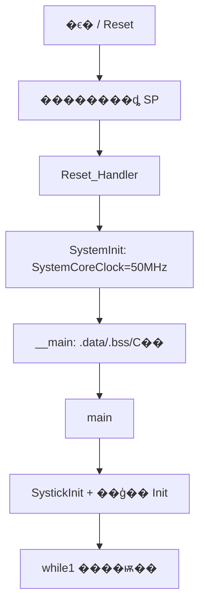
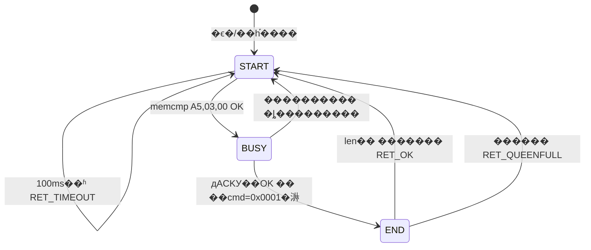

# sys/middleware ��Դ�볬��ϸ����

> ���ڲֿ� `e:\FPGA_SoftCore` ��ʵԴ�루`git HEAD` ������ִ��ļ�����  
> Ŀ�� MCU��**ARM Cortex-M0**��CMSDK_CM0����ϵͳʱ�� **50 MHz**��`system_CMSDK_CM0.c` �� `XTAL = 50000000`����

---

## Ŀ¼

1. [CMSIS ������� Reset �� main](#0-cmsis-�����-reset-��-main)
2. [sys/main.c / main.h](#1-sysmainc--mainh)
3. [sys/systick.c / systick.h](#2-syssystickc--systickh)
4. [sys/queue.c / queue.h](#3-sysqueuec--queueh)
5. [sys/crc.c / crc.h](#4-syscrc--crch)
6. [middleware/mid_comservice.c / mid_comservice.h](#5-middlewaremid_comservicec--mid_comserviceh)
7. [���������](#6-���������)

---

## 0. CMSIS ������� Reset �� main

### 0.1 �漰�ļ�

| �ļ� | ���� |
|------|------|
| `cmsis/Device/ARM/CMSDK_CM0/Source/ARM/startup_CMSDK_CM0.s` | �������Reset ��ڡ�Ĭ���ж�׮ |
| `cmsis/Device/ARM/CMSDK_CM0/Source/system_CMSDK_CM0.c` | `SystemInit()`��`SystemCoreClock` |
| Keil C �� `__main` | ��ʼ�� `.data`/`.bss`������ `main()` |

### 0.2 �ڴ沼�֣�startup ��ࣩ

```asm
Stack_Size  EQU  0x00000200   ; 512 �ֽ�ջ
Heap_Size   EQU  0x00000100   ; 256 �ֽڶѣ�QueueInit �� malloc �����˶ѣ�
```

- `__initial_sp`��ջ����������� 0 ��
- `__heap_base` / `__heap_limit`�������䣨MicroLib �� two-region ģʽ��

### 0.3 ���������ѡ��

| ���� | �������쳣 | ������ Handler |
|------|-----------|----------------|
| 0 | ��ʼ SP | `__initial_sp` |
| 1 | Reset | `Reset_Handler` |
| 15 | SysTick | `SysTick_Handler`��startup ��Ϊ WEAK ��׮��**�� `systick.c` ǿ���Ÿ���**�� |
| 16+ | INT00.. | UART/GPIO/Timer �ȣ�Ĭ�� `Default_Handler` ��ѭ�� |

UART0 RX ��Ӧ **INT01**��ע�ͣ�`UART 0 TX Handler` �� INT01��RX �� INT00������ startup ע��Ϊ׼����

### 0.4 Reset_Handler ������

```asm
Reset_Handler PROC
    IMPORT  SystemInit
    IMPORT  __main
    LDR     R0, =SystemInit
    MOV     R8, R0          ; �����ã����� X ̬
    MOV     R9, R8
    BLX     R0              ; �� ���� SystemInit()
    LDR     R0, =__main
    BX      R0              ; �� ��ת C �� __main
    ENDP
```

**�� `SystemInit()`**��`system_CMSDK_CM0.c`����

```c
void SystemInit(void)
{
    SystemCoreClock = XTAL;   // 50000000
}
```

������ȫ�ֱ�����**��**���� PLL/����ʱ�ӣ�FPGA ��˹̶� 50 MHz����

**�� `__main`**��Keil ����ʱ������˳��

1. ���� ROM �� RAM��`.data`��
2. ���� `.bss`
3. ��ʼ�� C ��
4. ���� **`main()`**

**�� Ӧ�� `main()`**��`sys/main.c`����ʼִ�С�

### 0.5 �����·ͼ



---

## 1. sys/main.c / main.h

### 1.1 �ļ�����

- **`main.c`**��Ӧ��Ψһ��ڣ�����**һ���Գ�ʼ��**��**Э��ʽ����ѭ��**���ȡ�
- **`main.h`**���ۺϸ���ͷ�ļ����� `main.c` �����ܰ�������ģ��ʹ�á�

### 1.2 main.h ������ϵ

```c
#include "systick.h"
#include "dev_led.h"
#include "uart.h"
#include "mid_comservice.h"      // middleware
#include "comm_analysis.h"     // app
#include "fpga_com.h"
#include "firmware_upgrate.h"
#include "dev_phy.h"
#include "ut_test_mode.h"
#include "spi.h"
#include "dev_spiflash.h"
#include "fault_record_process.h"
```

�޺ꡢ�޽ṹ�嶨�壬�� include ���ء�

### 1.3 main() ��ʼ���׶Σ��𲽣�

| ���� | ���� | ���� |
|------|------|------|
| 1 | `SystickInit()` | 1 ms SysTick��ȫ�ֺ����ʱ |
| 2 | `DevLedInit()` | LED GPIO |
| 3 | `Uart0Init()` | BMS ͨ�� UART0 @ 115200 |
| 4 | `MidComserviceInit()` | ͨ���м����RX ���塢SCI ���ն��С�UART �жϻص� |
| 5 | `SlaveCommInit()` | ��վͨ��״̬����UDP/BMS ���У�app �㣩 |
| 6 | `FpgaComInit()` | FPGA UDP �����ڴ�ͨ�� |
| 7 | `SpiInit()` | SPI |
| 8 | `DevPhy8201Init()` | PHY оƬ |
| 9 | `BmsRegInit()` | BMS �Ĵ������� |
| 10 | `DCDCRegInit()` | DCDC �Ĵ������� |

**˳��Ҫ��**�������� `SystickInit`��������ʱ���� `TimGetSystime`������ `Uart0Init` + `MidComserviceInit`��ע�� `Uart0IrqRxProcess`����Ȼ��������� UART/FPGA ��ҵ��

### 1.4 ��ѭ�� `while(1)` ���� Э��ʽ����

```c
while(1)
{
    ut_test_process();        // ��Ԫ���� / DDR д��
    DevLedProcess();          // LED ��˸
    MidComserviceHandle();    // �� UART �հ� + Э����� + �� gstSciRevQueue
    SlaveCommProcess();       // �� ���� gstSciRevQueue��BMS ��ѯ/д/UDP
    UpdataStatusAnalysis();   // ����״̬
    FPGARecordPorcess();      // ����¼��
}
```

**����ģ��**��

- **�� RTOS**������ռ��ÿ�� `*Process()` ������ٷ��ء�
- **�ж�ֻ�����**��UART RX ISR �� `mid_comservice_data_in()` д���λ��壻**Э���������ѭ��** `MidComserviceHandle()`��
- **������**��`MidComserviceHandle` ���� �� `gstSciRevQueue` �� `SlaveCommProcess` ���ѡ�
- **ʱ��Ƭ**����ģ���ڲ��� `TimGetSystime()` / `TimDifftimeFromNow()` ������������ BMS 300 ms ��ѯ����

**����ѭ���Ƽ����˳��**��

```
ut_test �� LED �� ���� UART ֡����� �� ���� BMS/UDP ҵ�� �� ���� �� ¼��
```

---

## 2. sys/systick.c / systick.h

### 2.1 �ļ�����

�ṩ **SysTick 1 ms ʱ��**��������ʱ������ʱ�������ֵ���㣨�������ȫ�������ڲۼ�⣨`TimSlotCheck`��ʵ���� `.c` ��δ�� `.h` ��������

### 2.2 �������ͣ�systick.h��

| ���� | ֵ/���� |
|------|---------|
| `SYS_TICK` | `(SysTick_Type*)0xE000E010`���� CMSIS `SysTick` �ȼۣ� |
| `__IO` | �� M0 ��ͨ��Ϊ `volatile` |

**API ����**��

```c
void SystickInit(void);
void DelayMs(__IO uint32_t nTime);
uint32_t TimGetSystime(void);
uint32_t TimDifftime(uint32_t time, uint32_t new_time);
void SoftDelayus(const uint32_t usec);
void SoftDelayms(uint32_t msec);
uint32_t TimDifftimeFromNow(uint32_t time);
```

### 2.3 ��̬������systick.c��

| ���� | ���� | ���� |
|------|------|------|
| `TimingDelay` | `volatile uint32_t` | `DelayMs()` ����ʱ��SysTick ÿ ms �� 1 |
| `SysTimingMs` | `volatile uint32_t` | ������������������**�����**��Լ 49.7 �죩 |

### 2.4 �������߼�

#### `SystickInit()`

1. `temp = SystemCoreClock / 1000` �� 50000000/1000 = **50000**��ÿ 1 ms ����ֵ��
2. `SysTick->LOAD = temp`
3. `SysTick->VAL = 0`
4. `SysTick->CTRL = CLKSOURCE | TICKINT | ENABLE`���ں�ʱ�ӡ����жϡ���������
5. `NVIC_EnableIRQ(SysTick_IRQn)`

**Ч��**��ÿ 1 ms ��һ�� `SysTick_Handler`��

#### `DelayMs(nTime)`

1. `TimingDelay = nTime`
2. �ٴ� `ENABLE` SysTick�����ౣ�գ�
3. `while(TimingDelay != 0)` �

**ע��**��ռ�� CPU�������� SysTick �ж� decrement��

#### `TimingDelay_Decrement()` / `_TimUpdateSystime()`

- �� `TimingDelay > 0` �� `--`
- `SysTimingMs++`

#### `SysTick_Handler()`

```c
void SysTick_Handler(void) { _TimUpdateSystime(); }
```

���� startup �е� weak Ĭ�� handler��

#### `TimGetSystime()`

���� `SysTimingMs`��32 λ�޷��ţ���

#### `TimDifftime(time, new_time)`

���� `new_time - time` �ĺ���**�������**��

- �� `new_time >= time`��`diff = new_time - time`
- ����`diff = new_time + (0xFFFFFFFF - time)`���������

#### `TimDifftimeFromNow(time)`

�ȼ��� `TimDifftime(time, SysTimingMs)`��

#### `TimSlotCheck(pUserTimeStamp, Expect_SlotMs)`���� .c�������

1. �� `TimDifftime(*pUserTimeStamp, SysTimingMs) >= Expect_SlotMs`
2. ���� `*pUserTimeStamp = SysTimingMs`������ `true`
3. ���򷵻� `false`

�����÷���ÿ N ms ִ��һ���߼���

#### `SoftDelayus(usec)` / `SoftDelayms(msec)`

- **�������ת**��ע��д���谴ʵ�� CPU У׼��`utime = 50 * usec / 5`��
- `SoftDelayms`��>1000 ms ʱ�ֶε��� `SoftDelayus(1000000)`

**�� `DelayMs` ����**�������� SysTick �������������Ȳ������ SysTick δ��ʱʹ�á�

---

## 3. sys/queue.c / queue.h

### 3.1 �ļ�����

**������λ���ζ���**��ÿ��Ԫ�ش�С�̶� `len_per_queue`����� `depth`��֧�ֶѷ�����ⲿ��̬���塣�� `mid_comservice`��`gstSciRevQueue`���� `comm_analysis`��UDP/BMS ���Ͷ��У�ʹ�á�

### 3.2 �ṹ�� `Queue_t`��queue.h��

```c
typedef struct _queue_stru_t
{
    void     *pData;          // �����ڴ棺depth * len_per_queue �ֽ�
    uint8_t  msg_in;          // ��һд������� [0, depth)
    uint8_t  msg_out;         // ��һ����������
    uint16_t len_per_queue;   // �����ֽ���
    uint16_t depth;           // ���
    uint16_t valid_num;       // ��ǰ��ЧԪ�ظ���
} Queue_t;
```

**���ι���**��`msg_in/msg_out` ���� `depth` ʱ `% depth` ���ơ�

### 3.3 �������߼�

#### `QueueInit(obj, queue_depth, queue_len)`

1. ���� in/out/valid��`depth`��`len_per_queue` ��ֵ
2. `pData = malloc(queue_len * queue_depth)`
3. ʧ�ܷ��� `false`���ɹ����� `true`

**����**��startup �Ѵ�С�� **256 �ֽ�**��`sizeof(SciRevData_t)` ��ϴ����ʧ�ܡ��������̶� SCI ���и����׵��Ǿ�̬����棨��ǰ mid_comservice ���� `QueueInit` + malloc����

#### `QueueInit_1(obj, buff, queue_depth, queue_len)`

������ͬ���� `pData = buff`��**�� malloc**�����ʺ�����̶��ڴ档

#### `QueueDeInit(obj)`

������������ `pData != NULL` �� `free(pData)`������ `QueueInit` ����ĺϷ�����

#### `QueueQuery(obj)` ���� ���������

- `pData == NULL` �� ���� **`true`**��ע�ͣ���Ϊ����/�����á���
- `valid_num >= depth` �� ���� **`true`**������
- ���򷵻� **`false`**��δ������д��

**����**��`true` = ������ Put������δ��ʼ������

#### `QueuePut(obj, p)`

1. `pData==NULL` �� `valid_num >= depth` �� `false`
2. `memcpy` ���� `msg_in * len_per_queue`
3. `msg_in = (msg_in + 1) % depth`��`valid_num++`
4. ���� `true`

**ֻ���� `len_per_queue` �ֽ�**��������ָ��ָ���������ݡ������ `SciRevData_t` �� `pData` ����ָ��**�־û�����**��mid_comservice �� `_garrRevData[i]`����

#### `QueueGet(obj, p)` ���� ����

1. ���� `false`
2. `*p = &pData[msg_out * len_per_queue]`��ָ��������ݣ�**�ǿ���**��
3. `msg_out++`��`valid_num--`
4. ���� `true`

#### `QueueRead(obj, p)` ���� ����

ͬ `QueueGet`����**��**�ƶ� `msg_out`/`valid_num`��ע�͵�Ĵ�����������ͼ�� peek����

#### `QueueClear(obj)`

������ͷ 1 ��Ԫ�أ�`msg_out++`��`valid_num--`�������������ݡ�

#### `QueueIsFull(obj)`

�� `QueueQuery` ���ƣ�`pData==NULL` �� `valid_num >= depth` �� `true`��

### 3.4 �ڱ������е��÷���mid_comservice��

```c
QueueInit(&gstSciRevQueue, SCI_REV_QUEUE_DEPTH, sizeof(SciRevData_t));  // ��� 2
// ...
QueuePut(&gstSciRevQueue, &garrSciData[rev_index]);  // ��� SciRevData_t �ṹ����
```

���Ѷˣ�`comm_analysis.c` �� `SlaveCommProcess`����

```c
QueueGet(&gstSciRevQueue, (void *)&p_rtu_cmd);
```

---

## 4. sys/crc.c / crc.h

### 4.1 �ļ�����

- **Modbus RTU CRC16**��������
- CRC У���װ
- ��С�� / uint8?uint16 ������ߣ����� Modbus ��Ĵ�������

**��Ҫ**��UART ˽��Э�飨0x5A/0xA5���õ��� **`CheckSum` �ֽ��ۼ�**���� `private_analysis.c`����**����**��ģ��� CRC��

### 4.2 ��̬���

- `_CrcHi[256]`��`_CrcLo[256]`����׼ **Modbus CRC16** ��/���ֽڱ�
- ����ʽ��0xA001�� reflected������ʼֵ 0xFFFF

### 4.3 `CrcModbus(p, len)`

**��**��

1. `ucCRCHi = 0xFF`, `ucCRCLo = 0xFF`
2. ��ÿ���ֽڣ�
   - `usIndex = ucCRCLo ^ *p++`
   - `ucCRCLo = ucCRCHi ^ _CrcHi[usIndex]`
   - `ucCRCHi = _CrcLo[usIndex]`
3. ���� `(ucCRCHi << 8) | ucCRCLo`��**���ֽ���ǰ**�� uint16 ��ֵ��

### 4.4 `CrcJudge(p, len)`

1. `act_crc = (p[len-1] << 8) | p[len-2]`��֡β **���ֽ���ǰ** ��� CRC��
2. `calc_crc = CrcModbus(p, len - 2)`
3. ��ȷ��� `true`

Modbus ֡���֣�`[addr][func][...][crc_lo][crc_hi]`��

### 4.5 ��������

| ���� | ���� |
|------|------|
| `BEBufToUint16(_pBuf)` | ��� 2 �ֽ� �� uint16 |
| `TabLsbToMsb(str, len)` | �ֽ�������β�Գƽ��������η�ת�� |
| `TabMsbToLsb(str, len)` | ͬ�ϣ��� NULL/len ��� |
| `MemcpyU16toU8SwapByte` | uint16 ���� �� uint8��**���ֽ���ǰ** |
| `MemcpyU16toU8` | uint16 �� uint8��**���ֽ���ǰ** |
| `MemcpyU8toU16` | ÿ 2 �ֽ�ƴ��һ�� uint16��С���� |

---

## 5. middleware/mid_comservice.c / mid_comservice.h

### 5.1 �ļ�����

**UART ͨ���м��**��IRQ ���ֽ� �� ����/���� RX ���� �� **˽��Э��״̬��** �� ����֡д�� **`gstSciRevQueue`**���� app �� `SlaveCommProcess()` ���ѡ�

ͬʱԤ�� DEBUG �˿ڡ�BMS ���� ACK �ص�ע�ᡣ

### 5.2 �궨�壨mid_comservice.c��

| �� | ֵ | ���� |
|----|-----|------|
| `COMSERVICE_BUFF_SIZE` | 550 | ���˿� RX/TX �������� |
| `MODBUS_ADDR` | 0x06 | Modbus ��վ��ַ��Modbus ��֧��ע�ͣ� |
| `RET_OK` | 0 | �����ɹ� |
| `RET_ERROR` | 1 | һ����� |
| `RET_TIMEOUT` | -1 | �հ���ʱ |
| `RET_QUEENFULL` | -2 | SCI ������ |
| `RET_VERIFY_ERROR` | -3 | У��ʧ�� |
| `RET_UNUSE_DATA` | 2 | ���ݲ��� |

### 5.3 ö����ṹ�壨mid_comservice.h��

#### �˿����� `en_comservice_index_t`

```c
EN_COMSERVICE_DEBUG_INDEX = 0,   // ���Կڣ�δ��ȫʵ�֣�
EN_COMSERVICE_COM_INDEX,         // BMS UART0
EN_COMSERVICE_INDEX_NUM,
```

#### Э��״̬�� `EN_PROTOCOL_STATE`

| ״̬ | ���� |
|------|------|
| `EN_PROTOCOL_STATE_RECIVR_DATA_START` | �ȴ�/ʶ��֡ͷ |
| `EN_PROTOCOL_STATE_FRAME_COLLECT_COM` | ��ע�͵������֡�ռ� |
| `EN_PROTOCOL_STATE_COM_DATA_BUSY` | ʶ����Ӧ���͡��㳤�� |
| `EN_PROTOCOL_STATE_COM_DATA_END` | ��������֡����� |
| `EN_PROTOCOL_STATE_MODBUS_DATA_BUSY` | ��ע�͵��Modbus |
| `EN_PROTOCOL_STATE_DATA_COLLECT_MOD` | ��ע�͵�� |
| `EN_PROTOCOL_STATE_RESPONSE` | ���� |
| `EN_PROTOCOL_TIMEOUT` | ���� |

**��ǰ��Ч·��**��`START �� COM_DATA_BUSY �� COM_DATA_END �� START`

#### `transmission_obj_t` ���� �˿��շ���������

```c
uint8_t  *p_buf;      // �����ַ
uint32_t  n_mem_len;  // ��������
uint32_t  n_w_cnt;    // дָ�루�����ֽ�����дƫ�ƣ�
uint32_t  n_r_cnt;    // ��ָ�루Э�����ѽ��ȣ�
```

COM ��ʵ��ʹ�ã�**���Ի���**��`n_w_cnt` = ��ǰ RX �ۼƳ��ȣ�����ʧ��ʱһ�������㡣

#### `CommPort_t`

�ۺ� `protocol_obj`��`rx_obj`��`tx_obj`��`dev_index` �ȣ���������Ҫ�� **COM ����** �� `rx_obj`��

#### `cmoservice_cfg_t` ���� per-port ֡��ʽ����

COM �����ã�`_garrComserviceCfg[EN_COMSERVICE_COM_INDEX]`����

| �ֶ� | ֵ | ���� |
|------|-----|------|
| `n_frame_delimiter` | 0x5A | ����֡ͷ�����Ͳࣩ |
| `n_frame_delimiter_ack` | 0xA5 | ��Ӧ֡ͷ |
| `c_frame_len` | 7 | ������Сͷ�� |
| `c_frame_len_rep` | 8 | ��Ӧ��Сͷ����д ACK�� |
| `c_check_start` | 2 | У����ʼƫ�ƣ�δֱ������ CheckSum ���ã� |
| `c_other_len` | 2 | � checksum ���� |

#### `SciRevData_t` ���� ���Ԫ��

```c
typedef struct {
    uint8_t           slave_addr;
    EN_UART_DATA_TYPE data_type;   // MODBUS / COM ����Ӧ / д��Ӧ��
    uint16_t          data_size;
    uint8_t           *pData;      // ָ�� _garrRevData[i]
} SciRevData_t;
```

#### Э����ṹ�壨�ĵ�/�����ο���

- `protocal_request_packet_t`��0x5A ���󣨷�������ã�
- `protocal_response_packet_t` / `ProtocalReadResponsePacket_t`��0xA5 ��Ӧ

### 5.4 ȫ��/��̬����

| ���� | ˵�� |
|------|------|
| `_garrComPort[2]` | ��· CommPort |
| `_garrRxBuff[550]` / `_garrTxBuff[550]` | COM �ڻ��� |
| `_garrReponsePackHead[]` | `{0xA5, 0x03, 0x00}` ��Ӧͷģ�� |
| `garrSciData[2]` | ���в۶�Ӧ�� SciRevData ������ |
| `_garrRevData[2][550]` | ʵ��֡�ֽڴ洢 |
| `gstSciRevQueue` | ���⵼������� 2 |
| `BMSUpataFun` | ���� ACK �ص�����ָ�� |

### 5.5 ˽��Э��У�� `CheckSum()`��ʵ���� app/private_analysis.c��

```c
uint16_t CheckSum(uint8_t *p, uint16_t size)
{
    uint16_t ret = 0;
    for (i = 0; i < size; i++)
        ret += p[i];
    return ret;   // 16 λ��Ȼ����ȼ��� & 0xFFFF
}
```

**mid_comservice �е��÷�**��д��Ӧ 8 �ֽڣ���

```c
CheckSum(p_data, 6) == (p_data[6] + ((uint16_t)p_data[7] << 8))
```

����ǰ 6 �ֽ��ۼӣ��� byte[6:7] С�� uint16 �Ƚϡ�

### 5.6 �������߼�

#### `RegisterBMSUpdataFunPoint(call_back_fun)`

���� `BMSUpataFun = call_back_fun`�����յ� `0x80F0/F1/FF` д ACK ʱ���á�

#### `MidComserviceInit()`

1. `memset` ��� `_garrComPort`
2. COM �ڣ�`rx_obj.p_buf = _garrRxBuff`��`n_mem_len = 550`��TX ͬ��
3. `QueueInit(&gstSciRevQueue, 2, sizeof(SciRevData_t))`
4. ѭ����`garrSciData[i].pData = _garrRevData[i]`
5. **`Uart0IrqRxProcess = &_DataIn`** ���� �� UART RX �жϻص�

#### `_DataIn()`��IRQ �����ģ�

1. `data = Uart0DataGet()`
2. `mid_comservice_data_in(EN_COMSERVICE_COM_INDEX, &data, 1)`

**ÿ�� 1 �ֽڵ���һ��**�����ж�Ƶ�ʣ�ע���ᵽ���Ѿֲ�������ȫ���Ա���ջ���⣩��

#### `mid_comservice_data_in(e_index, p_data, len)`

**���**��IRQ д�� `_garrComPort[e_index].rx_obj`����ѭ����ȡ������

**COM �ڷ�֧����·����**��

1. �����Ƿ�ʱ�� `nn_ret = RET_ERROR`��**ע��**��`nn_ret` ��ֵδ��ʽ�� 0���ɹ�·������Ĭ�� 0��
2. �� `p_buf == p_data`��ֱ�� `n_w_cnt = len`���㿽�� DMA ������
3. ������ `n_w_cnt + len < n_mem_len`��`memcpy` ׷�ӣ�`n_w_cnt += len`
4. ���� `RET_ERROR`����������

DEBUG ��֧��**�����۵�д��**��дָ���ƻأ���COM ��Ŀǰ**���ƻ�**��������

#### `MidComserviceHandle()`

������ `_MidComserviceComRx()`��SCIA �ָ��߼���ע�ͣ���

#### `_MidComserviceComRx()`

��ÿ���˿� `i`��

1. �� `n_w_cnt == n_r_cnt`������
2. ���� `n_len_first` / `n_len_second`��DEBUG �����ã�COM ʵ�ʴ� **`n_w_cnt` Ϊ len**��
3. COM �ڣ�`MidComserviceProtocolProcess(i, rx_buf, n_w_cnt)`
4. �����ֵ **`n_ret <= 0`**���ɹ�/��ʱ/У���/����������**���** `n_w_cnt`��`n_r_cnt`

**����**��һ֡���������ʧ���������� RX ���壬����ͬ����

---

### 5.7 Э��״̬�� `MidComserviceProtocolProcess()` ���� ����

**��̬״̬**��

- `_gProtocolState`����ǰ״̬
- `rev_index`���ֻ� `garrSciData[0/1]`
- `wait_flag` / `recv_times`��START ̬ 100 ms ��ʱ

**���**��`do { switch... n_loop--; } while(n_loop);` �������״̬������

#### ״̬ 1��`EN_PROTOCOL_STATE_RECIVR_DATA_START`

| ���� | ���� |
|------|------|
| 1 | �״ν��룺`wait_flag=1`��`recv_times=TimGetSystime()` |
| 2 | `len < 3` �� `n_ret = RET_UNUSE_DATA`�����ݲ����� |
| 3 | `memcmp(p_data, {A5,03,00}, 3)==0` �� ���� `COM_DATA_BUSY`��`n_loop++` ����һ�� |
| 4 | ���򱣳� START��Modbus ��֧��ע�ͣ� |
| 5 | �� `TimDifftimeFromNow(recv_times) > 100` �� `RET_TIMEOUT`���� `wait_flag` |
| 6 | �뿪 START ʱ�� `wait_flag`��`pake_len=0` |

**Ҫ��**�����뿴�� **`A5 03 00`** ����Ϊ BMS ��Ӧ��ʼ��

#### ״̬ 2��`EN_PROTOCOL_STATE_COM_DATA_BUSY`

ǰ�ã�`len >= c_frame_len_rep`����8��

**��֧ A ���� д��Ӧ��8 �ֽڹ̶���**

������ͬʱ���㣩��

- `cmd = p_data[3] | (p_data[4]<<8)` Ϊ `0x8002`��`0x80F0`��`0x80F1`��`0x80FF` ֮һ
- `CheckSum(p_data, 6) == (p_data[6] + (p_data[7]<<8))`

������

- `pake_len = 8`
- `data_type = TYPE_COM_WRESPONSE_DATA`
- �� `COM_DATA_END`

**��֧ B ���� ����Ӧ��cmd == 0x0001��**

1. `payload_len = p_data[6] + (p_data[7]<<8)`
2. `data_type = TYPE_COM_RRESPONSE_DATA`
3. `pake_len = 8 + payload_len + 2`��ͷ 8 + ���� + checksum 2��
4. �� `COM_DATA_END`��`n_loop++`

#### ״̬ 3��`EN_PROTOCOL_STATE_COM_DATA_END`

1. �ȴ� `len >= pake_len`
2. �� `QueueIsFull` �� `RET_QUEENFULL`
3. **8 �ֽ�д ACK**��
   - �� cmd Ϊ `0x80F0/F1/FF` �� `BMSUpataFun != NULL` �� ֱ�ӻص� `BMSUpataFun(p_data, 8)`��**��������� ACK ������·��**��
   - ���� `data_type = TYPE_COM_WRESPONSE_DATA`��`data_size = pake_len`��`n_ret = RET_OK`
4. **��������Ӧ**��`TYPE_COM_RRESPONSE_DATA`��`n_ret = RET_OK`
5. `_gProtocolState = START`��`n_loop = 0` ���� do-while

#### ������

```c
if (n_ret <= RET_OK) {
    if (n_ret == RET_OK) {
        memcpy(garrSciData[rev_index].pData, p_data, data_size);
        QueuePut(&gstSciRevQueue, &garrSciData[rev_index]);
        rev_index = (rev_index + 1) % SCI_REV_QUEUE_DEPTH;
    }
    _gProtocolState = EN_PROTOCOL_STATE_RECIVR_DATA_START;
}
return n_ret;
```

**����ֵԼ��**���� `_MidComserviceComRx`����

- `<= 0`��������֡����� RX���� OK��TIMEOUT��QUEENFULL��VERIFY��
- `> 0`�������գ��� `RET_UNUSE_DATA=2`�����ʼ 99��

### 5.8 Э��״̬������ͼ



### 5.9 BMS ��Ӧ֡��ʽ���������Ӧ��

**д��Ӧ 8 �ֽ�**��

```
[0]    0xA5
[1]    0x03  send_addr
[2]    0x00  recv_addr
[3:4]  cmd   LE uint16
[5:6]  err_code LE
[6:7]  checksum LE (sum of byte[0..5])
```

**����Ӧ��cmd=0x0001��**��

```
A5 03 00 | 01 00 | payload_len(2) | payload... | chk(2)
�ܳ��� = 8 + payload_len + 2
```

---

## 6. ���������

### 6.1 �� BMS ��ҵ��

```
UART0 RX �ж�
  �� _DataIn()
  �� mid_comservice_data_in()     // ׷�� _garrRxBuff
��ѭ�� MidComserviceHandle()
  �� _MidComserviceComRx()
  �� MidComserviceProtocolProcess()  // A5 ֡״̬�� + CheckSum
  �� QueuePut(gstSciRevQueue)
��ѭ�� SlaveCommProcess()
  �� QueueGet(gstSciRevQueue)
  �� ProtoUnpackJudge / ���� / ��ѯ״̬��
```

### 6.2 �� SoftCore �� BMS�����ͣ�app �㣩

`ReadBMSReg()` / `WriteBmsData()` �� **0x5A** ����֡����ͬһ `CheckSum()`���� `Uart0Send()` ���������������� middleware��������� `private_analysis.c`��

### 6.3 ���������

| �㷨 | λ�� | ��ʽ | ��; |
|------|------|------|------|
| **CheckSum** | `private_analysis.c` | �� byte & 0xFFFF��С�� | UART 0x5A/0xA5 ˽��Э�� |
| **CrcModbus** | `sys/crc.c` | CRC16 0xA001 | Modbus�����뱣���mid_comservice �� Modbus ̬��ע�ͣ� |
| **CheckSumFun** | `private_analysis.c` | 16/32 λ�ۼӣ���ѡ | DDR/FPGA �̼����У�� |

### 6.4 ʱ�������Լ��

- **100 ms**��Э�� START ̬����Чͷ��ʱ
- **300 ms**��`SlaveCommProcess` BMS ��ѯ����app��
- **gstSciRevQueue ��� 2**��������֡δ������ `RET_QUEENFULL`
- **SysTimingMs ���**��`TimDifftime` �Ѵ���������ڱȽ��Խ����ں��������

### 6.5 ��֪ʵ��ϸ�ڣ�����ʱע�⣩

1. `mid_comservice_data_in` �� `nn_ret` �ɹ�·���������ʼ���������֧����δ early return��
2. `MidComserviceProcess()` �Ʋ��Դ��룬�����Ӳ�� `garrSciData[1]`���������в�Ӧ���á�
3. COM �� RX **���������۵�**��550 �ֽ����򶪰���
4. ���� ACK��F0/F1/FF������ **`BMSUpataFun` �ص�**������ͨд��Ӧ��Ӳ��д��ڡ�
5. `TimSlotCheck` �� `systick.c` ʵ�ֵ�δ�� `systick.h` ���������ڲ�/���ļ���ʽ�����÷���

---

## ��¼���ؼ�Դ������

**main ����ѭ��**��`sys/main.c`����

```4:24:sys/main.c
int main(void)
{
    SystickInit();
    DevLedInit();
    Uart0Init();
    MidComserviceInit();
    SlaveCommInit();
    FpgaComInit();
    SpiInit();
    DevPhy8201Init();
    BmsRegInit();
    DCDCRegInit();
    while(1)
    {
        ut_test_process();
        DevLedProcess();
        MidComserviceHandle();
        SlaveCommProcess();
        UpdataStatusAnalysis();	
        FPGARecordPorcess();
    }
}
```

**Reset ��**��`startup_CMSDK_CM0.s`����

```120:132:cmsis/Device/ARM/CMSDK_CM0/Source/ARM/startup_CMSDK_CM0.s
Reset_Handler   PROC
                EXPORT  Reset_Handler             [WEAK]
                IMPORT  SystemInit
                IMPORT  __main
                LDR     R0, =SystemInit
                MOV     R8, R0
                MOV     R9, R8
                BLX     R0
                LDR     R0, =__main
                BX      R0
                ENDP
```

**Modbus CRC ����**��`sys/crc.c`����

```84:96:sys/crc.c
uint16_t CrcModbus(uint8_t *p, uint16_t len)
{
    uint8_t ucCRCHi = 0xFF;
    uint8_t ucCRCLo = 0xFF;
    uint16_t usIndex;
    while (len--)
    {
        usIndex = ucCRCLo ^ *p++;
        ucCRCLo = ucCRCHi ^ _CrcHi[usIndex];
        ucCRCHi = _CrcLo[usIndex];
    }
    return ((uint16_t)ucCRCHi << 8 | ucCRCLo);
}
```

---

����Ϊ `sys/` �� `middleware/mid_comservice` ָ���ļ�������Դ�뼶������
